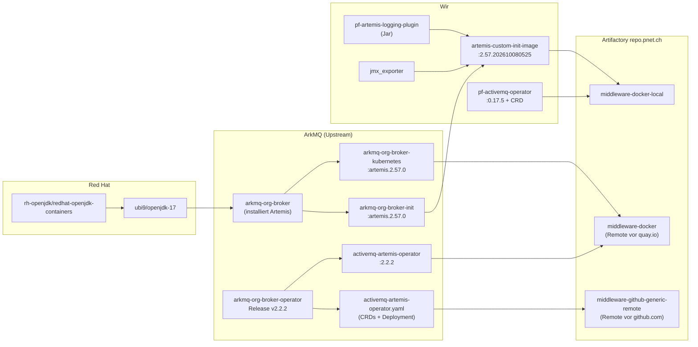
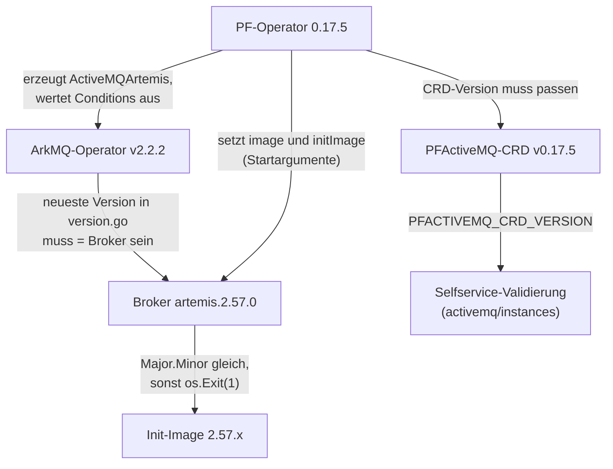
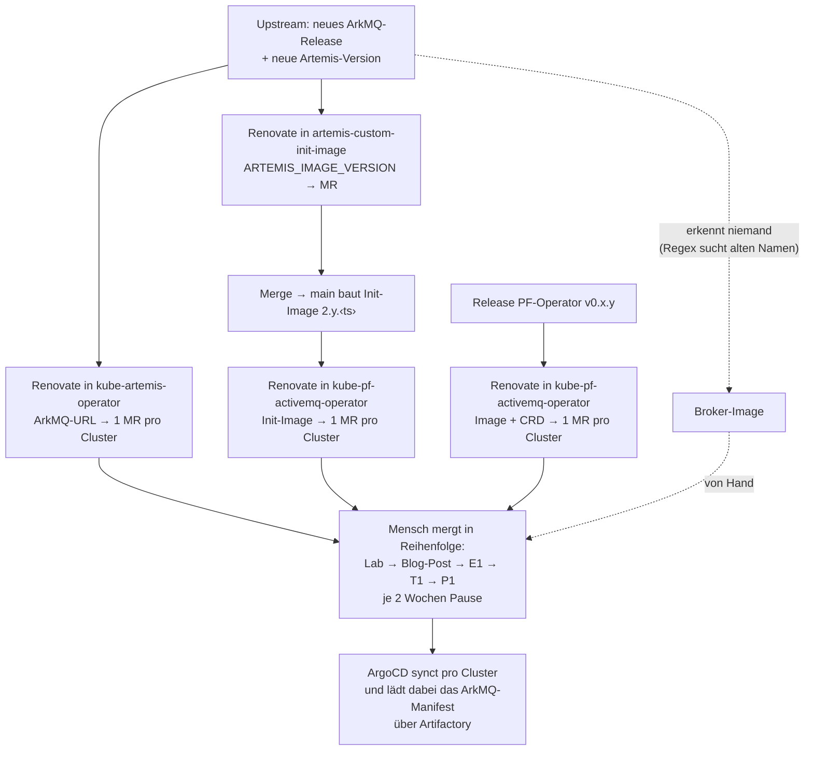
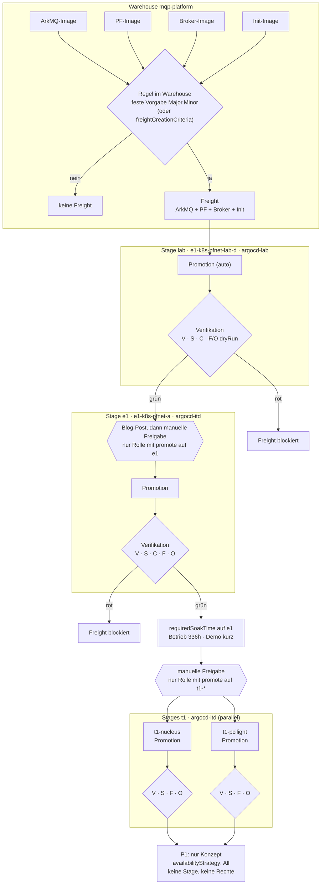
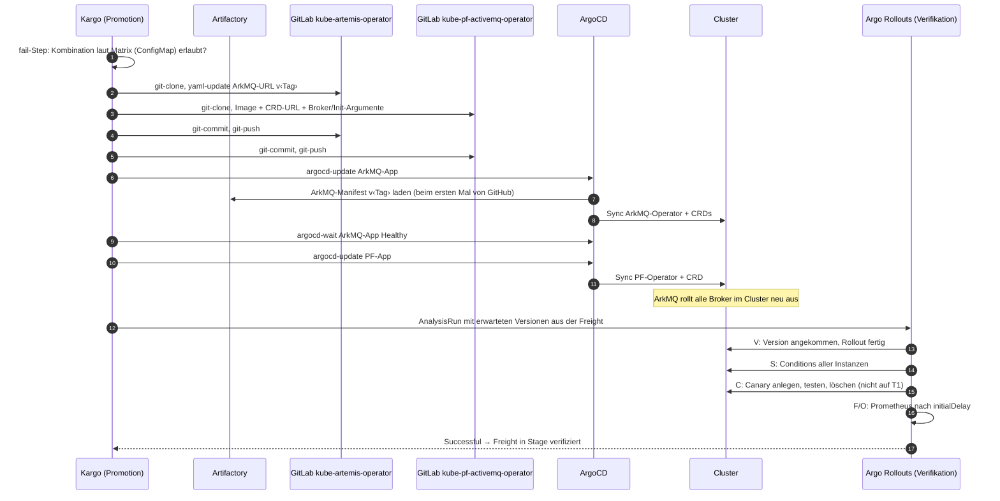

# Vorlage Detailbeschrieb: Probe-IPA und IPA MQP mit Kargo

Alle Notizen in einer Datei, als Grundlage für die Aufgabenstellungen (Stand 24.10.2026). Teil 1 (§1–§14) ist die Zusammenfassung und Vorlage. Die Details stehen in den Anhängen A–D. Diese Datei übernimmt das Review vom 24.10.2026: zwei geschlossene Varianten pro Arbeit, neutrale Ergebnisse, fachliche KO-Kriterien, keine doppelten Kriterien.

> Mit Unterstützung von KI (Claude) erstellt. Für beide Arbeiten deklarieren (A02 Punkt 3, Doc07 Punkt 6). Inhalte mit **[H]** sind Hypothesen aus dem Code und vor der Verwendung in Lab zu bestätigen.

## Inhalt

1. [MQP in Kürze](#1-mqp-in-kürze)
2. [Komponenten, Repos und Deployments](#2-komponenten-repos-und-deployments)
3. [Cluster, ArgoCD und Kargo](#3-cluster-argocd-und-kargo)
4. [Versionen und Abhängigkeiten](#4-versionen-und-abhängigkeiten)
5. [Ist: das Problem](#5-ist-das-problem)
6. [Soll: das Ziel über beide Arbeiten](#6-soll-das-ziel-über-beide-arbeiten)
7. [Kargo-Rahmen (Open Source, nur stabile Funktionen)](#7-kargo-rahmen-open-source-nur-stabile-funktionen)
8. [Testarten](#8-testarten)
9. [Detailbeschrieb Probe-IPA](#9-detailbeschrieb-probe-ipa)
10. [Detailbeschrieb IPA](#10-detailbeschrieb-ipa)
11. [Bezug Probe-IPA ↔ IPA](#11-bezug-probe-ipa--ipa)
12. [Vorarbeit: was vorher erlaubt ist und was nicht](#12-vorarbeit-was-vorher-erlaubt-ist-und-was-nicht)
13. [Offene Punkte und Klärungen](#13-offene-punkte-und-klärungen)
14. [Glossar](#14-glossar)

**Anhänge**

- [A: Testarten im Detail](#anhang-a-testarten-im-detail): Belege aus dem Code, Kargo/Argo Rollouts, Umsetzung pro Test, Fehlerfälle, korrigierte Annahmen
- [B: Versionen, Artifactory und Zielbild der Promotion](#anhang-b-versionen-artifactory-und-zielbild-der-promotion): Build-Kette, Renovate, Versionsstand, heutiges Ausrollen, Umbenennungen, Warehouse/Freight, Diagramme, komplettes Beispiel
- [C: Prüfungen vor der Probe-IPA](#anhang-c-prüfungen-vor-der-probe-ipa): 77 Prüfungen mit Befehlen
- [D: Weitere Erkenntnisse aus der Analyse](#anhang-d-weitere-erkenntnisse-aus-der-analyse): Release-Pipelines, versync, Stolpersteine, Hinweise zum Kriterienkatalog, weitere Auffälligkeiten

---

## 1. MQP in Kürze

**MQP** (Message Queue Platform) ist die ActiveMQ-Artemis-Plattform der PostFinance auf Kubernetes. Teams bestellen Broker-Instanzen per YAML im Repo `activemq/instances`. Ein eigener Operator (PF-Operator) übersetzt sie in Ressourcen des Upstream-Operators ArkMQ, der die Broker betreibt.

```
Instanz-YAML (activemq/instances)
   │  Merge-Operator prüft (LDAP, CES, GitLab, K8s)
   ▼
PFActiveMQ  (Namespace kube-pf-activemq)
   │  PF-Operator (eigener Go-Operator)
   ▼
ActiveMQArtemis  (Ziel-Namespace der Instanz)
   │  ArkMQ-Operator (Upstream)
   ▼
StatefulSet → Pod: Init-Container (Konfiguration, Logging-Plugin, JMX) + Broker
   │
   ▼
artemis-monitor (Dauer-Canary) und OPS UI überwachen
```

---

## 2. Komponenten, Repos und Deployments

### 2.1 Was ausgerollt wird (Gegenstand der Arbeiten)

| Komponente | Wer baut | Repo | Image / Artefakt | Deployt über |
|---|---|---|---|---|
| **ArkMQ-Operator** | Upstream | `github.com/arkmq-org/arkmq-org-broker-operator` (früher `activemq-artemis-operator`) | Manifest als GitHub-Release-Asset; Image `activemq-artemis-operator:<x.y.z>` | `kube-artemis-operator` |
| **PF-Operator** | MQP | `middleware/activemq/pf-activemq-operator` | `middleware-docker-local…/pf-activemq-operator:<x.y.z>` + CRD per Raw-URL am Git-Tag | `kube-pf-activemq-operator` |
| **Broker-Image** | Upstream | `arkmq-org/arkmq-org-broker-kubernetes-image` | `middleware-docker…/arkmq-org/arkmq-org-broker-kubernetes:artemis.<x.y.z>` | Argument des PF-Operators |
| **Init-Image** | MQP | `middleware/activemq/artemis-custom-init-image` | `…/artemis-custom-init-image:<Major.Minor>.<Zeitstempel>` (Basis `arkmq-org-broker-init` + Logging-Plugin + JMX-Exporter) | Argument des PF-Operators |

### 2.2 Weitere Repos (Umfeld, nicht Gegenstand)

| Bereich | Repo | Zweck |
|---|---|---|
| Plugin | `pf-artemis-logging-plugin` | Jar, kommt über das Init-Image in den Broker |
| Governance | `activemq-merge-operator` | prüft Instanz-Definitionen |
| Governance | `versync` | schreibt Versionen aus den kube-Repos in die Doku |
| Betrieb | `ops-ui` | MQP OPS UI (Jolokia) |
| Betrieb | `artemis-monitor` | sendet und empfängt dauerhaft Testnachrichten |
| Doku | `documentation` | TechDocs, u. a. Upgrade-Prozess |
| – | `artemis-custom-image`, `architecture` | ungenutzt bzw. leer |

### 2.3 Repo `deployments` (Tools rund um die Plattform)

| Ordner | Inhalt | Cluster |
|---|---|---|
| `appl-mqp-e2e` | `artemis-monitor` | alle 6 Broker-Cluster |
| `appl-mqp-merger` | Merge-Operator | `p1-k8s-management-a` |
| `appl-mqp-ops-ui` | OPS UI | E1 (no-auth, with-auth), management-a (nonprod, prod) |
| `appl-mqp-test` | leer | Lab-D, E1 |
| `job-vault-sync-hook` | Vault-Sync (CronJob) | – |

### 2.4 Build-Kette bis Artifactory (Ausgangslage, nicht Gegenstand)

| Artefakt | Entsteht aus | Liegt in `repo.pnet.ch` |
|---|---|---|
| Broker-Image | rh-openjdk → `ubi9/openjdk-17` → `arkmq-org-broker` → `arkmq-org-broker-kubernetes` (ArkMQ) | `middleware-docker` (Remote vor quay.io) |
| Init-Image | `arkmq-org-broker-init` (ArkMQ) + Logging-Plugin (Jar) + JMX-Exporter (unsere Pipeline) | `middleware-docker-local` |
| PF-Operator | `pf-activemq-operator` (unsere Pipeline) | `middleware-docker-local` |
| ArkMQ-Operator-Image | Release von `arkmq-org-broker-operator` | `middleware-docker` |
| ArkMQ-Manifest | Release-Asset von `arkmq-org-broker-operator` | `middleware-github-generic-remote` (Remote vor github.com) |

- Artifactory-Remotes sind Proxys mit Cache: Sie holen erst auf Anfrage.
- **Startpunkt der Arbeiten ist `repo.pnet.ch`.** Wie Versionen dorthin kommen, ist Ausgangslage.

---

## 3. Cluster, ArgoCD und Kargo

| Cluster | ArgoCD | Kargo-Controller meldet sich bei | Wer nutzt | Rolle |
|---|---|---|---|---|
| `e1-k8s-pfnet-lab-d` | `argocd-lab` | **Lab-D (Test-Instanz)** | nur MQP, zum Kaputtmachen | Lab, MQP läuft |
| Lab-C *(Clustername eintragen)* | `argocd-lab` | **Lab-D (Test-Instanz)** | nur MQP, zum Kaputtmachen | Lab, MQP wird aufgebaut |
| `e1-k8s-pfnet-a` | `argocd-itd` | management-a | Entwicklerteams | E1 |
| `t1-k8s-nucleus-a`, `t1-k8s-pcilight-a` | `argocd-itd` | management-a | Testteams | T1, gleiche Topologie wie P1 |
| `p1-k8s-nucleus-a`, `p1-k8s-pcilight-a` | `argocd` | management-a | Produktion | P1, tabu |
| `p1-k8s-management-a` | `argocd` | – | – | Merge-Operator, OPS UI, **Kargo-Prod-Control-Plane** |

**Zwei Kargo-Instanzen:**

| | Test-Instanz | Prod-Instanz |
|---|---|---|
| Control-Plane | Lab-D | management-a |
| Controller | Lab-D, Lab-C | alle anderen Cluster |
| Zweck | Kargo selbst testen | Apps promoten |
| Verwendung | **Probe-IPA** | **IPA** |

Wichtige Eigenschaften:

- Beide Operatoren laufen clusterweit (`WATCH_NAMESPACE: "*"`). Ein Upgrade trifft **alle Broker im Cluster**.
- CRDs gibt es nur einmal pro Cluster. Zwei Operator-Versionen parallel in einem Cluster gehen nicht.

---

## 4. Versionen und Abhängigkeiten

### 4.1 Stand Oktober 2026

| Cluster | ArkMQ | PF-Operator | PF-CRD | Broker-Image | Init-Image |
|---|---|---|---|---|---|
| Lab-D | v2.2.2 | 0.17.5 (Staging-Registry) | `main` (ungepinnt) | `arkmq-org-broker-kubernetes:artemis.2.57.0` | 2.57.202610080525 |
| Lab-C | – | – | – | – | – |
| E1, T1 (beide) | v2.2.2 | 0.17.5 | v0.17.5 | `arkmq-org-broker-kubernetes:artemis.2.57.0` | 2.57.202610080525 |
| P1 (beide) | v2.1.7 | 0.17.1 | v0.17.0 | `activemq-artemis-broker-kubernetes:artemis.2.53.0` | 2.53.202604280527 |

ArkMQ-Releases: v2.1.7 (14.04.2026), v2.2.0 (12.06.), v2.2.1 (04.09.), v2.2.2 (25.09.).

### 4.2 Regeln

| Regel | Quelle | Folge bei Verstoss | Status |
|---|---|---|---|
| Broker und Init haben dieselbe Major.Minor | `artemismq.go:49-55` | PF-Operator `os.Exit(1)` beim ersten Reconcile | belegt (Code) |
| Broker = neueste Version in der Liste des ArkMQ-Release (v2.1.7 → 2.53.0, v2.2.2 → 2.57.0) | PF setzt kein `spec.version`; ArkMQ vergleicht per Jolokia exakt | `BrokerVersionAligned=False` → `Ready=False` auf allen Instanzen | **[H]** bis P-20, P-141 |
| PF-Operator passt zur ArkMQ-API | `go.mod`: Modul `v2.9.9` ≈ Stand ArkMQ v2.2.0 | dauerhafter `Mismatch` (Reconcile alle 5 s) | belegt (Code, Go-Proxy) |
| Selfservice validiert gegen dieselbe CRD-Version | `PFACTIVEMQ_CRD_VERSION` in `activemq/instances` | neue Felder abgelehnt oder ungeprüft | belegt (Doku); nicht Gegenstand |

### 4.3 Warum die Abhängigkeiten so gross sind

Ein Operator baut auf einem anderen auf (PF-Operator → ArkMQ), der Broker setzt sich zur Laufzeit aus zwei Images zusammen, alles gilt clusterweit, und Broker haben Zustand (Journal auf PVC, Downgrade unsicher). Zwei Kopplungen sind selbst gemacht und könnten im PF-Operator gelockert werden (`spec.version` setzen, `DeepEqual` durch einen Vergleich der eigenen Felder ersetzen). Das ist ein Kandidat für „Nächste Schritte“.

---

## 5. Ist: das Problem

**Ablauf heute:**

1. Upstream veröffentlicht ArkMQ und Artemis.
2. Renovate erstellt MRs in drei Repos: Init-Image (Build), ArkMQ-URL (pro Cluster), PF-Operator + Init-Image (pro Cluster).
3. Ein Mensch mergt nach Plattform-Doku in der Reihenfolge Lab → Blog-Post → E1 → T1 → P1, mit je zwei Wochen Pause.
4. ArgoCD synct pro Cluster.

**Probleme (Ist-Analyse, in der Arbeit selbst zu belegen):**

| # | Problem | Folge |
|---|---|---|
| 1 | Bis zu **18 MRs pro Upgrade** (3 pro Cluster), Zusammenhang nur im Kopf der Person, die mergt | Fehler beim Kombinieren, hoher Aufwand |
| 2 | Reihenfolge und Wartezeit nur Konvention, technisch nicht erzwungen | Eine Version kann eine Stufe überspringen |
| 3 | **Kein Test stoppt eine Promotion.** Einziger Test nach dem Deployment ist der `artemis-monitor`, er blockiert nichts | Falsche Kombinationen fallen erst auf E1 oder später auf |
| 4 | Gültige Kombinationen kennt man nur aus Erfahrung | Risiko bei jedem Upgrade |
| 5 | Renovate erkennt **Broker-Updates nicht mehr** (Regex sucht den alten Image-Namen seit ArkMQ v2.2.2) | Upgrades werden vergessen |
| 6 | Status des PF-Operators kann veraltet sein (kein `observedGeneration`), Reason `Ready` auch bei `False` | Manuelle Prüfung nach dem Upgrade ist unzuverlässig |
| 7 | Grafana-Dashboard „Artemis E2E Monitor“ **mischt E1 und Lab-D** (gleiche Namespace- und Instanznamen) | E1 kann gesund aussehen, obwohl Werte von Lab-D stammen |
| 8 | `kube-*`-Repos ohne CI, envtest gegen `releases/latest` | Fehler erst im Cluster |
| 9 | Lab-D läuft mit Staging-Image und ungepinnter CRD | Lab ist kein verlässlicher erster Schritt |

---

## 6. Soll: das Ziel über beide Arbeiten

**Gesamtziel:** Eine neue Kombination der vier Komponenten wird als Ganzes erkannt, vor dem Ausrollen auf Gültigkeit geprüft, nach jedem Ausrollen automatisch getestet und erreicht die nächste Umgebung nur, wenn die Tests grün sind.

| | Probe-IPA | IPA |
|---|---|---|
| Teilziel | **Wie wird geprüft?** Teststrategie entwickeln und auf Testclustern nachweisen | **Wie wird ausgerollt?** Promotion-Strategie über die echten Umgebungen |
| Kargo | Test-Instanz (Lab-D) | Prod-Instanz (management-a) |
| Umgebungen | Lab-D → Lab-C | (Lab →) E1 → T1 (nucleus, pcilight) |
| Nutzen für MQP | Schutz vor falschen Kombinationen ist bewiesen und wiederverwendbar | weniger MRs, Reihenfolge und Wartezeit erzwungen, Tests sperren echte Stages |

---

## 7. Kargo-Rahmen (Open Source, nur stabile Funktionen)

Kargo v1.12.4 (12.10.2026). Funktionen mit Label **Beta** oder **Enterprise Beta** werden nicht verwendet (KO-Kriterium).

| Verwendbar | Wofür |
|---|---|
| Warehouse mit Image-Subscriptions, `allowTags`, `semverConstraint`, `freightCreationCriteria` | Versionen in `repo.pnet.ch` erkennen, Kombinationen filtern |
| Stage: `sources.stages`, `requiredSoakTime`, `availabilityStrategy` | Sperre, Wartezeit, Fan-out/Fan-in |
| `ProjectConfig.promotionPolicies` | automatische oder manuelle Freigabe pro Stage |
| RBAC-Verb `promote` mit `resourceNames` | wer auf welche Stage promoten darf |
| `PromotionTask`, Steps `git-*`, `yaml-update`, `argocd-update`, `argocd-wait`, `fail` | gleiche Promotion für alle Stages |
| Verifikation mit Argo-Rollouts-`AnalysisTemplate` (`job`, `prometheus`, `web`), `dryRun`, `args` mit `imageFrom()` **[H]** | Tests nach der Promotion |

| Ausgeschlossen | Ersatz |
|---|---|
| `wait-for-approval` (Enterprise) | Auto-Promotion aus + `promote`-Recht |
| `send-message` (Enterprise) | Blog-Post/Mail ausserhalb von Kargo |
| `git-merge-pr` (Beta) | `git-open-pr` + Merge von Hand (nur für P1-Konzept) |

Technische Fakten:

- Kargo erzeugt AnalysisRuns, **ausgewertet werden sie vom Argo-Rollouts-Controller** im Cluster der Control-Plane. CRDs **und** Controller nötig.
- Jobs laufen im Cluster der Control-Plane und brauchen Zugriff auf die Ziel-Cluster.
- `Inconclusive`, `Error`, `Failed` blockieren die Freight genauso wie ein Fehler.
- Kargo-GC räumt AnalysisRuns, Jobs und Pods nicht auf → `ttlSecondsAfterFinished` setzen.

---

## 8. Testarten

| | Testart | Wann / womit | Prüft | Fängt ab |
|---|---|---|---|---|
| **K** | Kompatibilität | **vor dem Commit**, `fail`-Step + Matrix (ConfigMap) | Broker = Init (Major.Minor); Broker passt zum ArkMQ-Release **[H]** | `os.Exit(1)`, `BrokerVersionAligned=False` – es wird nichts deployt |
| **V** | Version angekommen, Rollout fertig | Verifikation, Job | Operatoren und alle Broker laufen mit den Versionen der Freight, StatefulSets fertig | veralteter Status, hängende Rollouts, Pull-Fehler |
| **S** | Status aller Instanzen | Verifikation, Job | `PFActiveMQ` und `ActiveMQArtemis` auf `True`, nur **neue** Fehler zählen | Versionskonflikt, CRD/API-Fehler, Konfigurationsfehler |
| **F** | Nachrichtenfluss | Verifikation, Prometheus (`artemis-monitor`), **fester Cluster-Filter** | Nachrichten fliessen, keine Verspätungen/Fehler, Latenz im SLA | Broker „Ready“, verarbeitet aber nichts |
| **O** | Operator stabil | Verifikation, Prometheus | keine Neustarts, keine Reconcile-Fehler | Dauer-`Mismatch`, Crash-Loop, Speicherleck |
| **C** | Canary-Instanz | Verifikation, Job + Artemis-CLI | neue Instanz anlegen, Nachricht senden/empfangen, löschen, Aufräumen prüfen | neue Instanzen lassen sich nicht mehr anlegen/löschen |
| M | Management-Zugriff | optional, `web` gegen OPS UI | Jolokia antwortet | weitgehend durch S abgedeckt |
| U | Upgrade-Pfad | Ausblick | n-1 → n | braucht den P1-Stand in einem Cluster |

---

## 9. Detailbeschrieb Probe-IPA

> Gliederung nach dem üblichen Formular (Titel, Ausgangslage, Aufgabenstellung, Mittel und Methoden, Vorkenntnisse, Vorarbeiten, Neue Lerninhalte, Arbeiten der letzten 6 Monate). Felder in *kursiv* selbst ausfüllen.

### Titel

**Teststrategie für die automatische Verifikation von MQP-Upgrades mit Kargo**

### Ausgangslage

MQP besteht aus vier versionsabhängigen Komponenten (ArkMQ-Operator, PF-Operator, Broker-Image, Init-Image). Neue Versionen werden heute über Renovate-MRs pro Cluster ausgerollt. Kein automatischer Test stoppt eine ungültige oder fehlerhafte Kombination, bevor sie die nächste Umgebung erreicht. Kargo wird im Team bereits betrieben (Test-Instanz auf Lab-D, Prod-Instanz auf management-a). Die Testcluster Lab-D und Lab-C gehören MQP und sind über die Kargo-Test-Instanz erreichbar.

### Detaillierte Aufgabenstellung

**Ziel:** Eine Teststrategie entwickeln und umsetzen, mit der Kargo eine neue Kombination nach jeder Promotion automatisch prüft und die Weitergabe an die nächste Stage sperrt, solange die Prüfung nicht erfolgreich ist. Nachgewiesen auf Lab-D → Lab-C, so gebaut, dass sie für E1/T1 übernommen werden kann.

**Teilaufgaben:**

1. Ist-Analyse: heutige Prüfungen nach einem Upgrade, Lücken, Versionsabhängigkeiten (mit eigenen Belegen aus den Clustern).
2. Abnahmekriterien und Fehlerfälle definieren, die eine Teststrategie erkennen muss.
3. Evaluation von zwei Teststrategien (Nutzwertanalyse, Kriterien und Gewichtung vor der Bewertung).
4. Umsetzung der gewählten Variante als AnalysisTemplates an den Stages `lab-d` und `lab-c`, plus Kompatibilitätsprüfung vor dem Commit.
5. Testdurchführung mit provozierten Fehlerfällen, Testprotokoll.
6. Betriebsdoku und nächste Schritte für die IPA.

**Messbare Ergebnisse (neutral formuliert):**

1. Die Ist-Analyse dokumentiert die Komponenten, ihre Abhängigkeiten und die heutigen Prüfungen mit Belegen aus den Clustern.
2. Abnahmekriterien und mindestens vier definierte Fehlerfälle mit erwartetem Ergebnis liegen vor.
3. Die Evaluation ist durchgeführt; Kriterien, Gewichtung und KO-Kriterien sind vor der Bewertung festgelegt und datiert.
4. Die **gewählte Variante** ist als Verifikation an `lab-d` und `lab-c` umgesetzt.
5. Eine Kompatibilitätsprüfung verhindert vor dem Commit, dass eine Kombination mit ungleicher Major.Minor von Broker und Init ausgerollt wird.
6. Für jeden definierten Fehlerfall ist nachgewiesen, dass die Freight `lab-c` nicht erreicht.
7. Alle Kargo-Ressourcen liegen deklarativ in Git.
8. Testprotokoll und Betriebsdoku sind vorhanden.

**Variantenentscheid (zwei geschlossene Varianten):**

K ist in beiden Varianten gesetzt (läuft vor dem Commit, kostet fast nichts). V ist in beiden Grundlage (legt fest, ab wann gemessen wird).

| | **Variante 1: Zustand und Stabilität** | **Variante 2: Funktion und Lebenszyklus** |
|---|---|---|
| Tests | K + V + S + O | K + V + F + C |
| Idee | prüft, was Kubernetes und die Operatoren melden | prüft, was Anwender erleben: Nachrichten fliessen, neue Instanzen funktionieren |
| Quellen | K8s-API (Job), Controller-Metriken | Monitor-Metriken (Prometheus), K8s-API + Artemis-CLI (Job) |
| Stärke | schnell, deterministisch, findet Versionskonflikte und Dauer-Reconcile | findet „Ready, aber verarbeitet nichts“ und „neue Instanzen kaputt“ |
| Schwäche | Broker kann Ready sein und trotzdem nichts verarbeiten | langsamer, braucht Last/Messfenster und Ressourcen |

**Mögliche Bewertungskriterien:** erkannte Fehlerfälle (aus Teilaufgabe 2), Laufzeit pro Stage, Stabilität (keine falschen Alarme), Aufwand, Übertragbarkeit auf E1/T1, spätere Auswirkung auf andere Teams.

**Fachliche KO-Kriterien (Beispiele):**

- erkennt den Fehlerfall „Broker und Init passen nicht zusammen“
- erkennt den Fehlerfall „Operator läuft, Broker sind aber nicht auf der neuen Version“
- nur stabile Open-Source-Funktionen von Kargo und Argo Rollouts
- keine Schreibrechte ausserhalb von Lab-D/Lab-C

**Nicht gewählte Tests** kommen in „Nächste Schritte“.

### Abgrenzung

- Nur Lab-D und Lab-C, nur die Kargo-Test-Instanz. Kein E1, T1, P1.
- Freight-Modell und Promotion sind **nicht Teil der Bewertung**. Warehouse (ohne Regel), Stages `lab-d`/`lab-c` (beide manuell, Push) und eine einfache Promotion bestehen vorher als Vorbereitung und sind bewusst vorläufig.
- Auf Lab-C laufen keine fremden Instanzen; nachgebildet mit eigenen Test-Instanzen (1 und 2 Replicas).
- Build-Kette bis Artifactory, Kargo-Plattform und Selfservice-Validierung sind Ausgangslage.

### Mittel und Methoden

- *Projektmethode eintragen (z. B. IPERKA), für beide Arbeiten gleich*
- Kargo v1.12.x (Test-Instanz), Argo Rollouts (AnalysisTemplates), ArgoCD (`argocd-lab`), Kubernetes, kustomize, GitLab, Prometheus/Grafana, Splunk
- Nutzwertanalyse für den Variantenentscheid
- KI-Unterstützung (Claude) für Recherche und Strukturierung, deklariert im Arbeitsjournal

### Vorkenntnisse

*Eintragen:* rund ein Jahr Aufbau und Betrieb von Kargo im Team, Kubernetes, ArgoCD, GitOps, Betrieb von MQP.

### Vorarbeiten

*Mit der Fachkraft schriftlich bestätigen lassen:*

- Kargo-Test-Instanz auf Lab-D mit Controller auf Lab-C (bestehend)
- MQP auf Lab-C aufgebaut (Operatoren, Test-Instanzen, `artemis-monitor`, Prometheus, Canary-Namespace)
- Vorläufiges Warehouse, Stages `lab-d`/`lab-c`, einfache Promotion
- Machbarkeitschecks: Argo Rollouts auf Lab-D, Jobzugriff auf Lab-C, Prometheus-URL, P-20
- Kargo-Test-Instanz für die Dauer der Arbeit eingefroren

### Neue Lerninhalte

*Eintragen, z. B.:* Kargo-Verifikation mit Argo-Rollouts-AnalysisTemplates, Testkonzept für Plattform-Upgrades, Nutzwertanalyse.

### Arbeiten in den letzten 6 Monaten

*Eintragen.*

### Kriterien

| Slot | Kriterium | Art | Bezug |
|---|---|---|---|
| A13 (Pflichtwahl) | **D02** Standardisierung, Optimierung und Automatisierung | unverändert | manuelle Prüfung nach dem Upgrade → automatische Verifikation |
| A14 (Pflichtwahl) | **F03** Abnahme einer Server-Infrastruktur oder von Server-Diensten | unverändert | Abnahmekriterien, Testkonzept, Systemabhängigkeiten, Abnahme pro Stage |
| A15 | **A13** Erhebung und Dokumentation der Bedürfnisse und Umfeld | unverändert | Komponenten, Cluster, Schnittstellen |
| A16 | **A14** Machbarkeitsstudie (Proof of Concept) | unverändert | Kargo-Verifikation für MQP auf Testclustern |
| A17 | **A16** Durchführung einer Evaluation | unverändert | Teststrategie V1 vs. V2 |
| A18 | **D01** Analyse | unverändert | Ist-Analyse Prüfungen und Lücken |
| A19 | **D03** Sicherstellung des Betriebs und der Weiterentwicklung | unverändert | Betriebsdoku, nächste Schritte für die IPA |
| A20 | **C08** Planung und Implementierung eines Rollenkonzepts | angepasst | Rechte der Verifikations-Jobs, Least Privilege |
| A21 | Abbildung von Versionsabhängigkeiten in automatisierten Prüfungen | eigenes | Regeln belegt, als Prüfung K/S automatisiert |
| A22 | **E10** Konzept zur Überwachung | angepasst auf Broker statt Netzwerk | Schwellwerte und Aktionen = Erfolgsbedingungen der AnalysisTemplates. **Katalogversion klären** (E8–E11 fehlen evtl. im Excel); Alternative: F04 |

Gegenüber den Notizen gestrichen: das eigene Kriterium „Testkonzept für Verifikationen“ (doppelt zu A12 und F03).

### Zeitplan (Skizze für 3 Tage à 8 h, realistisch)

| Tag | Inhalt | h |
|---|---|---|
| 1 | Auftragsanalyse, Methode, Zeitplan (2). Ist-Analyse mit Belegen (2). Abnahmekriterien und Fehlerfälle (1). Nutzwertanalyse (3) | 8 |
| 2 | K als `fail`-Step (1). Job für V (+S oder C) inkl. Skript und Debugging (4). Prometheus-Template (F oder O) (1.5). Rechte der Jobs (1). Journal (0.5) | 8 |
| 3 | Tests inkl. Wartezeiten (Rollout bis 30 min, Zertifikat) und Fehlerfälle (3.5). Testprotokoll (1). Betriebsdoku, Fazit, Soll-/Ist (3.5) | 8 |

Puffer ist knapp: Fehlerfälle vorher auf Lab-D ausprobieren (Anhang C.13), sonst reicht Tag 3 nicht.

### Risiken und Plan B

| Risiko | Plan B (vorher festlegen) |
|---|---|
| Kein Argo-Rollouts-Controller auf Lab-D | vor der Arbeit installieren; sonst Probe-IPA verschieben |
| Job erreicht Lab-C nicht | V/S/C nur auf `lab-d` als Job; auf `lab-c` nur Prometheus-Tests |
| Prometheus von Lab-D nicht erreichbar | F und O entfallen → Variante 1 ohne O; dokumentiert als Einschränkung |
| Regel ArkMQ ↔ Broker stimmt nicht [H] | K prüft nur Broker = Init; Matrix entfällt |
| Kargo-Test-Instanz wird verändert | Einfrieren schriftlich vereinbaren |
| Wartezeiten sprengen die Demo | verkürzte Demo mit kleinem StatefulSet und kurzem Messfenster |

---

## 10. Detailbeschrieb IPA

### Titel

**Promotion-Strategie für MQP-Upgrades mit Kargo von E1 bis T1**

### Ausgangslage

Wie Probe-IPA, ergänzt um: Die Teststrategie aus der Probe-IPA liegt in Git und ist auf Testclustern nachgewiesen. E1 und T1 melden sich bei der Kargo-Prod-Instanz auf management-a. Upgrades laufen weiter über Renovate-MRs pro Cluster.

### Detaillierte Aufgabenstellung

**Ziel:** Die MQP-Komponenten werden mit der Kargo-Prod-Instanz über E1 auf beide T1-Cluster promotet. Die Verifikation aus der Probe-IPA sperrt jeden Übergang. Prod wird nicht berührt; das Vorgehen ist für P1 übertragbar beschrieben.

**Teilaufgaben:**

1. Ist-Analyse des Upgrade-Prozesses über E1/T1 (Dauer, MRs, Reihenfolge, frühere Upgrades).
2. Evaluation von zwei Promotion-Strategien (Nutzwertanalyse).
3. Kargo-Projekt auf management-a aus den Manifesten der Probe-IPA aufbauen, Stages E1/T1 ergänzen.
4. Gates, Rechte und Wartezeit gemäss gewählter Variante umsetzen.
5. Wartungs-/Upgrade-Konzept inkl. Rollback, ein Upgrade durchführen und protokollieren.
6. Renovate so anpassen, dass es baut, aber nicht mehr ausrollt.
7. Instruktion des Teams, Übergabe, Konzept für P1.

**Messbare Ergebnisse (neutral formuliert):**

1. Ein Kargo-Projekt auf management-a mit Stages für E1 und beide T1-Cluster, aufgebaut aus Git.
2. Die **gewählte Promotion-Strategie** ist umgesetzt (Topologie, Freigaben, Wartezeit, Rechte).
3. Die Verifikation der Probe-IPA sperrt jeden Übergang.
4. Ein echtes Upgrade ist über die Stages durchgeführt und protokolliert.
5. Ein Rollback (ältere Freight) ist getestet, die Grenzen sind beschrieben.
6. Renovate ändert die von Kargo verwalteten Overlays nicht mehr.
7. Konzept für P1 und Instruktion des Teams liegen vor.

**Rahmenbedingung Freight-Modell (keine eigene Bewertung):** Ein Warehouse bündelt alle vier Komponenten (Variante A), weil ArkMQ und Broker fest gekoppelt sind und nur eine gemeinsame Freight ungültige Kombinationen verhindert. Major.Minor wird in den Subscriptions fest vorgegeben; ein Minor-Upgrade ist eine bewusste Änderung. Begründung im Konzept, nicht in der Nutzwertanalyse.

**Variantenentscheid (zwei geschlossene Gesamtvarianten):**

| | **Variante 1: sequentiell, manuell** | **Variante 2: parallel, gemischt, mit Wartezeit** |
|---|---|---|
| Topologie | E1 → t1-nucleus → t1-pcilight | E1 → {t1-nucleus, t1-pcilight} |
| Freigabe | jede Stage manuell | erste Stage automatisch, E1 manuell nach Blog-Post, T1 manuell |
| Wartezeit | Konvention, nicht technisch | `requiredSoakTime` (Betrieb 336 h, Demo kurz) |
| Durchlaufzeit | länger | kürzer |
| Risiko | Fehler auf nucleus erreicht pcilight nicht | Fehler trifft beide T1 gleichzeitig |
| P1-Konzept | P1 hängt an t1-pcilight | P1 mit `availabilityStrategy: All` über beide T1 |

In beiden Varianten gleich: eine gemeinsame `PromotionTask`, Git per Push, Freigaben über `promote`-Rechte, K in jeder Stage.

**Fachliche KO-Kriterien (Beispiele):** eine Version erreicht T1 nie ohne grüne Verifikation auf E1; keine Promotion auf E1/T1 ohne berechtigte Person; Kargo hat keine Rechte auf P1; nur stabile Open-Source-Funktionen.

### Abgrenzung

- Kein Prod; P1 nur als Konzept, Kargo bekommt keine Rechte auf P1.
- E1/T1 nur nach Absprache mit den Teams.
- Verifikation der Probe-IPA ist Ausgangslage, kommt aus Git.
- Ob die Stage `lab` dabei ist, hängt davon ab, ob management-a `argocd-lab` erreicht.
- Build-Kette und Selfservice-Validierung sind nicht Teil der Arbeit.

### Mittel und Methoden

Wie Probe-IPA, zusätzlich Kargo-Prod-Instanz, `argocd-itd`, Renovate-Konfiguration.

### Vorarbeiten

*Schriftlich bestätigen lassen:* Teststrategie der Probe-IPA (Git), Zugriffe auf management-a, E1 und T1, Absprache mit den Teams. **Nicht vorab:** Projekt auf management-a, E1/T1-Stages, Freight-Regel.

### Kriterien

| Slot | Kriterium | Art | Bezug |
|---|---|---|---|
| A13 (Pflichtwahl) | **D02** Standardisierung, Optimierung und Automatisierung | unverändert | 18 MRs → eine Promotion über die Stages |
| A14 (Pflichtwahl) | **D05** Inbetriebnahme und Übergabe einer ICT-Lösung | unverändert | Umzug Test- → Prod-Instanz, Inbetriebnahme auf E1/T1 mit den Teams |
| A15 | **A13** Erhebung und Dokumentation der Bedürfnisse und Umfeld | unverändert | Stakeholder E1/T1, Prozess, ArgoCD, Repos |
| A16 | **A16** Durchführung einer Evaluation | unverändert | Promotion-Strategie V1 vs. V2 |
| A17 | **D03** Sicherstellung des Betriebs und der Weiterentwicklung | unverändert | Übergabe, nächste Schritte (P1) |
| A18 | **F05** Erstellung eines Wartungskonzepts | unverändert | Upgrade-Aufgaben, Zyklen (Wartezeit), Kommunikation (Blog-Post), Protokollierung (Freight-Historie), Wiederherstellung (Rollback) |
| A19 | **F06** Durchführung der Wartung | angepasst auf Versions-Upgrade | Upgrade über Kargo durchgeführt, protokolliert, Verfügbarkeit geprüft |
| A20 | **C08** Planung und Implementierung eines Rollenkonzepts | angepasst | Kargo-Rechte pro Stage, P1 ausgeschlossen |
| A21 | **A15** Instruktion | unverändert | Team in Freigabe, Rollback und Lesen der Verifikation instruieren |
| A22 | Zusammenspiel Renovate und Kargo | eigenes | Zuständigkeiten (bauen vs. ausrollen) definiert und umgesetzt |

Gegenüber den Notizen gestrichen: „Abbildung von Versionsabhängigkeiten“ (schon in der Probe-IPA, Freight-Modell ist Rahmenbedingung) und „Gate- und Rollback-Strategie“ (durch F05 Punkt 5 und F06 abgedeckt).

### Zeitplan (Skizze für 80 h)

| Phase | Inhalt | h |
|---|---|---|
| Informieren | Auftragsanalyse, Ist-Analyse inkl. frühere Upgrades, Stakeholder | 10 |
| Planen | Zeitplan, Rollenkonzept, Wartungskonzept-Entwurf | 8 |
| Entscheiden | Nutzwertanalyse V1/V2 | 6 |
| Realisieren | Projekt auf management-a aus Git, Stages E1/T1, Gates, Rechte, Renovate | 24 |
| Kontrollieren | Upgrade über E1 → T1, Fehlerfall, Rollback, Protokoll | 16 |
| Auswerten | Betriebsdoku, Instruktion, P1-Konzept, Fazit | 12 |
| Reserve | Wartezeiten, Absprachen | 4 |

### Risiken

- Teams auf E1/T1: Zeitfenster und Freigaben vorher absprechen.
- Prod-Instanz bedient auch andere Apps: Änderungen sorgfältiger als auf der Test-Instanz.
- Wartezeiten: für die Demo kurze Werte setzen und begründen.
- Rollback über eine Artemis-Minor-Version ist nicht sicher (CRD, Journal).
- Darf die IPA nicht auf der Probe-IPA aufbauen, muss die Verifikation neu hergeleitet werden.

---

## 11. Bezug Probe-IPA ↔ IPA

| | Probe-IPA | IPA |
|---|---|---|
| Frage | Was wird geprüft? | Wie wird ausgerollt? |
| Variantenentscheid | Teststrategie V1/V2 | Promotion-Strategie V1/V2 |
| Freight-Modell | vorläufig, ohne Regel | Rahmenbedingung A mit fester Vorgabe |
| Kargo | Test-Instanz Lab-D | Prod-Instanz management-a |
| Übergabe | AnalysisTemplates, `PromotionTask`, K in Git | wird übernommen, nicht neu gebaut |
| Kriterien, die nur hier vorkommen | F03, A14, D01, E10, Versionsabhängigkeiten | D05, F05, F06, A15, Renovate ↔ Kargo |

---

## 12. Vorarbeit: was vorher erlaubt ist und was nicht

| Vorher erlaubt (Vorbereitung) | Erst in der Arbeit (Leistung) |
|---|---|
| Zugänge, Rechte, Cluster bereitstellen | Ist-Analyse (A13, D01) mit eigenen Belegen |
| MQP auf Lab-C aufbauen | Abnahmekriterien und Fehlerfälle |
| Vorläufiges Warehouse, Stages, einfache Promotion | Nutzwertanalyse: Kriterien, Gewichtung (datiert), Bewertung |
| Machbarkeitschecks: P-81, P-82, P-100, P-101, P-20 | AnalysisTemplates der gewählten Variante |
| Fehlerfälle grob ausprobieren (Funktion klären) | Testdurchführung und -protokoll |
| Notizen und Recherche (diese Dateien) | Betriebsdoku, Fazit |

**Wichtig:** Die Notizen enthalten Empfehlungen. In der Arbeit werden Kriterien, Gewichtung und Bewertung **selbst** festgelegt und mit eigenen Messungen begründet. Die Grenze schriftlich mit der Fachkraft vereinbaren.

---

## 13. Offene Punkte und Klärungen

**Mit Fachkraft und Experten (schriftlich):**

- [ ] IPA darf auf der Probe-IPA aufbauen
- [ ] Was gilt als Vorarbeit (Lab-C, Warehouse, Stages, Promotion, Machbarkeitschecks)
- [ ] Welche Katalogversion gilt (E8–E11 im Excel?), E10 angepasst zulässig?
- [ ] Eigene und angepasste Kriterien mit Gütestufen ausformulieren und validieren lassen
- [ ] Projektmethode festlegen
- [ ] Vertraulichkeit: Dürfen interne Cluster-, Repo- und URL-Namen in einem privaten GitHub-Repo und in einem Claude-Projekt liegen? KI-Nutzung deklarieren

**Technisch, zuerst:**

- [ ] P-81/P-82: Argo-Rollouts-CRDs und -Controller auf Lab-D
- [ ] P-100: Jobzugriff von Lab-D auf Lab-C
- [ ] P-101: Prometheus-URL von Lab-D aus
- [ ] P-20, P-140, P-141: Regel ArkMQ ↔ Broker bestätigen (bis dahin **[H]**)
- [ ] Funktioniert `configMap()` im `if:` des `fail`-Steps? Funktioniert `imageFrom()` in den Verifikations-`args`?
- [ ] Clustername von Lab-C; eindeutige Namen für Namespace und Instanz auf Lab-C
- [ ] Welcher Stand gilt für die Stage `lab-d` (Staging oder Release)?
- [ ] Für die IPA: Erreicht management-a `argocd-lab`?

**Hinweise:**

- Auf P1 nur lesen, wenn Rechte ohnehin vorhanden sind; sonst Werte aus Git.
- Alle Codestellen, auf die sich die Arbeit stützt, muss man im Fachgespräch selbst erklären können.

---

## 14. Glossar

| Begriff | Bedeutung |
|---|---|
| ArkMQ | Upstream-Operator für ActiveMQ Artemis (`arkmq-org`) |
| PF-Operator | eigener Operator, übersetzt `PFActiveMQ` in `ActiveMQArtemis` |
| Freight | in Kargo eine Kombination von Artefakt-Versionen, die gemeinsam promotet wird |
| Warehouse | erkennt neue Versionen und erzeugt Freight |
| Stage | Ziel einer Promotion, hier ein Cluster |
| Promotion | Ausrollen einer Freight in eine Stage (Git-Commit + ArgoCD-Sync) |
| Verifikation | Tests nach der Promotion; nur bei Erfolg darf die Freight weiter |
| AnalysisTemplate / AnalysisRun | Testdefinition bzw. Testlauf von Argo Rollouts |
| Soak Time | Mindestzeit, die eine Freight in einer Stage laufen muss |
| Fan-out / Fan-in | eine Stage verteilt an mehrere / eine Stage wartet auf mehrere |
| Canary-Instanz | temporäre Test-Instanz, die angelegt und wieder gelöscht wird |
| Lab-D, Lab-C | MQP-Testcluster, zum Kaputtmachen |


---

# Anhänge

- Anhang A: Testarten im Detail
- Anhang B: Versionen, Artifactory und Zielbild der Promotion
- Anhang C: Prüfungen vor der Probe-IPA
- Anhang D: Weitere Erkenntnisse aus der Analyse

---

## Anhang A: Testarten im Detail

Detail zu den Testarten aus §8: Belege aus dem Code, Funktionsweise von Kargo und Argo Rollouts, Umsetzung pro Test.

**Einordnung:** Die Teststrategie ist das Thema der **Probe-IPA**. Entwickelt und nachgewiesen wird sie auf den MQP-Testclustern **Lab-D → Lab-C** mit der Kargo-Test-Instanz. In der IPA wird sie aus Git für E1 und T1 übernommen und ist dort Ausgangslage. Was nur E1/T1 betrifft, ist unten als Ausblick markiert.


### A.1 Kurzfassung

| # | Testart | Wo in Kargo | Priorität | Warum |
|---|---|---|---|---|
| K | **Kompatibilität der Kombination** | vor dem Commit (`fail`-Step in der Promotion) | unbedingt | ArkMQ und Broker-Version sind enger gekoppelt als gedacht (A.2.1) |
| V | **Version angekommen, Rollout fertig** | Verifikation, Job | unbedingt | Der Status des PF-Operators kann veraltet sein (A.2.2). Ohne V prüfen alle anderen Tests eventuell noch den alten Stand |
| S | **Status aller Instanzen ohne Regression** | Verifikation, Job | unbedingt | Operator-Updates betreffen alle Broker im Cluster |
| F | **Nachrichtenfluss (artemis-monitor)** | Verifikation, Prometheus | unbedingt | Einziger Test, der zeigt, dass Broker wirklich Nachrichten verarbeiten |
| O | **Operator stabil (kein Dauer-Reconcile)** | Verifikation, Prometheus | sehr gut | Fängt den `Mismatch`-Dauerzustand und Crash-Loops ab, die bei „Ready“ durchrutschen können |
| C | **Canary-Instanz anlegen und löschen** | Verifikation, Job | sehr gut (Lab-D, Lab-C; später E1) | Einziger Test für den Weg „neue Instanz“ inklusive Zertifikat und Löschen |
| M | Management-Zugriff (Jolokia, OPS UI) | Verifikation, Web | optional | Teilweise schon durch S abgedeckt |
| U | Upgrade-Pfad n-1 → n | eigene Stage | Ausblick | Braucht den P1-Stand in einem Cluster |

**Einordnung:** K, V, S und F decken die wichtigsten Fehlerbilder ab, O und C ergänzen. Welche umgesetzt werden, entscheidet die Nutzwertanalyse der Probe-IPA (§9: Variante 1 = K+V+S+O, Variante 2 = K+V+F+C). Der wichtigste neue Test ist **V**, weil der Status des PF-Operators veraltet sein kann.

---

### A.2 Was im Code auffällt und die Tests bestimmt

#### A.2.1 ArkMQ und Broker-Version müssen exakt zusammenpassen

Der PF-Operator setzt im `ActiveMQArtemis` zwar `image` und `initImage`, aber **nicht `spec.version`** (`pf-activemq-operator/controller/resource/artemismq.go`). ArkMQ verhält sich dann so (Code v2.2.2):

1. `ResolveBrokerVersionFromCR` nimmt bei leerer Version die **neueste Version aus der eigenen Liste** (`pkg/utils/common/common.go:210-218`, `version/version.go`).
2. `AssertBrokerImageVersion` fragt über Jolokia die laufende Broker-Version ab und vergleicht sie **exakt** mit dieser Version (`controllers/activemqartemis_reconciler.go:3789-3808`). Bei einer Abweichung wird `BrokerVersionAligned=False`.
3. `Ready` ist nur `True`, wenn keine andere Condition `False` ist (`pkg/utils/common/conditions.go:32-46`).
4. Der PF-Operator setzt `ActiveMQBrokersReady` nur auf `True`, wenn ArkMQ `Ready=True` meldet.

Die neueste Version in der Liste von ArkMQ passt genau zum heutigen Stand:

| ArkMQ | neueste Artemis-Version in `version.go` | Broker heute |
|---|---|---|
| v2.1.7 | 2.53.0 | P1: `artemis.2.53.0` |
| v2.2.2 | 2.57.0 | E1/T1/Lab: `artemis.2.57.0` |

**Folge (aus dem Code abgeleitet, in Lab bestätigen):** Ein neuer Broker (z. B. 2.57.1 oder 2.58.0) ohne passendes ArkMQ-Release führt zu `BrokerVersionAligned=False` und damit zu `ActiveMQBrokersReady=False` auf **allen** Instanzen im Cluster. Umgekehrt gilt das auch für ein neues ArkMQ ohne neuen Broker. ArkMQ und Broker müssen also gemeinsam promotet werden. Das ist ein starkes Argument für Freight-Variante A und eine konkrete, automatisch ableitbare Kompatibilitätsregel.

#### A.2.2 Der Status des PF-Operators kann veraltet sein

- Der PF-Operator setzt in seinen Conditions **kein `observedGeneration`** (`controller/pfactivemq_controller.go`, alle `SetStatusCondition`-Aufrufe). Ein `Ready=True` direkt nach der Promotion kann noch vom alten Operator stammen.
- Die Condition `Ready` hat auch bei `Status: False` den Reason `Ready` (`pfactivemq_controller.go:351-356`, ähnlich `:445-450`). **Tests müssen `status` prüfen, nie `reason`.**
- `AuthSecretReady` und `StorageReady` fliessen nicht in `Ready` ein (`allConditionsReady`, `:371-391`).
- `os.Exit(1)` bei falschem Init-Image passiert erst beim Reconcile (`artemismq.go:52-55`). Ohne Instanzen im Cluster würde der Operator sogar „healthy“ bleiben.

Ein reiner Check „Ready=True“ reicht deshalb nicht. Es braucht zuerst den Nachweis, dass die neue Version tatsächlich läuft (Test V).

#### A.2.3 Gute Ansatzpunkte im Code

- `ActiveMQArtemis.status.version` enthält `brokerVersion`, `image` und `initImage` (ArkMQ `api/v1beta1/activemqartemis_types.go:731-741`). Damit lässt sich prüfen, ob die neue Version angekommen ist.
- PF- und Merge-Operator liefern Controller-Runtime-Metriken (`prometheus.io/port: 8080`, `/metrics`).
- Der `artemis-monitor` liefert `monitor_messages_sent_total`, `_consumed_total`, `_consumed_errors_total`, `_delayed_total` und `monitor_e2e_duration` (`artemis-monitor/.../Metrics.java`). `delayed` zählt auch Nachrichten, die gar nicht gesendet werden konnten: Sie landen zuerst im Cache und laufen nach 10 s ab (`MessageCache.java`, `application.message.sla.delay=10000`).
- Prometheus hat die Labels `kubernetes_cluster_name` und `kubernetes_namespace` (Beispiel in `documentation/docs/howto/alarming.md`).
- Der Namespace `appl-mqp-test` existiert auf Lab-D und E1 schon und ist leer (`deployments/appl-mqp-test`). Er eignet sich für die Canary-Instanz. Auf Lab-C muss er für die Probe-IPA angelegt werden.

---

### A.3 Wie Kargo und Argo Rollouts verifizieren

Aus der Kargo-Doku und dem Kargo-Quellcode v1.12.4:

- **Ablauf:** Nach der Promotion wartet Kargo, bis die Argo-CD-Apps `Healthy` sind. Danach erzeugt Kargo aus allen `analysisTemplates` der Stage **eine** AnalysisRun. Ausgewertet wird sie vom **Argo-Rollouts-Controller** im Kargo-Cluster. Kargo übernimmt nur die Phase.
- **Phasen:** `Successful` markiert die Freight als verifiziert. `Failed`, `Error`, `Aborted` und **`Inconclusive`** sind Endzustände **ohne** Verifikation, die Freight bleibt also blockiert (`api/v1alpha1/stage_types.go:46-55`). Neu starten lässt sich die Verifikation mit `kargo verify stage`.
- **Metriken laufen parallel.** Alle Metriken einer AnalysisRun starten gleichzeitig. Eine Reihenfolge entsteht nur über `initialDelay` oder dadurch, dass ein Job selbst wartet.
- **Argumente aus der Freight:** In den `args` der Stage stehen auch in der Verifikation `imageFrom()`, `commitFrom()` und `warehouse()` zur Verfügung (`regular_stages.go`, `exprfn.FreightOperations`). Damit kann der Test die **erwartete** Version aus der Freight bekommen, z. B. `${{ imageFrom('middleware-docker-local.repo.pnet.ch/pf/middleware/pf-activemq-operator').Tag }}`.
- **`dryRun`** wird aus dem Template übernommen. So kann eine Metrik messen, ohne zu blockieren.
- **Provider in Open Source:** `job` (Erfolg = Exit-Code 0), `prometheus`, `web` (mit `jsonPath`, `successCondition`/`failureCondition`).
- **Aufräumen:** Laut `test.txt` räumt der Kargo-GC AnalysisRuns, Jobs und Pods **nicht** auf. In jedem Job `ttlSecondsAfterFinished` setzen.

**Regeln, damit kein `Inconclusive` entsteht:**

- Jede Prometheus- oder Web-Metrik braucht **beide** Bedingungen, `successCondition` und `failureCondition`.
- Jeder Job braucht `activeDeadlineSeconds` und `backoffLimit: 0` oder `1`. Ein Image-Pull-Fehler ergibt sonst `Inconclusive`.
- Bei `count` > 1 `failureLimit` bewusst setzen. Der Standard ist 0, also scheitert die Metrik schon beim ersten Fehlschlag.

---

### A.4 Die Testarten im Detail

#### K: Kompatibilität (vor der Promotion)

| | |
|---|---|
| Prüft | Broker = Init (Major.Minor); Broker-Version = neueste Version in der ArkMQ-Liste (A.2.1); PF-Operator für diese ArkMQ-Version freigegeben |
| Fängt ab | `os.Exit(1)` des PF-Operators; `BrokerVersionAligned=False` auf allen Instanzen; PF-Operator gegen falsche ArkMQ-API |
| Umsetzung | Matrix als ConfigMap im Kargo-Projekt, am Anfang der Promotion ein `fail`-Step mit `if:` auf `configMap('mqp-compat-matrix')` (ArkMQ → Artemis) und auf Broker = Init (Major.Minor). Läuft in jeder Stage, auch bei `kargo approve` |
| Probe-IPA / IPA | In der Probe-IPA ist K die einzige Prüfung vor dem Commit, weil das vorläufige Warehouse keine Regel hat. In der IPA kommt die Regel ins Warehouse (Freight-Modell), K bleibt als zweite Sicherung |
| Vorteil | Es wird nichts deployt, wenn die Kombination ungültig ist. Eine Verifikation käme erst nach dem Schaden |
| Matrix pflegen | Die Spalte ArkMQ → Artemis lässt sich aus `version/version.go` des ArkMQ-Release ablesen und später automatisch erzeugen |

#### V: Version angekommen, Rollout fertig (Job)

| | |
|---|---|
| Prüft | 1) Die Pods von PF-Operator und ArkMQ-Operator laufen mit dem Image aus der Freight. 2) Jedes `ActiveMQArtemis` mit Label `pf-activemq-operator.pnet.ch/operator-managed=true` hat `spec.deploymentPlan.image` und `status.version.image` = erwartetes Broker-Image sowie `status.version.brokerVersion` = erwartete Version. 3) Jedes StatefulSet ist fertig ausgerollt (`updatedReplicas == replicas`, `currentRevision == updateRevision`) |
| Fängt ab | veralteten Status (A.2.2); hängende Rolling Updates; Broker, die noch mit dem alten Image laufen |
| Umsetzung | Job mit `kubectl`/`jq`, der **pollt**, bis alles stimmt, mit Timeout über `activeDeadlineSeconds` (z. B. 30 min, je nach Anzahl Broker). Erwartete Versionen als `args` aus der Freight |
| Hinweis | Das ist die Grundlage für S, F und O. Ohne V messen sie eventuell noch den alten Stand |

#### S: Status aller Instanzen ohne Regression (Job)

| | |
|---|---|
| Prüft | Alle `PFActiveMQ`: `Ready` und `ActiveMQBrokersReady` stehen auf `status: "True"`. Alle `ActiveMQArtemis`: `Ready`, `Valid`, `BrokerVersionAligned`, `BrokerPropertiesApplied` stehen auf `True` |
| Fängt ab | CRD-/API-Inkompatibilität, Versionskonflikt ArkMQ/Broker, Fehler in der Broker-Konfiguration |
| Problem | Eine Instanz eines Teams, die schon **vorher** kaputt war, würde das Gate dauerhaft blockieren |
| Lösung | Als Regression zählt nur eine Condition, die **nach dem Start des neuen Operator-Pods** auf `False` gewechselt hat (`lastTransitionTime` > `startTime` des Pods). Bereits kaputte Instanzen werden geloggt, blockieren aber nicht. Die MQP-eigenen Instanzen (e2e, Canary) blockieren immer |
| Hinweis | Wegen A.2.2 nur auf `status` prüfen, nie auf `reason` |

#### F: Nachrichtenfluss mit artemis-monitor (Prometheus)

| | |
|---|---|
| Prüft | Nachrichten werden gesendet und empfangen, keine verspäteten oder verlorenen Nachrichten, Latenz im SLA |
| Abfragen (Skizze) | `sum(rate(monitor_messages_consumed_total{kubernetes_cluster_name="{{args.cluster}}"}[2m])) > 0`; `sum(increase(monitor_messages_delayed_total{...}[5m])) == 0`; `sum(increase(monitor_messages_consumed_errors_total{...}[5m])) == 0`; `monitor_e2e_duration{quantile="0.99"} < 2` |
| Einstellungen | `initialDelay` grösser als Rollout-Zeit + Messfenster (im Rolling Update sind verspätete Nachrichten normal); `interval: 1m`, `count: 5`, `failureLimit: 1` |
| Fängt ab | Broker läuft und ist „Ready“, verarbeitet aber nichts (TLS, Acceptor, Auth, Journal) |
| Voraussetzung | Prometheus muss vom Kargo-Cluster aus abfragbar sein, Cluster-Name als Stage-`vars` |
| **Pflicht: Cluster-Filter** | Jede Abfrage filtert fest auf `kubernetes_cluster_name="{{args.cluster}}"`. Lab-D und E1 haben denselben Namespace (`appl-mqp-e2e-e1`) und Instanznamen (`e1-mqp-e2e-a`). Das Grafana-Dashboard „Artemis E2E Monitor“ mischt deshalb nachweislich beide Cluster (A.6, Punkt 6). Ohne Filter könnte eine Stage grün sein, weil die Werte von einem anderen Cluster kommen |
| Vorlage | Die PromQL der Panels im Dashboard „Artemis E2E Monitor“ (Grafana → Inspect → Query) übernehmen und um den Cluster-Filter ergänzen. Heutige Normalwerte auf E1: Verfügbarkeit 100 %, Delayed 0, Latenz p99 etwa 10–40 ms |

#### O: Operator stabil (Prometheus)

| | |
|---|---|
| Prüft | Keine Neustarts der Operator-Pods und keine Reconcile-Fehler im Messfenster, und die Rate der Requeues steigt nicht |
| Abfragen (Skizze) | `sum(increase(kube_pod_container_status_restarts_total{namespace=~"kube-pf-activemq|kube-artemis-activemq",kubernetes_cluster_name="{{args.cluster}}"}[10m])) == 0`; `sum(increase(controller_runtime_reconcile_errors_total{controller="pfactivemq",...}[10m])) == 0` |
| Fängt ab | `Mismatch`-Dauerzustand (DeepEqual nie gleich, Requeue alle 5 s, `pfactivemq_controller.go:100-108`), Crash-Loop durch `os.Exit(1)`, Speicherlecks |
| Hinweis | Labelnamen (`controller`, Cluster-Label von kube-state-metrics) in Grafana prüfen. Zuerst in Lab mit `dryRun` laufen lassen |

#### C: Canary-Instanz (Job, Lab-D und Lab-C; später E1)

| | |
|---|---|
| Ablauf | 1) `PFActiveMQ` mit Namen pro Freight in `appl-mqp-test` anlegen. 2) Warten auf `Ready=True`. 3) Eine Nachricht senden und empfangen (z. B. mit dem Artemis-CLI im Broker-Image). 4) Löschen und prüfen, dass Zertifikat, Secrets und ConfigMap weg sind und der Finalizer entfernt wurde |
| Fängt ab | Neue Instanzen entstehen nach dem Upgrade nicht mehr korrekt; Probleme mit Zertifikat/cert-manager; hängende Finalizer beim Löschen (`DeletionReconciler`) |
| Vorlage | Eine echte Instanz-Definition aus `activemq/instances` (z. B. die e2e-Instanz), **nicht** `testfiles/testrun/single.yaml` (siehe A.6) |
| Dauer | Zertifikat + Broker-Start + Löschen, in Lab messen |
| Hinweis | Läuft am Merge-Operator vorbei. Das ist in einem MQP-eigenen Namespace vertretbar, gehört aber in die Abgrenzung. In der Probe-IPA auf beiden Testclustern ohne Absprache möglich. In der IPA auf E1 nur nach Absprache, auf T1 weglassen |

#### M: Management-Zugriff (optional)

ArkMQ braucht Jolokia für `BrokerVersionAligned` und `BrokerPropertiesApplied`, die OPS UI braucht Jolokia für alle Aktionen. Der Weg über Jolokia ist durch **S** schon indirekt abgedeckt. Ein zusätzlicher `web`-Test gegen `GET /v1/instance` der OPS UI (no-auth auf E1) würde zeigen, dass auch die OPS UI nach dem Upgrade noch funktioniert. Das ist sinnvoll, wenn bei einem Artemis-Update Änderungen an der Jolokia-API erwartet werden.

#### U: Upgrade-Pfad (Ausblick)

Braucht eine Stage mit dem P1-Stand (2.53 / v2.1.7 / 0.17.1), z. B. einen vCluster oder eine frisch aufgesetzte Lab-Umgebung. Für die IPA nur als nächster Schritt (D03).

---

### A.5 Zusammenspiel und Reihenfolge

```
Promotion:  K (fail-Step)  →  ArkMQ-App sync  →  argocd-wait  →  PF-App sync
                                                                   │
Kargo wartet auf Argo-CD-Health (Operator-Deployments)  ◄──────────┘
                                                                   │
AnalysisRun (alle Metriken starten parallel):                      ▼
  V  Job: pollt bis Version da + Rollout fertig      (0 … ~30 min)
  S  Job: wartet selbst auf V-Kriterien, prüft dann Conditions
  C  Job: legt Canary an, nachdem V-Kriterien erfüllt sind   (nicht auf T1)
  F  Prometheus: initialDelay ≥ Rollout + 5 min, dann 5 × 1 min
  O  Prometheus: initialDelay ≥ Rollout + 10 min, dann 1 Messung
```

Mein Vorschlag ist, V, S und C als **einen Job mit drei Phasen** umzusetzen. Dann ist die Reihenfolge garantiert, und das Protokoll liegt an einem Ort. Die beiden Prometheus-Metriken bleiben getrennt, damit sie in der Kargo-UI einzeln sichtbar sind.

**Pro Stage:**

| Stage | K | V | S | F | O | C | Arbeit |
|---|---|---|---|---|---|---|---|
| lab-d (erste Stage) | ✓ | ✓ | ✓ | dryRun | dryRun | ✓ | Probe-IPA |
| lab-c (zweite Stage, Modell für E1) | ✓ | ✓ | ✓ | ✓ | ✓ | ✓ | Probe-IPA |
| e1 | ✓ | ✓ | ✓ | ✓ | ✓ | ✓ (nach Absprache) | IPA (Ausblick) |
| t1-nucleus / t1-pcilight | ✓ | ✓ | ✓ | ✓ | ✓ | – | IPA (Ausblick) |

Auf Lab-C laufen keine Instanzen anderer Teams. Damit S aussagekräftig ist, laufen dort mehrere eigene Test-Instanzen (mindestens eine mit 1 und eine mit 2 Replicas) und ein `artemis-monitor` mit beiden Brokern in der URL. Für Lab-C **eindeutige Namen** verwenden (z. B. Namespace `appl-mqp-e2e-labc`, Instanz `labc-mqp-e2e-a`), damit sich Metriken nicht mit anderen Clustern mischen.

**Fehlerfälle für die Demo der Probe-IPA (F&P04), je einer pro Testart:**

| Fehler provozieren | Erwartet: blockiert durch |
|---|---|
| Init-Image 2.56 zu Broker 2.57 | K (Promotion in `lab-d` bricht vor dem Commit ab) |
| Broker 2.57.0 mit ArkMQ v2.1.7 | K, sonst S (`BrokerVersionAligned=False`) |
| Falsches Image-Tag, Pull schlägt fehl | V (Timeout) |
| Test-Instanz: Consumer-Port blockieren | F (auf `lab-c`; in `lab-d` nur `dryRun`) |

In jedem Fall wird zusätzlich gezeigt, dass die Freight **nicht auf `lab-c` promotet werden kann**. Das ist der Nachweis der Sperre (Probe-IPA, Ergebnis 6).

---

### A.6 Korrigierte Annahmen und Funde

Beim Lesen des Codes und in den Clustern wurden frühere Annahmen korrigiert:

1. **Argo Rollouts:** Früher angenommen, die CRDs reichten. Es braucht auch den Rollouts-Controller (A.3).
2. **Broker-Image und Renovate:** Nicht nur Lab-D, sondern **Lab, E1 und beide T1** verwenden `arkmq-org-broker-kubernetes`. Nur P1 hat noch `activemq-artemis-broker-kubernetes`. Die Renovate-Regex erkennt Broker-Updates deshalb auf **keinem Nicht-Prod-Cluster**. Das ist für Kargo wichtig: Die Image-Subscription muss den neuen Namen abonnieren.
3. **Vorlage für die Canary-Instanz:** `testfiles/testrun/single.yaml` und `multi.yaml` sind Fixtures für envtest (fake Secrets, `pause`-Image statt Broker). Als Canary taugen sie nicht.
4. **artemis-monitor auf E1** verbindet sich zweimal mit `ssl-0` statt mit `ssl-0` und `ssl-1` (`deployments/appl-mqp-e2e/e1-k8s-pfnet-a/deployment.yaml`). Auf E1 wird also nur ein Broker getestet. Vor der IPA korrigieren, sonst ist Test F auf E1 nur halb so aussagekräftig. Auf Lab-C gleich richtig aufsetzen. Dass im Dashboard bei `ss-1` ein Consumer verbunden ist, widerspricht dem nicht: Der Wert kann vom Monitor auf Lab-D stammen (Punkt 6).
5. **Go-Modul `v2.9.9` im PF-Operator**: Laut Go-Proxy stammt der Tag vom 11.06.2026, einen Tag vor ArkMQ v2.2.0, und zeigt auf einen Commit nahe v2.2.0. Im GitHub-Repo gibt es den Tag nicht mehr. Der PF-Operator kompiliert also gegen etwa den Stand von v2.2.0, nicht gegen eine „deutlich neuere API“.
6. **Grafana-Dashboard „Artemis E2E Monitor“ mischt E1 und Lab-D** (geprüft am 24.10.2026): Mit Cluster `e1-k8s-pfnet-a` und Namespace `appl-mqp-e2e-e1` zeigt es zwei Monitor-Pods, `artemis-monitor-687fd587-xhlwm` und `artemis-monitor-7c89dcd99c-xn4p5`. Der zweite läuft laut `kubectl` auf **Lab-D**. Ursache: Lab-D verwendet denselben Namespace und Instanznamen wie E1, und die Panels filtern nicht (alle) nach Cluster. Passend dazu zeigt das Panel „Log Events“ die Stufe `debug`, die nur der Monitor auf Lab-D schreibt (`LOGGING_LEVEL_CH_POSTFINANCE_ACTIVEMQ: Debug`, alle anderen Cluster `Info`).

---

### A.7 Offene Fragen

- [x] Auf welcher Kargo-Control-Plane läuft das MQP-Projekt? → Probe-IPA auf der Test-Instanz (Lab-D), IPA auf management-a.
- [ ] Läuft auf Lab-D ein Argo-Rollouts-Controller, und welche Version hat er? `consecutiveSuccessLimit` gibt es erst ab Rollouts v1.8.
- [ ] Wie erreichen Verifikations-Jobs von Lab-D aus Lab-C (in der IPA von management-a aus E1/T1)? Option a: Kubeconfig mit Leserechten pro Cluster als Secret. Option b: eigene Rollouts-Instanz mit Job-Kubeconfig und `controllerInstanceID` pro Shard. Vor der Probe-IPA klären.
- [ ] Welche Prometheus-URL (direkt oder Thanos/Mimir) ist vom Kargo-Cluster aus erreichbar, und mit welcher Authentifizierung?
- [ ] A.2.1 in Lab bestätigen: Broker 2.57.0 mit ArkMQ v2.1.7 deployen und `BrokerVersionAligned` beobachten.
- [ ] Wie lange dauert ein Rolling Update aller Broker auf Lab-D und Lab-C? Das bestimmt `activeDeadlineSeconds` und `initialDelay`. Für E1 in der IPA neu messen (mehr Instanzen).
- [ ] Für die IPA: Erlaubt das Team die Canary-Instanz in `appl-mqp-test` auf E1? Sonst dort ohne C.

---

### Quellen

- Kargo Docs, Verification: https://docs.kargo.io/user-guide/how-to-guides/verification
- Kargo Docs, Working with Stages: https://docs.kargo.io/user-guide/how-to-guides/working-with-stages
- Kargo Docs, Expression Language: https://docs.kargo.io/user-guide/reference-docs/expressions
- Kargo Quellcode v1.12.4: `pkg/rollouts/analysis_run_builder.go`, `pkg/controller/stages/regular_stages.go`, `api/v1alpha1/stage_types.go` (https://github.com/akuity/kargo/tree/v1.12.4)
- Argo Rollouts, Analysis: https://argo-rollouts.readthedocs.io/en/stable/features/analysis/
- Argo Rollouts, Job-Provider: https://argo-rollouts.readthedocs.io/en/stable/analysis/job/
- Argo Rollouts, Web-Provider: https://argo-rollouts.readthedocs.io/en/stable/analysis/web/
- ArkMQ v2.2.2 / v2.1.7: `api/v1beta1/activemqartemis_types.go`, `controllers/activemqartemis_reconciler.go`, `pkg/utils/common/{common,conditions}.go`, `version/version.go` (https://github.com/arkmq-org/activemq-artemis-operator)

---

## Anhang B: Versionen, Artifactory und Zielbild der Promotion

Detail zu Build-Kette, Artifactory, Versionen, heutigem Ausrollen und dem Zielbild der Promotion (IPA).


### B.1 Komponenten und wer sie baut

Für ein Broker-Upgrade zählen vier Komponenten. Zwei bauen wir selbst, zwei kommen von Upstream.

| Komponente | Wer baut | Repo | Pipeline | Ergebnis |
|---|---|---|---|---|
| **PF-Operator** | wir | `middleware/activemq/pf-activemq-operator` | `create-go-app@v0.49.4` + goreleaser. MR → Snapshot, `main` → Staging-Image, Tag `v*` → Release + Changelog | `middleware-docker-local.repo.pnet.ch/pf/middleware/pf-activemq-operator:<x.y.z>`; die CRD wird per Raw-URL am Git-Tag geladen |
| **Init-Image** | wir | `middleware/activemq/artemis-custom-init-image` | `pipeline-includes/images@v6.1.223`. MR → Staging, `main` → Release | `middleware-docker-local.repo.pnet.ch/pf/middleware/artemis-custom-init-image:<Major.Minor>.<Zeitstempel>` |
| Logging-Plugin | wir | `middleware/activemq/pf-artemis-logging-plugin` | `pipeline-includes/java@v13.0.27` | Jar in `middleware-maven-releases-local`. Kommt **nur über das Init-Image** in den Broker |
| **ArkMQ-Operator** | Upstream | `github.com/arkmq-org/arkmq-org-broker-operator` | GitHub-Release | Manifest (GitHub-Release-Asset) + Image `quay.io/arkmq-org/activemq-artemis-operator:<x.y.z>` |
| **Broker-Image** | Upstream | `github.com/arkmq-org/arkmq-org-broker-kubernetes-image` | ArkMQ (cekit/buildah) | `quay.io/arkmq-org/arkmq-org-broker-kubernetes:artemis.<x.y.z>` |

Nicht relevant für die Promotion: `artemis-custom-image` wird gebaut (noch auf 2.53), aber in keinem Manifest verwendet. Die Tools in `deployments` (artemis-monitor, OPS UI, Merge-Operator, Vault-Sync) haben einen eigenen Release-Zyklus.

---

### B.2 Build-Kette



**Wichtig zur Kette:**

- Das Init-Image wird aus drei Gründen neu gebaut: neue Artemis-Basis, neues Logging-Plugin oder neuer JMX-Exporter. Am Tag sieht man nur Major.Minor (`IMAGE_STATIC_VERSION="${ARTEMIS_IMAGE_VERSION%.*}"`), nicht den Artemis-Patch.
- Das Broker-Image trägt das Label `org.opencontainers.image.source = https://github.com/rh-openjdk/redhat-openjdk-containers`, auch `name = ubi9/openjdk-17` und `version = 1.24`. Alles geerbt vom Basis-Image, weil ArkMQ diese Labels nicht selbst setzt. Darum verlinkt Renovate im MR die falsche Quelle. Die richtigen Quellen für Release Notes sind die Releases von `arkmq-org/arkmq-org-broker-operator` und die Release Notes von Apache Artemis.
- ArkMQ kann ein Tag wie `artemis.2.57.0` neu pushen, z. B. wegen Java-Sicherheitsfixes im Basis-Image. Nur der Digest zeigt, welches Image wirklich läuft.

---

### B.3 Von Upstream ins Artifactory

#### B.3.1 Remote-Repos sind Proxys mit Cache

Niemand kopiert Versionen aktiv von GitHub oder quay.io ins Artifactory. `middleware-docker` und `middleware-github-generic-remote` sind **Remote-Repositories**. Sie holen etwas erst, wenn es angefordert wird, und speichern es dann im Cache.

| Anfrage | Was Artifactory macht | Wer fragt |
|---|---|---|
| **Tag-Liste** eines Images (`/v2/<repo>/tags/list`) | fragt quay.io live und gibt alle Tags zurück, ohne Images zu laden | Renovate, künftig Kargo |
| **Manifest** eines Tags | holt das Manifest bei quay.io (Digest, Labels), speichert es | Renovate (Labels, Links), künftig Kargo (Digest) |
| **Layer** eines Images | holt die Daten bei quay.io, speichert sie | Cluster beim Image-Pull |
| **Datei** im Generic-Remote (ArkMQ-Manifest) | holt die Datei bei GitHub, speichert sie | ArgoCD beim Rendern mit kustomize |

Darum liegen in `middleware-github-generic-remote` nur v2.1.7 und v2.2.2. Das sind die zwei Versionen, die ArgoCD bisher angefordert hat. Der Ordner zeigt also nicht, welche Versionen es gibt.

Neue Tags sind eventuell erst verzögert sichtbar, weil Artifactory die Tag-Liste eine Zeit lang zwischenspeichert („Metadata Retrieval Cache Period“ des Remotes). Bei zwei Wochen zwischen den Stages spielt das keine Rolle.

#### B.3.2 Wo Renovate heute nach neuen Versionen sucht

| Komponente | Repo | `datasource` | Renovate fragt | über Artifactory? |
|---|---|---|---|---|
| ArkMQ | `kube-artemis-operator` | `github-releases` | die **GitHub-API** nach Releases von `arkmq-org/activemq-artemis-operator` | **nein**. Die Regex liest aus dem Artifactory-Pfad nur Repo-Name und aktuelle Version |
| Broker-Image | `kube-pf-activemq-operator` | `docker` | Tag-Liste in `middleware-docker` (Remote vor quay.io) | ja (Regex sucht aber den alten Namen, siehe B.7) |
| Init-Image | `kube-pf-activemq-operator` | `docker` | Tag-Liste in `middleware-docker-local` | ja |
| PF-CRD | `kube-pf-activemq-operator` | `gitlab-tags` | Tags von `pf-activemq-operator` in GitLab | nein |
| Artemis-Basis im Init-Image | `artemis-custom-init-image` | `docker` | Tag-Liste von `arkmq-org-broker-init` in `middleware-docker` | ja |

Die Presets `middleware/buildenv/renovate-presets` habe ich nicht gesehen. Falls dort eine `hostRule` für GitHub steht, läuft die ArkMQ-Abfrage über einen Proxy. Am Ablauf ändert das nichts.

#### B.3.3 Wie Kargo neue Versionen sehen würde

- Kargo hat **keine Subscription auf GitHub-Releases**. Den Weg von Renovate für ArkMQ kann Kargo nicht gehen.
- Darum abonniert Kargo für ArkMQ das **Operator-Image** in `middleware-docker`. Die Abfrage der Tag-Liste durch das Warehouse ist selbst die Anfrage, die Artifactory an quay.io weiterreicht. Kargo ist also der „jemand“, der anfordert. Vorher muss niemand das Image gezogen haben.
- Dass das Remote neue Tags durchreicht, ist belegt: Renovate hat das MR von `artemis.2.53.0` auf `artemis.2.57.0` über dasselbe Remote erstellt, bevor ein Cluster 2.57.0 gezogen hatte.
- Das ArkMQ-Manifest im Generic-Remote muss Kargo nicht abrufen. Kargo schreibt nur die URL ins Overlay, laden tut es ArgoCD.
- **Entscheid: kein `http`-Step zur Prüfung des Manifests.** Das Warehouse hat die Versionen schon gefunden. Eine zweite Prüfung in der Promotion würde dessen Analyse wiederholen. Es bleibt eine **Annahme**: Image-Tag `x.y.z` und Release `vx.y.z` gehören zusammen, weil ArkMQ beide im selben Release-Ablauf veröffentlicht. Die Annahme wird einmal geprüft (Anhang C, P-123) und in der Betriebsdoku festgehalten. Stimmt sie einmal nicht, scheitert der Sync in **Lab** (`kustomize build` mit 404, `argocd-wait` mit Timeout), und andere Teams sind nicht betroffen. Aufräumen: vorherige Freight auf `lab` promoten.
- Kargo braucht dafür nur Zugriff auf Artifactory, nicht aufs Internet.

#### B.3.4 Startpunkt der Arbeit und Abgrenzung

**Die Arbeit beginnt dort, wo eine Version in `repo.pnet.ch` liegt.** Wie sie dorthin kommt (unsere Pipelines, die Remotes vor quay.io und GitHub, Renovate in den Build-Repos), ist **Ausgangslage**. Das wird in der Umfeldanalyse beschrieben, aber nicht verändert. B.1, B.2, B.3.1 und B.3.2 beschreiben diese Ausgangslage.

**Startpunkt heute (Renovate) und mit Kargo:**

| Komponente | Renovate heute schaut auf | Kargo würde schauen auf |
|---|---|---|
| Broker-Image | `repo.pnet.ch` (`middleware-docker`) | `repo.pnet.ch` (`middleware-docker`) |
| Init-Image | `repo.pnet.ch` (`middleware-docker-local`) | `repo.pnet.ch` (`middleware-docker-local`) |
| PF-Operator | Image: `repo.pnet.ch`; CRD: **GitLab-Tags** (`gitlab-tags`) | `repo.pnet.ch` (Image). Die CRD-Version leitet sich aus dem Image-Tag ab |
| ArkMQ | **GitHub-API direkt** (`github-releases`) | `repo.pnet.ch` (Operator-Image in `middleware-docker`) |

Renovate hat heute **drei** Startpunkte: Artifactory, GitLab und GitHub. Mit Kargo gibt es nur noch **einen**:

- Die Grenze der Arbeit ist eindeutig: Artifactory.
- Kargo braucht keinen Zugriff aufs Internet. Renovate braucht heute für ArkMQ einen Zugang zur GitHub-API, direkt oder über einen Proxy.
- Erkannt wird nur, was intern auch wirklich verfügbar ist.

Der Startpunkt der heutigen Renovate-Konfiguration wird also nicht einfach übernommen, sondern vereinheitlicht. Für die Ist-Analyse: heute drei Quellen. Für den Variantenentscheid: mit Kargo eine Quelle.

**Annahmen an der Schnittstelle:** Kargo verlässt sich an der Grenze auf folgende Punkte. Sie werden nicht gelöst, sondern benannt. Sie gehören in die Risiken und in die Betriebsdoku (D03).

| Annahme | Was passiert, wenn sie nicht stimmt |
|---|---|
| Die Remotes in Artifactory reichen neue Tags von quay.io durch | Kargo sieht keine neuen Versionen |
| Image-Tag des ArkMQ-Operators = Release-Tag (`2.2.2` ↔ `v2.2.2`) | Sync in Lab scheitert |
| Init-Image-Tag beginnt mit Artemis-Major.Minor | Regel Broker = Init greift nicht |
| Das Init-Image wird nach einem Artemis-Update zeitnah gebaut (Renovate-MR) | Es entsteht keine neue Freight |
| Image-Namen bleiben stabil (siehe Umbenennungen in B.7) | Subscription findet nichts mehr |

---

### B.4 Versionsstand pro Cluster

Aus den Overlays von `kube-artemis-operator/envs` und `kube-pf-activemq-operator/overlays`:

| Cluster | ArkMQ | PF-Operator | PF-CRD | Broker-Image | Init-Image |
|---|---|---|---|---|---|
| `e1-k8s-pfnet-lab-d` | v2.2.2 | 0.17.5 **(Staging-Registry)** | **`main` (ungepinnt)** | `arkmq-org-broker-kubernetes:artemis.2.57.0` | 2.57.202610080525 |
| Lab-C | – | – | – | – | – (MQP wird für die Probe-IPA aufgebaut) |
| `e1-k8s-pfnet-a` | v2.2.2 | 0.17.5 | v0.17.5 | `arkmq-org-broker-kubernetes:artemis.2.57.0` | 2.57.202610080525 |
| `t1-k8s-nucleus-a` | v2.2.2 | 0.17.5 | v0.17.5 | `arkmq-org-broker-kubernetes:artemis.2.57.0` | 2.57.202610080525 |
| `t1-k8s-pcilight-a` | v2.2.2 | 0.17.5 | v0.17.5 | `arkmq-org-broker-kubernetes:artemis.2.57.0` | 2.57.202610080525 |
| `p1-k8s-nucleus-a` | v2.1.7 | 0.17.1 | **v0.17.0** | `activemq-artemis-broker-kubernetes:artemis.2.53.0` | 2.53.202604280527 |
| `p1-k8s-pcilight-a` | v2.1.7 | 0.17.1 | **v0.17.0** | `activemq-artemis-broker-kubernetes:artemis.2.53.0` | 2.53.202604280527 |

Auffällig:

- P1 nutzt die CRD v0.17.0 zum Operator 0.17.1.
- Lab läuft mit dem Staging-Image und einer ungepinnten CRD. Als Kargo-Stage taugt Lab so nicht ohne Absprache.
- Releases von ArkMQ: v2.1.7 (14.04.2026), v2.2.0 (12.06.), v2.2.1 (04.09.), v2.2.2 (25.09.). Der Bump vor rund 4 Monaten ging wahrscheinlich zuerst auf v2.2.0, v2.2.2 gibt es erst seit dem 25.09. In der GitLab-History prüfen, die lokale Kopie hat keine Historie.

---

### B.5 Abhängigkeiten zwischen den Versionen

#### B.5.1 Die Regeln



| Regel | Quelle | Folge bei Verstoss |
|---|---|---|
| Broker und Init haben dieselbe Version in Major.Minor | `pf-activemq-operator/controller/resource/artemismq.go:49-55` | PF-Operator `os.Exit(1)` beim ersten Reconcile |
| Broker = neueste Version in der Liste des ArkMQ-Release | ArkMQ: PF setzt kein `spec.version` → `ResolveBrokerVersion` nimmt die neueste → `AssertBrokerImageVersion` vergleicht exakt | `BrokerVersionAligned=False` → `Ready=False` auf allen Instanzen (aus dem Code abgeleitet, in Lab bestätigen) |
| PF-Operator kennt die API des ArkMQ-Operators | `go.mod`: `github.com/arkmq-org/activemq-artemis-operator/v2 v2.9.9` | dauerhaft `Mismatch` oder Felder, die abgelehnt werden |
| Selfservice validiert gegen dieselbe CRD-Version | `documentation/docs/infra/guides/platform.md` → `PFACTIVEMQ_CRD_VERSION` in `activemq/instances/.gitlab-ci.yml` | neue Felder werden im Selfservice abgelehnt oder nicht geprüft |

Bekannte Paare ArkMQ → Artemis (letzter Eintrag in `version/version.go`): **v2.1.7 → 2.53.0**, **v2.2.2 → 2.57.0**.

#### B.5.2 Warum die Abhängigkeiten so gross sind

Bei MQP baut ein Operator auf einem anderen Operator auf, und der Broker setzt sich zur Laufzeit aus zwei Images zusammen. Jede Schicht verlässt sich auf Details der Schicht darunter.

```
Team-Instanz (PFActiveMQ-YAML)
   │  liest
PF-Operator ──────────── unsere Schicht: übersetzt PF-Standards in ArkMQ
   │  erzeugt ActiveMQArtemis, liest dessen Status
ArkMQ-Operator ───────── Upstream-Schicht: weiss, wie man Artemis betreibt
   │  erzeugt StatefulSet, spricht per Jolokia mit dem Broker
Pod: Init-Container + Broker-Container
   │  Init schreibt die Konfiguration, Broker startet damit
Apache Artemis (Journal auf PVC)
```

1. **Der PF-Operator ist eng an die ArkMQ-API gebunden.** Er verwendet die Go-Typen von ArkMQ direkt und vergleicht die gesamte Spec mit `reflect.DeepEqual` (`pfactivemq_controller.go:455`). Bringt ArkMQ neue Felder oder Defaults mit, ist der Vergleich nie mehr gleich.
2. **ArkMQ entscheidet, welche Artemis-Version „richtig“ ist.** Ohne `spec.version` nimmt ArkMQ die neueste Version seiner Liste als Sollwert und prüft per Jolokia, ob der Broker sie hat. So wird aus „ArkMQ v2.2.2“ automatisch „Broker muss 2.57.0 sein“.
3. **Der Broker besteht aus zwei Images.** Das Init-Image erzeugt vor dem Start Konfiguration, Bibliotheken (Logging-Plugin, JMX-Exporter) und Skripte. Format und Bibliotheken ändern sich zwischen Artemis-Versionen, darum müssen beide Images zusammenpassen.
4. **Alles gilt clusterweit.** Beide Operatoren beobachten alle Namespaces, CRDs gibt es nur einmal pro Cluster. Ein Upgrade trifft alle Instanzen aller Teams auf einmal.
5. **Broker haben Zustand.** Das Journal liegt auf dem PVC. Ein Upgrade ist ein Rolling Restart aller Broker, ein Downgrade über eine Minor-Version ist nicht sicher.

| Abhängigkeit | Unvermeidbar? | Liesse sich lockern durch |
|---|---|---|
| PF → ArkMQ-API | teilweise | Vergleich nur der eigenen Felder statt `DeepEqual` |
| ArkMQ → Broker-Version | **selbst gemacht** | `spec.version` setzen, dann prüft ArkMQ gegen die gewünschte Version |
| Broker ↔ Init | ja (Design von ArkMQ) | – |
| clusterweit | ja (CRDs) | nur mit vCluster |
| Journal/Downgrade | ja (Artemis) | – |
| Selfservice ↔ CRD | teilweise | CRD-Version automatisch aus dem Deployment ableiten |

Kargo macht die Abhängigkeiten sichtbar und sichert sie ab, entfernt sie aber nicht. Die beiden Punkte beim PF-Operator (`spec.version`, kein `DeepEqual`) sind gute Kandidaten für „Nächste Schritte“ (D03).

---

### B.6 Heutiges Ausrollen



- Für ein volles Upgrade sind das bis zu **3 MRs pro Cluster, also bis zu 18 MRs**. Dass sie zusammengehören, weiss nur, wer sie mergt.
- Die Reihenfolge und die zwei Wochen Pause stehen in `documentation/docs/infra/guides/platform.md:81-89`. Technisch erzwungen ist nichts davon.
- Alle MRs bekommen das Label `wf::Blocked`, Automerge ist aus.

---

### B.7 Umbenennungen bei ArkMQ

| Alt | Neu | Seit |
|---|---|---|
| Repo `arkmq-org/activemq-artemis-operator` | `arkmq-org/arkmq-org-broker-operator` (gleiche Repo-ID 275795995, 301-Weiterleitung) | – |
| Repo `activemq-artemis-broker-kubernetes-image` | `arkmq-org-broker-kubernetes-image` | – |
| Image `activemq-artemis-broker-kubernetes` | `arkmq-org-broker-kubernetes` | ArkMQ v2.2.2 (Manifest, `RELATED_IMAGE_*`) |
| Image `activemq-artemis-broker-init` | `arkmq-org-broker-init` | ArkMQ v2.2.2 |
| Image `activemq-artemis-operator` | noch nicht umbenannt (Stand v2.2.2) | – |

Folgen:

- Die Renovate-Regex in `kube-pf-activemq-operator` sucht `activemq-artemis-broker-kubernetes` und erkennt deshalb **auf keinem Nicht-Prod-Cluster** Broker-Updates.
- Renovate in `kube-artemis-operator` und die URL über `middleware-github-generic-remote` funktionieren nur dank der Weiterleitung.
- Das Operator-Image kann in einem späteren Release ebenfalls umbenannt werden. Subscriptions (Renovate und Kargo) bei jedem ArkMQ-Release prüfen.

---

### B.8 Promotion mit Kargo

Dieser Abschnitt beschreibt das **Zielbild der IPA** auf der Kargo-Prod-Instanz (management-a). Gezeigt ist **Variante 2** aus §10 (parallel, gemischt, mit Wartezeit) mit der Rahmenbedingung Freight-Modell A und fester Vorgabe von Major.Minor. Bei Variante 1 entfällt der Fan-out: T1 wird nacheinander promotet, alle Freigaben sind manuell, die Wartezeit ist Konvention. Die Testarten kommen aus der Probe-IPA (§8, Anhang A).

Ob die Stage `lab` im Zielbild Platz hat, hängt davon ab, ob management-a `argocd-lab` erreicht. Heute melden sich die Controller von Lab-D und Lab-C bei der Test-Instanz. Sonst beginnt die IPA-Pipeline bei E1, und die Diagramme unten verlieren die Stage `lab`.

**Probe-IPA und IPA im Vergleich:**

| | Probe-IPA | IPA (Zielbild) |
|---|---|---|
| Kargo | Test-Instanz, Control-Plane Lab-D | Prod-Instanz, Control-Plane management-a |
| Warehouse | vorläufig, vier Subscriptions, **ohne Regel** | Freight-Modell A mit fester Vorgabe (Rahmenbedingung, B.10) |
| Stages | `lab-d`, `lab-c` (beide `argocd-lab`) | (`lab`,) `e1`, `t1-nucleus`, `t1-pcilight` |
| Freigabe | beide manuell | Lab automatisch, E1 manuell nach Blog-Post, T1 manuell + Wartezeit |
| Promotion-Schritte | K, Commits per Push, ArkMQ → PF | gleich, als gemeinsame `PromotionTask` aus Git |
| Verifikation | **bewerteter Inhalt**: V, S, C, F/O (`lab-d` mit `dryRun`) | aus Git übernommen, auf T1 ohne C |
| Rechte | Verifikations-Jobs auf Lab-D/Lab-C | dazu `promote` pro Stage, P1 ausgeschlossen |

Zwischen den Arbeiten bleibt das Projekt auf der Test-Instanz bestehen, betrifft aber nur Lab-D und Lab-C. Es gibt also keinen Konflikt mit dem Projekt auf management-a.

#### B.8.1 Warehouse: Versionen erkennen

| Komponente | Subscription | Strategie | Schreibt in |
|---|---|---|---|
| ArkMQ | `middleware-docker.repo.pnet.ch/arkmq-org/activemq-artemis-operator` | `SemVer` | `kube-artemis-operator/envs/<cluster>`: Manifest-URL mit `v${Tag}` |
| PF-Operator | `middleware-docker-local.repo.pnet.ch/pf/middleware/pf-activemq-operator` | `SemVer` | `kube-pf-activemq-operator/overlays/<cluster>`: `newTag` + CRD-URL `/-/raw/v${Tag}/…` |
| Broker | `middleware-docker.repo.pnet.ch/arkmq-org/arkmq-org-broker-kubernetes` | `Lexical`, `allowTags: ^artemis\.\d+\.\d+\.\d+$` | Argument `--artemis-image` (mit Digest) |
| Init | `middleware-docker-local.repo.pnet.ch/pf/middleware/artemis-custom-init-image` | `SemVer` (Zeitstempel = Patch) | Argument `--artemis-init-image` (mit Digest) |

Das Broker-Tag `artemis.2.57.0` ist kein SemVer. Kargo ignoriert solche Tags bei `SemVer` (`pkg/controller/semver/parser.go`). `Lexical` sortiert falsch, sobald ein Patch zweistellig wird (2.57.10 vor 2.57.9).

#### B.8.2 Wie aus den Versionen eine Freight wird

Das Warehouse weiss von sich aus **nicht**, ob Versionen zusammenpassen. Es nimmt pro Subscription die **neueste** Version und bildet daraus einen Kandidaten. Ob daraus eine Freight wird, entscheidet nur eine Regel, die **wir** vorgeben.

```
Discovery:  neuestes ArkMQ-Image   → 2.3.0
            neuestes PF-Image      → 0.17.5
            neuestes Broker-Image  → artemis.2.58.0
            neuestes Init-Image    → 2.57.202610080525
                    │
                    ▼
Kandidat:   ArkMQ 2.3.0 · PF 0.17.5 · Broker 2.58.0 · Init 2.57.x
                    │
freightCreationCriteria: Broker 2.58 == Init 2.57 ?  → false
                    │
                    ▼
            keine Freight (ältere Kombinationen probiert das Warehouse nicht)
```

Erst wenn unsere Pipeline das Init-Image `2.58.<ts>` gebaut hat, ist die Regel erfüllt, und die Freight entsteht.

**Was eine Regel im Warehouse prüfen kann:** Sie sieht nur die Tags (und Digests) der gefundenen Images.

| Regel | Aus den Tags ablesbar? | Wo prüfen |
|---|---|---|
| Broker = Init (Major.Minor) | **ja**: `artemis.2.58.0` und `2.58.202611…` | Warehouse (`freightCreationCriteria` oder feste Vorgabe) |
| ArkMQ passt zur Broker-Version | **nein**, steht nur in `version.go` von ArkMQ | Matrix als ConfigMap + `fail`-Step in der Promotion, oder feste Vorgabe (siehe unten) |
| PF-Operator passt zu ArkMQ | **nein**, nirgends maschinenlesbar | Verifikation in Lab (Tests S und O) |

**Regel A1: Ausdruck in `freightCreationCriteria`** (Skizze, in Lab testen)

```yaml
freightCreationCriteria:
  expression: |
    let b = split(trimPrefix(imageFrom('middleware-docker.repo.pnet.ch/arkmq-org/arkmq-org-broker-kubernetes').Tag, 'artemis.'), '.');
    let i = split(imageFrom('middleware-docker-local.repo.pnet.ch/pf/middleware/artemis-custom-init-image').Tag, '.');
    b[0] == i[0] && b[1] == i[1]
```

Verglichen werden die ersten zwei Teile, wie im PF-Operator (`artemismq.go:49-55`). `let`, `split` und `trimPrefix` sind Funktionen von expr-lang. Ob sie in `freightCreationCriteria` verfügbar sind, sagt die Kargo-Doku nicht ausdrücklich.

Nachteil: Weil das Warehouse nur die neueste Kombination prüft, **blockiert eine Komponente alle anderen**. Ist der Broker schon auf 2.58, das Init-Image aber noch nicht gebaut, entsteht auch für einen dringenden Fix am PF-Operator keine Freight.

**Regel A2: Major.Minor in den Subscriptions fest vorgeben**

| Subscription | Vorgabe |
|---|---|
| Broker | `allowTags: ^artemis\.2\.57\.\d+$` |
| Init | `semverConstraint: ~2.57` |
| ArkMQ | `semverConstraint: ~2.2` |

Das Warehouse sieht 2.58 dann gar nicht. Ein Minor-Upgrade von Artemis ist eine bewusste Änderung am Warehouse: alle drei Vorgaben gemeinsam anpassen. Das deckt auch die Regel ArkMQ ↔ Broker ab, ganz ohne Matrix. Patch-Versionen, neue Init-Builds und Releases des PF-Operators laufen weiter automatisch.

A2 passt gut zu MQP: Minor-Upgrades von Artemis sind selten, kommen mit einem ArkMQ-Release und sind ohnehin ein bewusster Entscheid (Blog-Post). Für die IPA als Rahmenbedingung gesetzt (§10). In der Probe-IPA hat das Warehouse noch keine Regel; dort fängt der `fail`-Step (K) ungültige Kombinationen vor dem Commit ab.

**Was trotzdem durchrutscht, und wer es merkt:** ArgoCD bewertet nur die Health der **Operator-Deployments**. Die Instanzen (`PFActiveMQ`, `ActiveMQArtemis`) liegen in anderen Apps und Namespaces.

| Was passt nicht | Was im Cluster passiert | ArgoCD-App der Operatoren | Wer merkt es |
|---|---|---|---|
| Broker ≠ Init (Major.Minor) | PF-Operator `os.Exit(1)` beim Reconcile → CrashLoop | **Degraded** | ArgoCD. Kargo wartet auf Healthy, die Promotion scheitert |
| ArkMQ ↔ Broker-Version | Operatoren laufen. Alle Instanzen `BrokerVersionAligned=False` → `Ready=False` | **Healthy** | nur die Verifikation (Test S) |
| PF ↔ ArkMQ-API | Operatoren laufen. Dauerhaft `Mismatch`, Requeue alle 5 s | **Healthy** | nur die Verifikation (Tests S und O) |

Der erste Fall braucht mindestens eine Instanz im Cluster, die reconciled wird. In Lab ist das die e2e-Instanz.

Ohne eigene Verifikation zählt für Kargo nur die ArgoCD-Health. In zwei von drei Fällen würde eine kaputte Kombination in Lab als verifiziert gelten und nach E1 weiterlaufen.

**Kurz:** Das Warehouse nimmt die neuesten Versionen. Kriterium oder feste Vorgabe filtern die offensichtlich falschen heraus. Was dann noch falsch ist, bleibt in Lab an der Verifikation hängen, nicht an ArgoCD.

#### B.8.3 Gesamtablauf



#### B.8.4 Ablauf einer Promotion in einer Stage



#### B.8.5 Was jede Stage macht

| | **lab** | **e1** | **t1-nucleus / t1-pcilight** | P1 (nur Konzept) |
|---|---|---|---|---|
| Cluster | `e1-k8s-pfnet-lab-d` | `e1-k8s-pfnet-a` | `t1-k8s-nucleus-a` / `t1-k8s-pcilight-a` | `p1-k8s-nucleus-a` / `p1-k8s-pcilight-a` |
| ArgoCD | `argocd-lab` | `argocd-itd` | `argocd-itd` | `argocd` |
| Wer ist betroffen | nur MQP | Entwicklerteams | Testteams | Produktion |
| Zweck | technischer Smoke-Test: Lässt sich die Kombination überhaupt installieren? | erster Einsatz mit echten Instanzen anderer Teams | Generalprobe für P1, gleiche Topologie (nucleus + pcilight) | – |
| Freight von | Warehouse (`direct`) | Stage `lab` | Stage `e1` | beide T1-Stages, `availabilityStrategy: All` |
| Start | automatisch | **manuell** nach Blog-Post, nur Rolle mit `promote` auf `e1` | **manuell**, nur Rolle mit `promote` auf `t1-*` | per MR ausserhalb von Kargo |
| Wartezeit davor | – | – | `requiredSoakTime` auf e1: 336h (Demo: kurz) | 336h auf T1 |
| Git | `git-push` direkt | `git-push` direkt | `git-push` direkt | MR (Vier-Augen-Prinzip, Change) |
| Reihenfolge Sync | ArkMQ → warten → PF | gleich | gleich, beide T1 gleichzeitig | – |
| Verifikation | V, S, C; F und O nur `dryRun` | V, S, C, F, O | V, S, F, O (keine Canary) | – |
| Bei Fehler | Freight bleibt in Lab, andere Teams merken nichts | Freight blockiert; Rollback = vorherige Freight promoten | Freight blockiert; Rollback = vorherige Freight promoten | – |
| Vorher informieren | – | Blog-Post | Testteams (Zeitfenster) | Change-Prozess |

Die Freigabe liegt in jeder Stage in Kargo, Git läuft überall per Push. Alle Stages rufen dieselbe `PromotionTask` auf; strenger werden nur die Tore davor (Freigabe, Wartezeit) und die Verifikation danach. Ein MR (`git-open-pr` + `git-wait-for-pr`) ist erst für P1 vorgesehen, wo ein Vier-Augen-Prinzip nötig ist. In der Probe-IPA sind `lab` und `e1` noch beide manuell.

---

### B.9 Eine komplette Promotion von Anfang bis Ende

Zielbild der IPA. Beispiel: ArkMQ veröffentlicht **v2.3.0** mit **Artemis 2.58.0**. PF-Operator bleibt auf 0.17.5. Das Beispiel nutzt Regel A2 aus B.8.2 (feste Vorgabe von Major.Minor). Mit Regel A1 (Ausdruck in `freightCreationCriteria`) entsteht die Freight automatisch, sobald das Init-Image 2.58 gebaut ist. Ab dann läuft alles gleich.

| Tag | Was passiert | Wer | Kargo-Sicht |
|---|---|---|---|
| 0 | ArkMQ veröffentlicht v2.3.0, auf quay.io erscheinen `activemq-artemis-operator:2.3.0`, `arkmq-org-broker-kubernetes:artemis.2.58.0`, `arkmq-org-broker-init:artemis.2.58.0` | Upstream | Warehouse ignoriert sie wegen der Vorgabe `~2.2` / `2.57`. Patches innerhalb 2.57 liefen weiter automatisch |
| 0–1 | Renovate in `artemis-custom-init-image`: `ARTEMIS_IMAGE_VERSION` 2.58.0 → MR → Review → Merge → `main` baut `2.58.<ts>` | Renovate, MQP | Warehouse ignoriert auch dieses Image (Vorgabe `~2.57`) |
| 1 | MQP entscheidet das Minor-Upgrade und passt die drei Vorgaben im Warehouse an (ArkMQ `~2.3`, Broker `2.58`, Init `~2.58`) | MQP | **Freight** „ArkMQ 2.3.0 · PF 0.17.5 · Broker 2.58.0 · Init 2.58.<ts>“ |
| 1 | Stage `lab` (automatisch): K (v2.3.0 → 2.58.0 ✓), Commits, Sync ArkMQ → PF, alle Lab-Broker rollen neu aus | Kargo | Verifikation V, S, C (≈ 30–60 min, in Lab messen) |
| 1 | Verifikation grün | Kargo | Freight in `lab` verifiziert → auf `e1` verfügbar |
| 2 | Blog-Post veröffentlicht, berechtigte Person promotet auf `e1` | MQP | Sync auf E1, Verifikation V, S, C, F, O |
| 2 | Verifikation grün | Kargo | Freight in `e1` verifiziert, Wartezeit startet |
| 2–16 | Zwei Wochen Betrieb auf E1. `artemis-monitor` läuft weiter als Dauer-Canary | – | T1-Stages zeigen die Freight als „noch nicht verfügbar“ |
| 16 | Absprache mit Testteams; berechtigte Person promotet auf beide T1 | MQP | Beide T1 parallel, Verifikation V, S, F, O |
| 16 | Beide grün | Kargo | Freight in beiden T1 verifiziert |
| ≥ 30 | P1 per MR wie heute (Konzept: später Kargo mit `availabilityStrategy: All`) | MQP + Change | Freight-Historie zeigt, wo die Kombination getestet wurde |

**Was in diesem Beispiel schiefgehen kann:**

| Fehler | Wo er auffällt | Was passiert |
|---|---|---|
| Init-Image wird nicht neu gebaut | Warehouse | Es findet kein Init 2.58, es entsteht keine Freight. Nichts wird ausgerollt |
| ArkMQ v2.3.0 kennt 2.58.0 nicht (Matrix falsch) | `fail`-Step in Lab | Promotion bricht ab, bevor committet wird |
| Image-Tag `2.3.0`, aber Release heisst anders | Sync in Lab (`kustomize build` 404, `argocd-wait` Timeout) | Promotion schlägt fehl, Commit bleibt im Repo; vorherige Freight auf `lab` promoten |
| ArkMQ bringt neue Defaults, PF meldet dauernd `Mismatch` | S und O in Lab | Freight blockiert, Lab bleibt auf neuem Stand, Fix im PF-Operator nötig |
| Broker läuft, verarbeitet aber nichts | F auf E1 | Freight blockiert, Rollback auf E1 = vorherige Freight promoten |
| Neue Instanzen lassen sich nicht mehr anlegen | C in Lab oder E1 | Freight blockiert |
| Fehler erst nach Tagen (z. B. Speicherleck) | `artemis-monitor`, Alarme während der Wartezeit | Wartezeit verhindert, dass T1 betroffen ist. Freight von Hand blockieren |

---

### B.10 Was Kargo löst und was nicht

| Kargo löst direkt | Kargo löst mit Workaround | Kargo löst nicht |
|---|---|---|
| neue Images erkennen, vier Komponenten zu einer Freight bündeln | ArkMQ als Image statt URL abonnieren | CRD- und Journal-Downgrade sicher machen |
| in beide kube-Repos schreiben | Broker-Tag ohne SemVer (`Lexical`) | Canary innerhalb eines Clusters (Operator gilt für alle Broker) |
| ArgoCD-Apps in Reihenfolge synchronisieren | Regel ArkMQ → Artemis (ConfigMap + `fail`) | Blog-Post, Absprachen (Nachrichten nur in Enterprise) |
| Verifikation und Sperre pro Stage | Image-Argumente in eigene Datei verschieben | Umbenennungen bei Upstream erkennen |
| automatische und manuelle Freigabe, Rechte pro Stage | Test V gegen veralteten Status | Selfservice-CRD-Version in `activemq/instances` (anderes Repo, Abgrenzung) |
| Mindestlaufzeit, Fan-out und Fan-in | Rechte der Verifikations-Jobs auf die Ziel-Cluster | |
| Rollback durch erneutes Promoten, Historie | | |

---

### B.11 Vorbereitung vor der Probe-IPA

- [ ] **MQP auf Lab-C aufbauen:** Overlays `lab-c` in `kube-artemis-operator` und `kube-pf-activemq-operator`, ArgoCD-Apps in `argocd-lab`, mindestens zwei Test-Instanzen (1 und 2 Replicas), `artemis-monitor` mit beiden Brokern in der URL, Namespace für die Canary-Instanz, Prometheus für Lab-C. **Eindeutige Namen** (z. B. `appl-mqp-e2e-labc`, `labc-mqp-e2e-a`), weil Lab-D und E1 dieselben Namen verwenden und sich die Metriken im Dashboard schon heute mischen.
- [ ] Vorläufiges Warehouse (vier Subscriptions, ohne Regel) und Stages `lab-d`/`lab-c` (beide manuell, Push) auf der Kargo-Test-Instanz mit einfacher Promotion aufbauen. Bewusst vorläufig, wird in der IPA evaluiert. Alles deklarativ in Git.
- [ ] Kargo-Test-Instanz für die Dauer der Probe-IPA einfrieren (Absprache im Team).
- [ ] Image-Argumente aus dem Inline-Patch (`patch: |-`) in eine eigene Datei verschieben. `yaml-update` kann nicht in einen Text-Block schreiben.
- [ ] Lab-D klären: Staging-Image und CRD von `main` oder Release-Stand für die Stage `lab-d`?
- [ ] Renovate: Overlays von Lab-D und Lab-C in `ignorePaths` (E1/T1 erst zur IPA); Regex für den Broker auf den neuen Namen umstellen; `depName` für ArkMQ auf `arkmq-org/arkmq-org-broker-operator`.
- [ ] Für die IPA: `artemis-monitor` auf E1 korrigieren (`ssl-0` doppelt statt `ssl-0` und `ssl-1`).
- [ ] Prüfen, ob Image-Tag und Release-Tag bei ArkMQ immer übereinstimmen (`2.2.2` ↔ `v2.2.2`).
- [ ] In Artifactory prüfen, ob `middleware-docker` für `arkmq-org/activemq-artemis-operator` auch Tags zeigt, die noch nie gezogen wurden.
- [ ] Matrix ArkMQ → Artemis als ConfigMap anlegen (aus `version/version.go`).
- [ ] Regel „Broker = neueste Version in der ArkMQ-Liste“ in Lab bestätigen.
- [ ] Rechte der Verifikations-Jobs von Lab-D auf Lab-C klären; Argo-Rollouts-Controller auf Lab-D prüfen.
- [ ] Für die IPA: Erreicht management-a `argocd-lab`, oder beginnt die Pipeline bei E1?
- [ ] GitLab-History von `kube-artemis-operator/envs/*` für die Ist-Analyse auswerten (wann welche Version auf welchem Cluster).

---

### B.12 Quellen

- MQP-Repos lokal: `kube-artemis-operator`, `kube-pf-activemq-operator`, `pf-activemq-operator`, `artemis-custom-init-image`, `documentation/docs/infra/guides/platform.md`, `renovate.json` der Repos
- ArkMQ Releases: https://github.com/arkmq-org/arkmq-org-broker-operator/releases
- ArkMQ Release-Manifest v2.2.2 / v2.1.7: `…/releases/download/v2.2.2/activemq-artemis-operator.yaml`
- ArkMQ Broker-Images: https://github.com/arkmq-org/arkmq-org-broker-kubernetes-image, https://github.com/arkmq-org/arkmq-org-broker-image
- Image-Labels: quay.io Registry-API für `arkmq-org/arkmq-org-broker-kubernetes@sha256:e42956655870701a804110f26f87dc0670a26296579ca3b10c6e76869b645f39`
- Kargo v1.12.4: https://docs.kargo.io, Quellcode https://github.com/akuity/kargo/tree/v1.12.4
- Artifactory Remote Repositories: https://jfrog.com/help/r/jfrog-artifactory-documentation/remote-repositories

---

## Anhang C: Prüfungen vor der Probe-IPA

Checkliste mit allem, was sich **heute** in den Clustern, in Grafana, in Artifactory und in Git prüfen lässt und Belege für die Teststrategie liefert (Stand 24.10.2026). Grundlage für Ist-Analyse (A13, D01), Testkonzept (F03, A12), Schwellwerte (E10) und Variantenentscheid (A16). Die Testarten K, V, S, F, O, C sind in §8 und Anhang A beschrieben.


### So benutzen

- **Ⓡ** = nur lesen (auf P1 nur, wenn Rechte ohnehin vorhanden sind; sonst Werte aus Git). **Ⓦ** = verändert etwas, **nur auf Lab-D oder Lab-C**.
- Bei jeder Prüfung das Ergebnis in die Spalte „Ergebnis“ eintragen (Datum, Cluster, Wert). Ausgaben als Text oder Screenshot im Arbeitsjournal ablegen, damit sie als Beleg reproduzierbar sind (A12 Punkt 1).
- Namespaces in den Befehlen: `PFActiveMQ` liegen bei uns in **`kube-pf-activemq`** (nicht `kube-pf-activemq-instances`, wie die Plattform-Doku sagt, siehe P-03). ArkMQ-Operator in `kube-artemis-activemq`. Monitor in `appl-mqp-e2e-<env>`, auf Lab-D `appl-mqp-e2e-e1`.
- Cluster-Kontext vor jedem Befehl prüfen: `kubectl config current-context`.


### C.1 Instanzen und Status (S)

| ID | | Prüfung | Befehl / Ort | Wofür | Ergebnis |
|---|---|---|---|---|---|
| P-01 | Ⓡ | Anzahl `PFActiveMQ` pro Cluster | `kubectl get pfactivemq -A --no-headers \| wc -l` | Umfang von S, Dauer von V hochrechnen | |
| P-02 | Ⓡ | `Ready` und `ActiveMQBrokersReady` aller Instanzen | siehe Befehl unten (B1) | Ausgangslage: Wie viele sind **heute schon** nicht Ready? Begründet, dass S nur neue Fehler zählt | |
| P-03 | Ⓡ | In welchen Namespaces liegen `PFActiveMQ`? | `kubectl get pfactivemq -A -o custom-columns=NS:.metadata.namespace --no-headers \| sort -u` | Doku sagt `kube-pf-activemq-instances`, bei uns `kube-pf-activemq` → Fund für Ist-Analyse | |
| P-04 | Ⓡ | Alle Conditions einer nicht-Ready Instanz | Befehl B2 | Fehlerbilder verstehen, Testfälle ableiten | |
| P-05 | Ⓡ | Instanzen mit 0 Replicas | `kubectl get pfactivemq -A -o custom-columns=NAME:.metadata.name,REPL:.spec.instance.replicas \| awk '$2==0'` | Gelten als „Ready“ (`pfactivemq_controller.go:425-437`). S muss sie richtig behandeln | |
| P-06 | Ⓡ | `ActiveMQArtemis`: Ready, Valid, Version, Properties | Befehl B3 | Welche ArkMQ-Conditions S prüfen muss | |
| P-07 | Ⓡ | Steht irgendwo `Ready`-Reason `Ready` mit Status `False`? | in B1 Spalten READY und GRUND vergleichen | Beleg: Tests dürfen nur `status` prüfen, nie `reason` | |
| P-08 | Ⓡ | Haben die Conditions ein `observedGeneration`? | `kubectl get pfactivemq <name> -n kube-pf-activemq -o yaml \| grep -A6 conditions` | Beleg, warum V nötig ist (Status kann veraltet sein) | |
| P-09 | Ⓡ | `lastTransitionTime` der Conditions | in P-04 ansehen | Grundlage für S: „nach dem Start des neuen Operators auf False gewechselt“ | |
| P-10 | Ⓡ | `AuthSecretReady` und `StorageReady` vorhanden? | in P-04 ansehen | Fliessen nicht in `Ready` ein (`allConditionsReady`). S muss sie eventuell separat prüfen | |
| P-11 | Ⓡ | Gibt es `ActiveMQArtemis` ohne zugehöriges `PFActiveMQ`? | B3 mit B1 vergleichen | Verwaiste Ressourcen, sollen S nicht stören | |

**B1: Status aller Instanzen**

```bash
kubectl get pfactivemq -n kube-pf-activemq -o custom-columns=\
'NAME:.metadata.name,'\
'ZIEL:.spec.instance.namespace,'\
'REPL:.spec.instance.replicas,'\
'READY:.status.conditions[?(@.type=="Ready")].status,'\
'BROKERS:.status.conditions[?(@.type=="ActiveMQBrokersReady")].status,'\
'GRUND:.status.conditions[?(@.type=="ActiveMQBrokersReady")].reason'
```

**B2: alle Conditions einer Instanz**

```bash
kubectl get pfactivemq <name> -n kube-pf-activemq \
  -o jsonpath='{range .status.conditions[*]}{.type}{"\t"}{.status}{"\t"}{.reason}{"\t"}{.lastTransitionTime}{"\t"}{.message}{"\n"}{end}'
```

**B3: ArkMQ-Seite**

```bash
kubectl get activemqartemis -A -o custom-columns=\
'NS:.metadata.namespace,NAME:.metadata.name,'\
'READY:.status.conditions[?(@.type=="Ready")].status,'\
'VALID:.status.conditions[?(@.type=="Valid")].status,'\
'ALIGNED:.status.conditions[?(@.type=="BrokerVersionAligned")].status,'\
'PROPS:.status.conditions[?(@.type=="BrokerPropertiesApplied")].status,'\
'BROKER:.status.version.brokerVersion'
```

---

### C.2 Versionen und Kompatibilität (K, V)

| ID | | Prüfung | Befehl / Ort | Wofür | Ergebnis |
|---|---|---|---|---|---|
| P-20 | Ⓡ | **Regel ArkMQ ↔ Broker live:** `ALIGNED=True` und `BROKER` = neueste Version der ArkMQ-Liste? | B3 auf E1 (erwartet `2.57.0`) und P1 (erwartet `2.53.0`) | **Wichtigster Beleg** für Test K und das Freight-Modell | |
| P-21 | Ⓡ | Laufende Images der Operatoren | `kubectl get deploy -n kube-pf-activemq -o jsonpath='{..image}'` und dasselbe für `kube-artemis-activemq` | Stimmt der Cluster mit Git überein? Grundlage für V | |
| P-22 | Ⓡ | Startargumente des PF-Operators | `kubectl get deploy pf-activemq-operator -n kube-pf-activemq -o jsonpath='{.spec.template.spec.containers[0].args}'` | Broker- und Init-Image, wie sie V erwarten muss | |
| P-23 | Ⓡ | Images in den Broker-Pods | `kubectl get pods -A -l ActiveMQArtemis -o custom-columns=NS:.metadata.namespace,POD:.metadata.name,INIT:.spec.initContainers[*].image,IMG:.spec.containers[*].image` | Laufen alle Broker mit dem Image aus den Argumenten? Gibt es Nachzügler? | |
| P-24 | Ⓡ | `status.version` von `ActiveMQArtemis` | in B3 Spalte BROKER, zusätzlich `.status.version.image` und `.initImage` | Feld, das V auswertet | |
| P-25 | Ⓡ | Liste unterstützter Versionen im laufenden ArkMQ | `kubectl get deploy -n kube-artemis-activemq -o yaml \| grep RELATED_IMAGE_ActiveMQ_Artemis_Broker_Kubernetes \| tail -3` | Letzter Eintrag = Sollwert für den Broker. Quelle für die Matrix (K) | |
| P-26 | Ⓡ | Installierte CRD-Versionen | `kubectl get crd pfactivemqs.pf-activemq-operator.pnet.ch activemqartemises.broker.amq.io -o custom-columns=NAME:.metadata.name,VERS:.spec.versions[*].name,CREATED:.metadata.creationTimestamp` | Grundlage für Rollback-Grenzen (CRD-Downgrade) | |
| P-27 | Ⓡ | Init-Image-Tag: Major.Minor + Zeitstempel | aus P-22 | Format für die Regel Broker = Init bestätigen | |
| P-28 | Ⓡ | Digest der laufenden Images | `kubectl get pods -n kube-pf-activemq -o jsonpath='{..imageID}'`, ebenso für einen Broker-Pod | Ob ein Tag neu gepusht wurde, sieht man nur am Digest | |

---

### C.3 Rollout und Laufzeiten (V, Demo)

| ID | | Prüfung | Befehl / Ort | Wofür | Ergebnis |
|---|---|---|---|---|---|
| P-30 | Ⓡ | Anzahl Broker-Pods pro Cluster | `kubectl get pods -A -l ActiveMQArtemis --no-headers \| wc -l` | Dauer eines Rollouts auf E1/T1 hochrechnen | |
| P-31 | Ⓦ | **Dauer eines Rolling Restarts** auf Lab-D | `time kubectl rollout restart statefulset/e1-mqp-e2e-a-ss -n appl-mqp-e2e-e1 && kubectl rollout status statefulset/e1-mqp-e2e-a-ss -n appl-mqp-e2e-e1 --timeout=30m` | `activeDeadlineSeconds` von V, `initialDelay` von F und O, Demo-Plan | |
| P-32 | Ⓦ | Verspätungen während des Restarts | Dashboard „Artemis E2E Monitor“, Cluster Lab-D, während P-31 | Wie viele `delayed` sind im Rollout normal? Begründet das Messfenster von F | |
| P-33 | Ⓦ | Zeit, bis die Latenz nach dem Restart wieder normal ist | Dashboard, Panel Latency, nach P-31 | Länge von `initialDelay` | |
| P-34 | Ⓡ | Readiness- und Liveness-Probes der Broker | `kubectl get sts e1-mqp-e2e-a-ss -n appl-mqp-e2e-e1 -o jsonpath='{.spec.template.spec.containers[0].readinessProbe}'` | Wann gilt ein Broker als bereit? Wirkt auf die Dauer des Rollouts | |
| P-35 | Ⓡ | PodDisruptionBudgets | `kubectl get pdb -A \| grep -i mqp` | Kann ein Rollout hängen bleiben? | |
| P-36 | Ⓡ | Update-Strategie der StatefulSets | `kubectl get sts -A -l ActiveMQArtemis -o custom-columns=NS:.metadata.namespace,NAME:.metadata.name,STRAT:.spec.updateStrategy.type` | Rolling oder OnDelete? Ändert, wie V „fertig“ erkennt | |
| P-37 | Ⓡ | `currentRevision` vs. `updateRevision` | `kubectl get sts -A -l ActiveMQArtemis -o custom-columns=NAME:.metadata.name,CUR:.status.currentRevision,UPD:.status.updateRevision,READY:.status.readyReplicas` | Felder für V. Stehen heute alle gleich? | |
| P-38 | Ⓡ | Dauer eines ArgoCD-Syncs der Operatoren | ArgoCD UI, Sync-Historie der MQP-Apps auf Lab-D | Teil der gesamten Promotion-Dauer | |

---

### C.4 Operatoren (O)

| ID | | Prüfung | Befehl / Ort | Wofür | Ergebnis |
|---|---|---|---|---|---|
| P-40 | Ⓡ | Neustarts der Operator-Pods | `kubectl get pods -n kube-pf-activemq` und `-n kube-artemis-activemq` (Spalte RESTARTS) | Normalwert für O | |
| P-41 | Ⓡ | Reconcile-Rate im Normalbetrieb | Grafana Explore: `sum by (kubernetes_cluster_name) (rate(controller_runtime_reconcile_total{controller="pfactivemq"}[10m]))` | Schwellwert für O. Hohe Rate = Hinweis auf `Mismatch` | |
| P-42 | Ⓡ | Reconcile-Fehler | `sum by (kubernetes_cluster_name) (increase(controller_runtime_reconcile_errors_total{controller="pfactivemq"}[1h]))` | Normalwert für O | |
| P-43 | Ⓡ | Gibt es die Metriken überhaupt, und wie heissen die Labels? | Grafana Explore: `{__name__=~"controller_runtime_.*", kubernetes_namespace="kube-pf-activemq"}` | Machbarkeit von O; richtige Labelnamen | |
| P-44 | Ⓡ | Dasselbe für den ArkMQ-Operator | wie P-41 bis P-43 mit `kubernetes_namespace="kube-artemis-activemq"` | Sieht man Probleme auf der ArkMQ-Seite? | |
| P-45 | Ⓡ | Wechsel der Conditions in 24 h | `kubectl logs deploy/pf-activemq-operator -n kube-pf-activemq --since=24h \| grep -c "condition change"` | Flattert der Status? Fehlerbild für O | |
| P-46 | Ⓡ | Hinweise auf `Mismatch` | `kubectl logs deploy/pf-activemq-operator -n kube-pf-activemq --since=24h \| grep -i mismatch \| head` | Gibt es den Dauerzustand schon heute? | |
| P-47 | Ⓡ | Fehler im Log des ArkMQ-Operators | `kubectl logs deploy/activemq-artemis-controller-manager -n kube-artemis-activemq --since=24h \| grep -iE "error\|mismatch\|VersionMismatch" \| head` | Fehlerbilder auf der ArkMQ-Seite | |
| P-48 | Ⓡ | Speicher und CPU der Operatoren über 7 Tage | Grafana: `container_memory_working_set_bytes` / `container_cpu_usage_seconds_total` für beide Operator-Namespaces | Erkennt O Speicherlecks? Normalwerte | |
| P-49 | Ⓡ | Health-Endpunkte | `kubectl get deploy pf-activemq-operator -n kube-pf-activemq -o jsonpath='{.spec.template.spec.containers[0].livenessProbe}'` | Was ArgoCD als „Healthy“ zählt | |

---

### C.5 Nachrichtenfluss und Monitoring (F)

| ID | | Prüfung | Befehl / Ort | Wofür | Ergebnis |
|---|---|---|---|---|---|
| P-50 | Ⓡ | PromQL der Dashboard-Panels | Grafana „Artemis E2E Monitor“ → jedes Panel → Inspect → Query | Vorlage für die AnalysisTemplates von F | |
| P-51 | Ⓡ | Normalwerte auf E1, T1, P1 (7 Tage) | Dashboard, Zeitraum 7 Tage, pro Cluster | Schwellwerte für F (E10): Latenz p99, Verfügbarkeit, Delayed | |
| P-52 | Ⓡ | Filtert jedes Panel nach Cluster? | Panel-Queries aus P-50 auf `kubernetes_cluster_name` prüfen | Bestätigt den Fund „Dashboard mischt E1 und Lab-D“ pro Panel | |
| P-53 | Ⓡ | Monitor-Pods pro Cluster | `kubectl get pods -n appl-mqp-e2e-<env> -l app=artemis-monitor -o wide` | Läuft auf jedem Cluster genau einer? | |
| P-54 | Ⓡ | Broker-URL des Monitors pro Cluster | `kubectl get deploy artemis-monitor -n appl-mqp-e2e-<env> -o jsonpath='{..env[?(@.name=="SPRING_ARTEMIS_BROKER_URL")].value}'` | Auf E1 zweimal `ssl-0`? Werden alle Broker getestet? | |
| P-55 | Ⓡ | Consumer pro Broker, nur ein Cluster | Grafana: `artemis_consumer_count{kubernetes_cluster_name="e1-k8s-pfnet-a", queue="mqp.example.TEST"}` | Hat `ss-1` auf E1 wirklich keinen Consumer? | |
| P-56 | Ⓡ | Rohmetriken direkt am Monitor | `kubectl port-forward deploy/artemis-monitor -n appl-mqp-e2e-e1 8080` und `curl localhost:8080/actuator/prometheus \| grep monitor_` | Genaue Namen und Labels der Metriken | |
| P-57 | Ⓡ | Scrape-Intervall von Prometheus | Grafana: `scrape_interval` der Datenquelle oder Abstand der Datenpunkte | Mindestlänge des Messfensters (`[2m]`, `[5m]`) | |
| P-58 | Ⓡ | Prometheus-Endpunkt für Abfragen | Grafana → Datenquelle → URL (direkt Prometheus, Thanos oder Mimir?) | Adresse für den `prometheus`-Provider der AnalysisRun | |
| P-59 | Ⓡ | Broker-Metriken (`artemis_*`) vorhanden? | Grafana Explore: `{__name__=~"artemis_.*", kubernetes_cluster_name="e1-k8s-pfnet-lab-d"}` | Zusätzliche Signale für F (z. B. `artemis_message_count` in der DLQ) | |
| P-60 | Ⓡ | Bestehende Alarme für MQP | `documentation/docs/howto/alarming.md`, Alertmanager/Grafana Alerting | Schwellwerte, die es schon gibt (E10) | |
| P-61 | Ⓡ | Logging-Plugin-Ereignisse in Splunk | `index=midwitd kubernetes_namespace=appl-mqp-e2e-e1 "[PFEventLogging]"` | Kommt das Plugin nach einem Upgrade noch? Kandidat für einen Zusatztest | |
| P-62 | Ⓡ | Log-Level des Monitors pro Cluster | Env `LOGGING_LEVEL_CH_POSTFINANCE_ACTIVEMQ` (Lab-D `Debug`, sonst `Info`) | Konfigurationsunterschiede dokumentieren | |

---

### C.6 Neue Instanz anlegen und löschen (C)

| ID | | Prüfung | Befehl / Ort | Wofür | Ergebnis |
|---|---|---|---|---|---|
| P-70 | Ⓡ | Vorlage für eine echte Instanz | Repo `activemq/instances`, die e2e-Instanz von Lab-D | Grundlage des Canary-Manifests | |
| P-71 | Ⓦ | **Zeit bis `Ready=True`** einer neuen Instanz auf Lab-D | Instanz anlegen, dann `kubectl wait --for=condition=Ready pfactivemq/<name> -n kube-pf-activemq --timeout=15m` mit `time` | Dauer von C, passt C in die Verifikation? | |
| P-72 | Ⓦ | Zeit für das Zertifikat | `kubectl get certificate -n <ziel> -w` während P-71 | Grösster Teil der Wartezeit? | |
| P-73 | Ⓦ | Nachricht senden und empfangen | im Broker-Pod: `/home/jboss/amq-broker/bin/artemis producer --message-count 1 ...` und `consumer` (Pfad im Image prüfen) | Befehl für den Job von C | |
| P-74 | Ⓦ | **Löschen und Aufräumen** | `kubectl delete pfactivemq <name> -n kube-pf-activemq` und danach Zertifikat, Secrets, ConfigMap, StatefulSet, PVC im Ziel-Namespace prüfen | Bleibt etwas liegen? Hängt der Finalizer? | |
| P-75 | Ⓡ | Läuft der Merge-Operator beim direkten Anlegen mit? | Logs des Merge-Operators auf management-a, Doku | Abgrenzung: C umgeht den Merge-Operator | |
| P-76 | Ⓡ | Welche Rechte braucht C? | ClusterRole des PF-Operators (`kube-pf-activemq-operator/base/clusterrole.yaml`) als Vergleich | Minimal-Rolle für den Canary-Job (C08) | |

---

### C.7 Kargo und Argo Rollouts auf Lab-D

| ID | | Prüfung | Befehl / Ort | Wofür | Ergebnis |
|---|---|---|---|---|---|
| P-80 | Ⓡ | Kargo-Version der Test-Instanz | `kargo version` bzw. Image des Kargo-Controllers | Doku-Version festhalten (heute v1.12.4 aktuell) | |
| P-81 | Ⓡ | **Argo-Rollouts-CRDs** | `kubectl get crd analysistemplates.argoproj.io analysisruns.argoproj.io clusteranalysistemplates.argoproj.io` | Ohne sie keine Verifikation | |
| P-82 | Ⓡ | **Argo-Rollouts-Controller** und Version | `kubectl get pods -A \| grep -i rollouts` und Image-Tag | Wertet die AnalysisRuns aus. `consecutiveSuccessLimit` erst ab v1.8 | |
| P-83 | Ⓡ | Rollouts-Integration in Kargo aktiv | Helm-Values von Kargo: `controller.rollouts.integrationEnabled`, Log des Kargo-Controllers beim Start („Argo Rollouts integration is enabled“) | Schaltet sich sonst ohne Meldung ab | |
| P-84 | Ⓡ | `controllerInstanceID` gesetzt? | Helm-Values `controller.rollouts.controllerInstanceID` | Welcher Rollouts-Controller die AnalysisRuns übernimmt | |
| P-85 | Ⓡ | Shards: Controller auf Lab-D und Lab-C | `kubectl get pods -n <kargo-ns>` auf beiden Clustern, Shard-Namen | Welche Shard-Namen die Stages `lab-d`/`lab-c` brauchen | |
| P-86 | Ⓡ | Bestehende Projekte, Stages, AnalysisTemplates | `kargo get projects`, Repo `middleware/kargopromotion` | Muster wiederverwenden | |
| P-87 | Ⓡ | Kargo-GC: Was wird aufgeräumt? | Helm-Values `garbageCollector.*` | AnalysisRuns, Jobs, Pods bleiben liegen → `ttlSecondsAfterFinished` | |
| P-88 | Ⓡ | Wer kann Kargo-Version und Konfiguration ändern? | Team, Repo der Kargo-Installation | Einfrieren während der Probe-IPA absprechen | |
| P-89 | Ⓡ | Kargo-Metriken (`:9000`) und Grafana-Dashboard | laut `test.txt` vorhanden | Promotion- und Verifikationsdauer messen | |

---

### C.8 ArgoCD

| ID | | Prüfung | Befehl / Ort | Wofür | Ergebnis |
|---|---|---|---|---|---|
| P-90 | Ⓡ | Namen der MQP-Apps in `argocd-lab` | ArgoCD UI oder `argocd app list \| grep -i -E "artemis\|activemq\|mqp"` | Für `argocd-update` und `argocd-wait` | |
| P-91 | Ⓡ | **Annotation `kargo.akuity.io/authorized-stage`** | `kubectl get application <app> -n <argocd-ns> -o jsonpath='{.metadata.annotations}'` | Ohne sie darf Kargo die App nicht anfassen | |
| P-92 | Ⓡ | Auto-Sync an oder aus? | App-Spec `syncPolicy` | Mit Auto-Sync synct ArgoCD selbst; Reihenfolge ArkMQ → PF muss trotzdem stimmen | |
| P-93 | Ⓡ | Health-Check für `PFActiveMQ` in ArgoCD? | ArgoCD-ConfigMap `argocd-cm`, Eintrag `resource.customizations.health.pf-activemq-operator.pnet.ch_PFActiveMQ` | Ob ArgoCD den Zustand der Instanzen kennt | |
| P-94 | Ⓡ | Welche Revision/Branch verfolgen die Apps? | App-Spec `source.targetRevision` | Kargo schreibt dorthin | |
| P-95 | Ⓡ | Wie lädt ArgoCD die ArkMQ-URL aus Artifactory? | Repo-Server-Logs beim Sync | Braucht es Anmeldedaten oder einen Proxy? | |

---

### C.9 Netzwerk und Rechte (C08)

| ID | | Prüfung | Befehl / Ort | Wofür | Ergebnis |
|---|---|---|---|---|---|
| P-100 | Ⓦ | Erreicht ein Pod auf Lab-D die API von Lab-C? | Test-Pod auf Lab-D: `curl -k https://<lab-c-api>/version` | Voraussetzung für V, S, C auf Lab-C | |
| P-101 | Ⓦ | Erreicht ein Pod auf Lab-D Prometheus? | Test-Pod auf Lab-D: `curl <prometheus-url>/api/v1/query?query=up` | Voraussetzung für F und O | |
| P-102 | Ⓦ | Erreicht ein Pod auf Lab-D Artifactory? | `curl -I https://repo.pnet.ch/artifactory/api/system/ping` | Für den Kargo-Controller und Jobs | |
| P-103 | Ⓡ | NetworkPolicies im Kargo-Namespace | `kubectl get networkpolicy -n <kargo-ns>` | Blockieren sie Jobs? | |
| P-104 | Ⓡ | Wie kommt Kargo heute an Git? | Secrets im Kargo-Projekt, Token-Rechte in GitLab | Schreibrecht nur auf die Overlays von Lab-D/Lab-C | |
| P-105 | Ⓡ | CODEOWNERS / geschützte Branches in den kube-Repos | GitLab → Settings → Repository | Darf Kargo direkt auf `main` pushen? | |
| P-106 | Ⓡ | Rollen im Kargo-Projekt | `kubectl get roles,rolebindings -n <projekt>` | Ausgangslage für C08 | |

---

### C.10 Lab-C vorbereiten

| ID | | Prüfung | Befehl / Ort | Wofür | Ergebnis |
|---|---|---|---|---|---|
| P-110 | Ⓡ | Clustername von Lab-C | `kubectl config get-contexts`, Label in Prometheus | Für Overlays, Stage-Variablen, Cluster-Filter | |
| P-111 | Ⓡ | Läuft auf Lab-C schon etwas von MQP? | `kubectl get ns \| grep -iE "artemis\|activemq\|mqp"` | Ausgangslage | |
| P-112 | Ⓡ | cert-manager und Issuer auf Lab-C | `kubectl get clusterissuer` | Die Instanzen brauchen Zertifikate | |
| P-113 | Ⓡ | StorageClass auf Lab-C | `kubectl get storageclass` | Der PF-Operator setzt fest `vsphere-csi` | |
| P-114 | Ⓡ | Ressourcen auf Lab-C (Nodes, CPU, RAM) | `kubectl top nodes` | Reichen sie für zwei bis drei Test-Instanzen + Canary? | |
| P-115 | Ⓡ | Wird Lab-C von Prometheus eingesammelt? | Grafana: `up{kubernetes_cluster_name="<lab-c>"}` | Sonst zuerst einrichten | |
| P-116 | Ⓡ | Pflicht-Secrets (Truststore, CES) auf Lab-C | Namen aus den Deployments, z. B. `ces-data-p1-shared-pki-all-store` | Monitor und Instanzen brauchen sie | |
| P-117 | Ⓡ | Eindeutige Namen festlegen | z. B. `appl-mqp-e2e-labc`, `labc-mqp-e2e-a` | Keine Vermischung mit Lab-D/E1 | |

---

### C.11 Artifactory und Versionen erkennen

| ID | | Prüfung | Befehl / Ort | Wofür | Ergebnis |
|---|---|---|---|---|---|
| P-120 | Ⓡ | Tags des ArkMQ-Operator-Images, auch nie gezogene | Artifactory UI: `middleware-docker` → `arkmq-org/activemq-artemis-operator`, oder `curl https://middleware-docker.repo.pnet.ch/v2/arkmq-org/activemq-artemis-operator/tags/list` | Kann Kargo ArkMQ über das Image erkennen? | |
| P-121 | Ⓡ | Tags des Broker-Images | wie P-120 für `arkmq-org/arkmq-org-broker-kubernetes` | Format `artemis.x.y.z`, Strategie `Lexical` bestätigen | |
| P-122 | Ⓡ | Tags des Init-Images und des PF-Operators | `middleware-docker-local` | Format, nur Release-Repo verwenden | |
| P-123 | Ⓡ | Image-Tag = Release-Tag bei ArkMQ | Tags aus P-120 mit https://github.com/arkmq-org/arkmq-org-broker-operator/releases vergleichen | Annahme an der Schnittstelle | |
| P-124 | Ⓡ | Cache-Dauer der Remotes | Artifactory → Remote `middleware-docker` → „Metadata Retrieval Cache Period“ | Wie spät Kargo neue Tags sieht | |
| P-125 | Ⓡ | Inhalt des Generic-Remote | `middleware-github-generic-remote/arkmq-org/...` | Nur angeforderte Versionen (heute v2.1.7, v2.2.2) | |
| P-126 | Ⓡ | Image-Labels (Quelle) | Artifactory UI oder `skopeo inspect` | Beleg für den falschen Link in Renovate-MRs | |

---

### C.12 Git, Renovate und Geschichte

| ID | | Prüfung | Befehl / Ort | Wofür | Ergebnis |
|---|---|---|---|---|---|
| P-130 | Ⓡ | **Letzte Upgrades pro Cluster** | GitLab-History von `kube-artemis-operator/envs/*` und `kube-pf-activemq-operator/overlays/*` | Dauer Lab → E1 → T1 → P1, wurde die Reihenfolge eingehalten? | |
| P-131 | Ⓡ | **Was passierte beim letzten Upgrade?** | Dashboard und Splunk zu den Zeitpunkten aus P-130 | Echte Fehlerbilder → Testfälle („Hätte Test X das gefunden?“) | |
| P-132 | Ⓡ | Gab es Incidents oder Rollbacks? | Tickets, Chat, Blog-Posts, Revert-Commits | Belegt den Nutzen der Teststrategie | |
| P-133 | Ⓡ | Offene Renovate-MRs in den kube-Repos | GitLab, Label `wf::Blocked` | Wie viele liegen heute herum? | |
| P-134 | Ⓡ | Renovate-Presets | `middleware/buildenv/renovate-presets` (`go`, `k8s-deployment`, `image`) | Automerge, `hostRules` für GitHub | |
| P-135 | Ⓡ | Renovate-Logs zum Broker-Image | Renovate-Dashboard-Issue im Repo | Beleg, dass Broker-Updates nicht mehr erkannt werden | |
| P-136 | Ⓡ | Blog-Posts zu früheren Upgrades | Doku-Seite/Blog | Inhalt und Zeitpunkt (Prozess vor E1) | |
| P-137 | Ⓡ | `PFACTIVEMQ_CRD_VERSION` im Repo `activemq/instances` | `.gitlab-ci.yml` | Passt sie zur deployten CRD? | |
| P-138 | Ⓡ | versync: ist die Doku aktuell? | `documentation/data/platform_data.json` mit den Overlays vergleichen | Ist-Analyse | |

---

### C.13 Fehlerfälle für die Demo vorab ausprobieren

Alles **nur auf Lab-D**, vor der Probe-IPA, ohne Kargo. So weisst du, wie jeder Fehler im Cluster aussieht, bevor du den Test dafür schreibst.

| ID | | Fehler provozieren | Was beobachten | Testart | Ergebnis |
|---|---|---|---|---|---|
| P-140 | Ⓦ | Init-Image 2.56 zu Broker 2.57 | PF-Operator `os.Exit(1)` beim Reconcile? Nach wie vielen Sekunden? Health in ArgoCD? | K | |
| P-141 | Ⓦ | Broker 2.57.0 mit ArkMQ v2.1.7 | `BrokerVersionAligned=False`? Was zeigt `PFActiveMQ`? Laufen die Broker weiter? | K, S | |
| P-142 | Ⓦ | Image-Tag, das es nicht gibt | `ImagePullBackOff`, wie lange bis sichtbar? | V | |
| P-143 | Ⓦ | Consumer-Port blockieren (NetworkPolicy) | Wann steigt `delayed` im Dashboard? | F | |
| P-144 | Ⓦ | Operator-Pod löschen | Wie lange bis wieder Ready? Neustarts in den Metriken? | O | |
| P-145 | Ⓦ | Instanz mit ungültiger Spec anlegen | Welche Condition, welche Meldung? | C, S | |
| P-146 | Ⓦ | StatefulSet auf OnDelete stellen und Image ändern | Bleibt der Rollout hängen? Merkt man es nur an `updateRevision`? | V | |

---

### C.14 Zusammenfassung: Was welche Prüfung belegt

| Beleg für | Prüfungen |
|---|---|
| Test K und Freight-Modell | P-20, P-25, P-27, P-140, P-141 |
| Test V | P-08, P-21 bis P-24, P-28, P-31, P-36, P-37, P-142, P-146 |
| Test S | P-01 bis P-11, P-141, P-145 |
| Test F | P-32, P-33, P-50 bis P-62, P-143 |
| Test O | P-40 bis P-49, P-144 |
| Test C | P-70 bis P-76, P-145 |
| Schwellwerte (E10) | P-32, P-33, P-41, P-42, P-48, P-51, P-57, P-60 |
| Machbarkeit Kargo/Rollouts | P-80 bis P-95, P-100 bis P-102 |
| Rollenkonzept (C08) | P-76, P-104 bis P-106 |
| Ist-Analyse (A13, D01) | P-03, P-52, P-54, P-62, P-120 bis P-138 |
| Demo-Planung (F&P04) | P-31, P-38, P-71, P-140 bis P-146 |

**Wenn die Zeit knapp ist, zuerst:** P-20, P-02, P-31/P-32, P-81/P-82, P-91, P-100/P-101, P-130/P-131.

---

## Anhang D: Weitere Erkenntnisse aus der Analyse

Teile der ersten Analyse (23.10.2026), die oben nicht schon stehen.

### D.1 Heutige Release-Strategie

#### Build und Release

| Repo-Typ | Pipeline | MR | main | Tag `v*` |
|---|---|---|---|---|
| Go | `create-go-app@v0.49.4` | Test, Lint, Trivy (allow_failure), Snapshot | Staging-Image | Release, Changelog (git-cliff), Release Notes |
| Images | `pipeline-includes/images@v6.1.223` | Staging-Image | Release, Tag = Artemis-Version + Zeitstempel | – |
| Java | `pipeline-includes/java@v13.0.27` | Build, Test | Release | – |

#### Renovate

- Presets aus `middleware/buildenv/renovate-presets`
- `kube-pf-activemq-operator`: Die Gruppe `artemis-version` bündelt Broker- und Init-Image (gut). Die Gruppe `pf-activemq-operator-version` bündelt Image und CRD. Ein MR pro Cluster, kein Automerge, Label `wf::Blocked`.
- `kube-artemis-operator`: Regex-Manager auf die GitHub-Release-URL, ein MR pro Cluster. Datasource ist `github-releases`: Renovate fragt die GitHub-API direkt, der Artifactory-Pfad ist nur der Text, in dem die Version steht.
- `deployments`: `automerge: false` nur für die OPS UI auf e1 und p1-nonprod. **P1-prod hat keine Regel** und verhält sich wie im Preset eingestellt. Prüfen, ob Prod automatisch gemergt wird und E1 nicht.
- Was fehlt: PF-Operator und ArkMQ werden nicht gemeinsam behandelt.

#### Promotion heute

Manuell pro Cluster-MR, ArgoCD synct nach dem Merge. Die Reihenfolge steht in `documentation/docs/infra/guides/platform.md:81-89`: Lab → Blog-Post → E1 → T1 → P1, mit zwei Wochen Pause zwischen den Umgebungen. Technisch gibt es keine Sperre.

#### Tests heute

| Was | Wie | Lücke |
|---|---|---|
| PF-Operator | Unit-Tests und envtest | ArkMQ-CRD von `releases/latest` (`controller/util_test.go:20`), Broker-Image fest auf 2.37 (`suite_test.go:82`) |
| artemis-monitor | docker-compose mit echtem Broker | nur bei MRs |
| logging-plugin | docker-compose mit Broker und Plugin | – |
| merge-operator, versync | Unit-Tests | – |
| `kube-*`, `deployments` | **keine CI** | kein `kustomize build`, kein Schema-Check |
| nach Deployment | `artemis-monitor` als Dauer-Canary | blockiert keine Promotion |

### D.2 versync

- Liest die ArkMQ-Version aus `kube-artemis-operator/envs/<cluster>`, den PF-Operator und die Broker-Version aus `kube-pf-activemq-operator/overlays/<cluster>`.
- Vergleicht mit `documentation/data/platform_data.json` und committet bei einer Abweichung direkt auf den Branch.
- Läuft nur in der Doku-Pipeline auf `main` und reagiert nicht auf Änderungen in den kube-Repos.
- Die Doku hinkt eine Pipeline hinterher (`version-sync` und `create-platform-docs` laufen beide in der Stage `.pre`).
- Nicht erfasst werden das Init-Image, die ArkMQ-Library im PF-Operator und neue Cluster (die Liste kommt aus der JSON-Datei).
- Kein Kompatibilitätscheck, Fehler werden nur geloggt.
- Die ArkMQ-Regex verlangt, dass die URL der erste Eintrag unter `resources:` ist.
- Läuft mit einem Snapshot-Image (`versync:0.0.1-20260130080422`).
- Mit Kargo zeigt die Freight-Historie, welche Versionen wo laufen. versync könnte künftig den Stage-Status von Kargo lesen.

### D.3 Technische Stolpersteine für Kargo

1. **ArkMQ ist eine Release-URL, kein Image.** Optionen: das Operator-Image abonnieren und die Manifest-Version daraus ableiten, oder das Manifest in ein Git-Repo spiegeln. *Empfehlung: Operator-Image in `middleware-docker` abonnieren, siehe Anhang B.3.3.*
2. **Abhängigkeit im Freight-Modell abbilden.** Kargo kennt keine „ist kompatibel mit“-Regeln. Entweder bündeln oder per Verification absichern.
3. **Renovate und Kargo schreiben dieselben Dateien.** Die Kargo-Overlays gehören in die `ignorePaths` von Renovate.
4. **Zwei Repos pro Cluster.** Eine Promotion muss eventuell in `kube-artemis-operator` und `kube-pf-activemq-operator` committen und zwei Apps in der richtigen Reihenfolge synchronisieren.
5. **Zwei ArgoCD-Instanzen.** Lab (`argocd-lab`) und E1/T1 (`argocd-itd`).
6. **Kargo schreibt in Repos, in denen auch P1 liegt.** Absichern über CODEOWNERS oder Push-Rules, oder über einen eigenen Branch bzw. ein eigenes Repo.
7. **Lab-d ist eine Spielwiese.** Staging-Images, Debug-Logging, CRD ungepinnt von `main`. Klären, wem Lab gehört.
8. **Upgrade-Pfad testen**, nicht nur Neuinstallation (P1 springt von 2.53 / v2.1.7 / 0.17.1).
9. **Rollback ist heikel.** Downgrade von CRD und Broker-Journal ist nicht unbedingt sicher.
10. **Broker-Tag `artemis.2.57.0` ist kein SemVer.** Kargo braucht `Lexical` mit Regex.
11. **Image-Argumente stehen in einem Inline-Patch** (`patch: |-`). `yaml-update` kann dort nicht schreiben, der Patch muss in eine eigene Datei.
12. **Verifikations-Jobs laufen im Kargo-Cluster** und brauchen Zugriff auf die Ziel-Cluster. Argo-Rollouts-Controller und CRDs müssen dort laufen.

### D.4 Hinweise aus dem Kriterienkatalog


- A12 (Testdurchführung) ist seit Dezember 2025 Standardkriterium: reproduzierbare Testinfrastruktur, Szenarien mit erwarteten Ergebnissen bzw. DoD.
- F&P04: Die Demo muss live am Produkt laufen. Wartezeiten von Analysen und Syncs einplanen und eine verkürzte Demo vorbereiten.
- Projektmethode früh festlegen. A01, A04, A11, A12 und Doc01 hängen davon ab.
- Pflichtwahlkriterien unverändert übernehmen, Wahlkriterien dürfen angepasst oder selbst erstellt werden.
- Vorsicht bei der Nummerierung: Die Slots A13/A14 auf der Folie sind nicht dasselbe wie die Katalog-Kriterien A13/A14.
- G/H-Kriterien gelten für Applikationsentwicklung und werden für PE nicht verwendet.

### D.5 Weitere Auffälligkeiten

Gut für die Ist-Analyse, nicht Teil der Arbeiten. In der Arbeit selbst belegen:

- **Broker-Image und Renovate** *(korrigiert)*: Nicht nur Lab-d, sondern **Lab, E1 und beide T1** nutzen `arkmq-org-broker-kubernetes` (umbenannt mit ArkMQ v2.2.2). Nur P1 hat noch `activemq-artemis-broker-kubernetes`. Die Renovate-Regex sucht den alten Namen und erkennt Broker-Updates deshalb auf keinem Nicht-Prod-Cluster.
- **Falscher Link in Renovate-MRs:** Das Broker-Image erbt `org.opencontainers.image.source` vom Red-Hat-Basis-Image. Renovate verlinkt deshalb `rh-openjdk/redhat-openjdk-containers` statt ArkMQ.
- **Artifactory-Remotes** sind Proxys mit Cache. In `middleware-github-generic-remote` liegen nur Versionen, die schon einmal angefordert wurden (heute v2.1.7, v2.2.2).
- **`artemis-custom-image`** wird in keinem Manifest referenziert.
- **`appl-mqp-test`** ist leer (`resources: []`).
- **Vault-Sync-Images** laufen mit `:latest` und `imagePullPolicy: Always`.
- **Grafana-Dashboard „Artemis E2E Monitor“ mischt E1 und Lab-D** (geprüft am 24.10.2026): Bei Cluster `e1-k8s-pfnet-a` erscheinen zwei Monitor-Pods. `artemis-monitor-7c89dcd99c-xn4p5` läuft auf Lab-D. Lab-D nutzt denselben Namespace (`appl-mqp-e2e-e1`) und Instanznamen (`e1-mqp-e2e-a`) wie E1. Folge für die Arbeiten: Jede Abfrage in einer AnalysisRun braucht einen festen Cluster-Filter, und Lab-C bekommt eindeutige Namen.
- **Monitor auf Lab-D läuft mit Log-Level `Debug`**, alle anderen mit `Info`. Lab-D schreibt dadurch pro Sekunde je eine Zeile „Send message“ und „Received message“.
- **Lab-d lädt die PF-CRD ungepinnt von `main`.**
- **`architecture`-Repo** enthält nur das GitLab-Template.
- **Schnelle Verbesserungen** ausserhalb der IPA: CI mit `kustomize build` und kubeconform für die kube-Repos, ArkMQ-URL im envtest auf die deployte Version pinnen, `spec.version` im PF-Operator setzen und `DeepEqual` durch einen Vergleich der eigenen Felder ersetzen (lockert zwei Abhängigkeiten, siehe §4.3 und Anhang B.5.2).
