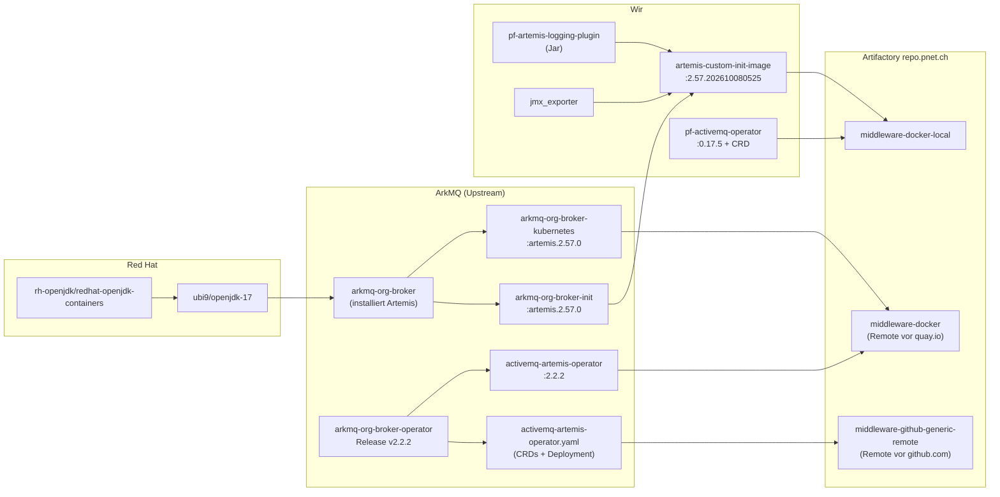
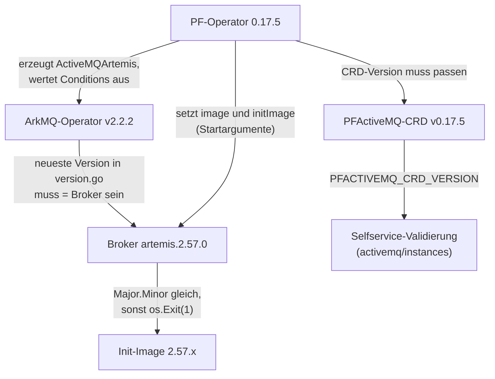
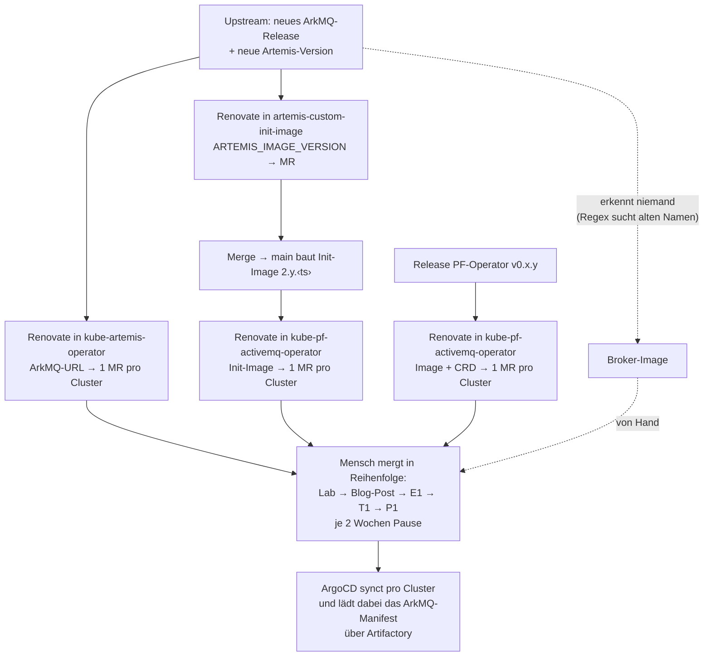
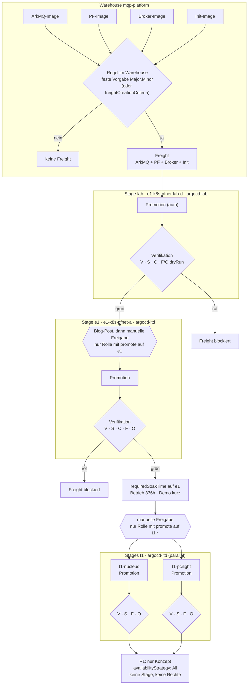
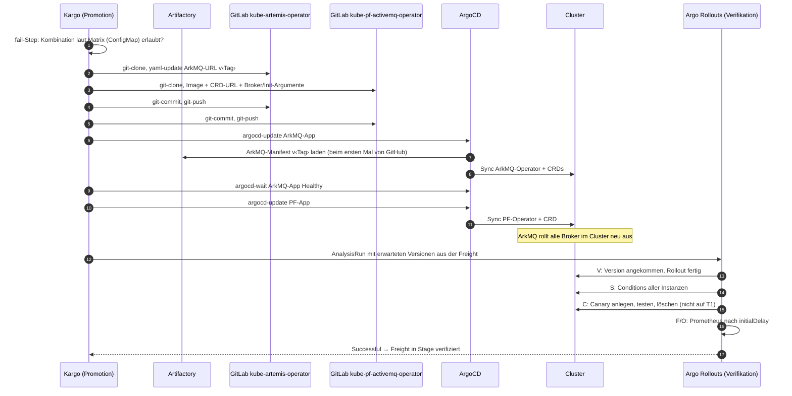

# Versionen, Build-Kette und Promotion mit Kargo

Was wir bisher über die Versionen der MQP-Komponenten wissen: wer sie baut, wie sie ins Artifactory kommen, wie sie zusammenhängen, wie sie heute ausgerollt werden und wie eine Promotion mit Kargo aussehen würde (Stand 24.10.2026). Ergänzt [NOTIZEN.md](NOTIZEN.md), [VARIANTENENTSCHEIDE.md](VARIANTENENTSCHEIDE.md) und [TESTARTEN.md](TESTARTEN.md).

> Mit Unterstützung von KI (Claude) erstellt. Für die IPA deklarieren (A02 Punkt 3, Doc07 Punkt 6).

## Inhalt

1. [Komponenten und wer sie baut](#1-komponenten-und-wer-sie-baut)
2. [Build-Kette](#2-build-kette)
3. [Von Upstream ins Artifactory](#3-von-upstream-ins-artifactory) (inkl. [Startpunkt und Abgrenzung](#34-startpunkt-der-arbeit-und-abgrenzung))
4. [Versionsstand pro Cluster](#4-versionsstand-pro-cluster)
5. [Abhängigkeiten zwischen den Versionen](#5-abhängigkeiten-zwischen-den-versionen)
6. [Heutiges Ausrollen](#6-heutiges-ausrollen)
7. [Umbenennungen bei ArkMQ](#7-umbenennungen-bei-arkmq)
8. [Promotion mit Kargo](#8-promotion-mit-kargo)
9. [Eine komplette Promotion von Anfang bis Ende](#9-eine-komplette-promotion-von-anfang-bis-ende)
10. [Was Kargo löst und was nicht](#10-was-kargo-löst-und-was-nicht)
11. [Vorbereitung vor der Probe-IPA](#11-vorbereitung-vor-der-probe-ipa)
12. [Quellen](#12-quellen)

---

## 1. Komponenten und wer sie baut

Für ein Broker-Upgrade zählen vier Komponenten. Zwei bauen wir selbst, zwei kommen von Upstream.

| Komponente | Wer baut | Repo | Pipeline | Ergebnis |
|---|---|---|---|---|
| **PF-Operator** | wir | `middleware/activemq/pf-activemq-operator` | `create-go-app@v0.49.4` + goreleaser. MR → Snapshot, `main` → Staging-Image, Tag `v*` → Release + Changelog | `middleware-docker-local.repo.pnet.ch/pf/middleware/pf-activemq-operator:<x.y.z>`; die CRD wird per Raw-URL am Git-Tag geladen |
| **Init-Image** | wir | `middleware/activemq/artemis-custom-init-image` | `pipeline-includes/images@v6.1.223`. MR → Staging, `main` → Release | `middleware-docker-local.repo.pnet.ch/pf/middleware/artemis-custom-init-image:<Major.Minor>.<Zeitstempel>` |
| Logging-Plugin | wir | `middleware/activemq/pf-artemis-logging-plugin` | `pipeline-includes/java@v13.0.27` | Jar in `middleware-maven-releases-local`. Kommt **nur über das Init-Image** in den Broker |
| **ArkMQ-Operator** | Upstream | `github.com/arkmq-org/arkmq-org-broker-operator` | GitHub-Release | Manifest (GitHub-Release-Asset) + Image `quay.io/arkmq-org/activemq-artemis-operator:<x.y.z>` |
| **Broker-Image** | Upstream | `github.com/arkmq-org/arkmq-org-broker-kubernetes-image` | ArkMQ (cekit/buildah) | `quay.io/arkmq-org/arkmq-org-broker-kubernetes:artemis.<x.y.z>` |

Nicht relevant für die Promotion: `artemis-custom-image` wird gebaut (noch auf 2.53), aber in keinem Manifest verwendet. Die Tools in `deployments` (artemis-monitor, OPS UI, Merge-Operator, Vault-Sync) haben einen eigenen Release-Zyklus.

---

## 2. Build-Kette



**Wichtig zur Kette:**

- Das Init-Image wird aus drei Gründen neu gebaut: neue Artemis-Basis, neues Logging-Plugin oder neuer JMX-Exporter. Am Tag sieht man nur Major.Minor (`IMAGE_STATIC_VERSION="${ARTEMIS_IMAGE_VERSION%.*}"`), nicht den Artemis-Patch.
- Das Broker-Image trägt das Label `org.opencontainers.image.source = https://github.com/rh-openjdk/redhat-openjdk-containers`, auch `name = ubi9/openjdk-17` und `version = 1.24`. Alles geerbt vom Basis-Image, weil ArkMQ diese Labels nicht selbst setzt. Darum verlinkt Renovate im MR die falsche Quelle. Die richtigen Quellen für Release Notes sind die Releases von `arkmq-org/arkmq-org-broker-operator` und die Release Notes von Apache Artemis.
- ArkMQ kann ein Tag wie `artemis.2.57.0` neu pushen, z. B. wegen Java-Sicherheitsfixes im Basis-Image. Nur der Digest zeigt, welches Image wirklich läuft.

---

## 3. Von Upstream ins Artifactory

### 3.1 Remote-Repos sind Proxys mit Cache

Niemand kopiert Versionen aktiv von GitHub oder quay.io ins Artifactory. `middleware-docker` und `middleware-github-generic-remote` sind **Remote-Repositories**. Sie holen etwas erst, wenn es angefordert wird, und speichern es dann im Cache.

| Anfrage | Was Artifactory macht | Wer fragt |
|---|---|---|
| **Tag-Liste** eines Images (`/v2/<repo>/tags/list`) | fragt quay.io live und gibt alle Tags zurück, ohne Images zu laden | Renovate, künftig Kargo |
| **Manifest** eines Tags | holt das Manifest bei quay.io (Digest, Labels), speichert es | Renovate (Labels, Links), künftig Kargo (Digest) |
| **Layer** eines Images | holt die Daten bei quay.io, speichert sie | Cluster beim Image-Pull |
| **Datei** im Generic-Remote (ArkMQ-Manifest) | holt die Datei bei GitHub, speichert sie | ArgoCD beim Rendern mit kustomize |

Darum liegen in `middleware-github-generic-remote` nur v2.1.7 und v2.2.2. Das sind die zwei Versionen, die ArgoCD bisher angefordert hat. Der Ordner zeigt also nicht, welche Versionen es gibt.

Neue Tags sind eventuell erst verzögert sichtbar, weil Artifactory die Tag-Liste eine Zeit lang zwischenspeichert („Metadata Retrieval Cache Period“ des Remotes). Bei zwei Wochen zwischen den Stages spielt das keine Rolle.

### 3.2 Wo Renovate heute nach neuen Versionen sucht

| Komponente | Repo | `datasource` | Renovate fragt | über Artifactory? |
|---|---|---|---|---|
| ArkMQ | `kube-artemis-operator` | `github-releases` | die **GitHub-API** nach Releases von `arkmq-org/activemq-artemis-operator` | **nein**. Die Regex liest aus dem Artifactory-Pfad nur Repo-Name und aktuelle Version |
| Broker-Image | `kube-pf-activemq-operator` | `docker` | Tag-Liste in `middleware-docker` (Remote vor quay.io) | ja (Regex sucht aber den alten Namen, siehe §7) |
| Init-Image | `kube-pf-activemq-operator` | `docker` | Tag-Liste in `middleware-docker-local` | ja |
| PF-CRD | `kube-pf-activemq-operator` | `gitlab-tags` | Tags von `pf-activemq-operator` in GitLab | nein |
| Artemis-Basis im Init-Image | `artemis-custom-init-image` | `docker` | Tag-Liste von `arkmq-org-broker-init` in `middleware-docker` | ja |

Die Presets `middleware/buildenv/renovate-presets` habe ich nicht gesehen. Falls dort eine `hostRule` für GitHub steht, läuft die ArkMQ-Abfrage über einen Proxy. Am Ablauf ändert das nichts.

### 3.3 Wie Kargo neue Versionen sehen würde

- Kargo hat **keine Subscription auf GitHub-Releases**. Den Weg von Renovate für ArkMQ kann Kargo nicht gehen.
- Darum abonniert Kargo für ArkMQ das **Operator-Image** in `middleware-docker`. Die Abfrage der Tag-Liste durch das Warehouse ist selbst die Anfrage, die Artifactory an quay.io weiterreicht. Kargo ist also der „jemand“, der anfordert. Vorher muss niemand das Image gezogen haben.
- Dass das Remote neue Tags durchreicht, ist belegt: Renovate hat das MR von `artemis.2.53.0` auf `artemis.2.57.0` über dasselbe Remote erstellt, bevor ein Cluster 2.57.0 gezogen hatte.
- Das ArkMQ-Manifest im Generic-Remote muss Kargo nicht abrufen. Kargo schreibt nur die URL ins Overlay, laden tut es ArgoCD.
- **Entscheid: kein `http`-Step zur Prüfung des Manifests.** Das Warehouse hat die Versionen schon gefunden. Eine zweite Prüfung in der Promotion würde dessen Analyse wiederholen. Es bleibt eine **Annahme**: Image-Tag `x.y.z` und Release `vx.y.z` gehören zusammen, weil ArkMQ beide im selben Release-Ablauf veröffentlicht. Die Annahme wird einmal geprüft (§11) und in der Betriebsdoku festgehalten. Stimmt sie einmal nicht, scheitert der Sync in **Lab** (`kustomize build` mit 404, `argocd-wait` mit Timeout), und andere Teams sind nicht betroffen. Aufräumen: vorherige Freight auf `lab` promoten.
- Kargo braucht dafür nur Zugriff auf Artifactory, nicht aufs Internet.

### 3.4 Startpunkt der Arbeit und Abgrenzung

**Die Arbeit beginnt dort, wo eine Version in `repo.pnet.ch` liegt.** Wie sie dorthin kommt (unsere Pipelines, die Remotes vor quay.io und GitHub, Renovate in den Build-Repos), ist **Ausgangslage**. Das wird in der Umfeldanalyse beschrieben, aber nicht verändert. §1 und §2 sowie §3.1 und §3.2 beschreiben diese Ausgangslage.

**Startpunkt heute (Renovate) und mit Kargo:**

| Komponente | Renovate heute schaut auf | Kargo würde schauen auf |
|---|---|---|
| Broker-Image | `repo.pnet.ch` (`middleware-docker`) | `repo.pnet.ch` (`middleware-docker`) |
| Init-Image | `repo.pnet.ch` (`middleware-docker-local`) | `repo.pnet.ch` (`middleware-docker-local`) |
| PF-Operator | Image: `repo.pnet.ch`; CRD: **GitLab-Tags** (`gitlab-tags`) | `repo.pnet.ch` (Image). Die CRD-Version leitet sich aus dem Image-Tag ab |
| ArkMQ | **GitHub-API direkt** (`github-releases`) | `repo.pnet.ch` (Operator-Image in `middleware-docker`) |

Renovate hat heute **drei** Startpunkte: Artifactory, GitLab und GitHub. Mit Kargo gibt es nur noch **einen**:

- Die Grenze der Arbeit ist eindeutig: Artifactory.
- Kargo braucht keinen Zugriff aufs Internet. Renovate braucht heute für ArkMQ einen Zugang zur GitHub-API, direkt oder über einen Proxy.
- Erkannt wird nur, was intern auch wirklich verfügbar ist.

Der Startpunkt der heutigen Renovate-Konfiguration wird also nicht einfach übernommen, sondern vereinheitlicht. Für die Ist-Analyse: heute drei Quellen. Für den Variantenentscheid: mit Kargo eine Quelle.

**Annahmen an der Schnittstelle:** Kargo verlässt sich an der Grenze auf folgende Punkte. Sie werden nicht gelöst, sondern benannt. Sie gehören in die Risiken und in die Betriebsdoku (D03).

| Annahme | Was passiert, wenn sie nicht stimmt |
|---|---|
| Die Remotes in Artifactory reichen neue Tags von quay.io durch | Kargo sieht keine neuen Versionen |
| Image-Tag des ArkMQ-Operators = Release-Tag (`2.2.2` ↔ `v2.2.2`) | Sync in Lab scheitert |
| Init-Image-Tag beginnt mit Artemis-Major.Minor | Regel Broker = Init greift nicht |
| Das Init-Image wird nach einem Artemis-Update zeitnah gebaut (Renovate-MR) | Es entsteht keine neue Freight |
| Image-Namen bleiben stabil (siehe Umbenennungen in §7) | Subscription findet nichts mehr |

---

## 4. Versionsstand pro Cluster

Aus den Overlays von `kube-artemis-operator/envs` und `kube-pf-activemq-operator/overlays`:

| Cluster | ArkMQ | PF-Operator | PF-CRD | Broker-Image | Init-Image |
|---|---|---|---|---|---|
| `e1-k8s-pfnet-lab-d` | v2.2.2 | 0.17.5 **(Staging-Registry)** | **`main` (ungepinnt)** | `arkmq-org-broker-kubernetes:artemis.2.57.0` | 2.57.202610080525 |
| Lab-C | – | – | – | – | – (MQP wird für die Probe-IPA aufgebaut) |
| `e1-k8s-pfnet-a` | v2.2.2 | 0.17.5 | v0.17.5 | `arkmq-org-broker-kubernetes:artemis.2.57.0` | 2.57.202610080525 |
| `t1-k8s-nucleus-a` | v2.2.2 | 0.17.5 | v0.17.5 | `arkmq-org-broker-kubernetes:artemis.2.57.0` | 2.57.202610080525 |
| `t1-k8s-pcilight-a` | v2.2.2 | 0.17.5 | v0.17.5 | `arkmq-org-broker-kubernetes:artemis.2.57.0` | 2.57.202610080525 |
| `p1-k8s-nucleus-a` | v2.1.7 | 0.17.1 | **v0.17.0** | `activemq-artemis-broker-kubernetes:artemis.2.53.0` | 2.53.202604280527 |
| `p1-k8s-pcilight-a` | v2.1.7 | 0.17.1 | **v0.17.0** | `activemq-artemis-broker-kubernetes:artemis.2.53.0` | 2.53.202604280527 |

Auffällig:

- P1 nutzt die CRD v0.17.0 zum Operator 0.17.1.
- Lab läuft mit dem Staging-Image und einer ungepinnten CRD. Als Kargo-Stage taugt Lab so nicht ohne Absprache.
- Releases von ArkMQ: v2.1.7 (14.04.2026), v2.2.0 (12.06.), v2.2.1 (04.09.), v2.2.2 (25.09.). Der Bump vor rund 4 Monaten ging wahrscheinlich zuerst auf v2.2.0, v2.2.2 gibt es erst seit dem 25.09. In der GitLab-History prüfen, die lokale Kopie hat keine Historie.

---

## 5. Abhängigkeiten zwischen den Versionen

### 5.1 Die Regeln



| Regel | Quelle | Folge bei Verstoss |
|---|---|---|
| Broker und Init haben dieselbe Version in Major.Minor | `pf-activemq-operator/controller/resource/artemismq.go:49-55` | PF-Operator `os.Exit(1)` beim ersten Reconcile |
| Broker = neueste Version in der Liste des ArkMQ-Release | ArkMQ: PF setzt kein `spec.version` → `ResolveBrokerVersion` nimmt die neueste → `AssertBrokerImageVersion` vergleicht exakt | `BrokerVersionAligned=False` → `Ready=False` auf allen Instanzen (aus dem Code abgeleitet, in Lab bestätigen) |
| PF-Operator kennt die API des ArkMQ-Operators | `go.mod`: `github.com/arkmq-org/activemq-artemis-operator/v2 v2.9.9` | dauerhaft `Mismatch` oder Felder, die abgelehnt werden |
| Selfservice validiert gegen dieselbe CRD-Version | `documentation/docs/infra/guides/platform.md` → `PFACTIVEMQ_CRD_VERSION` in `activemq/instances/.gitlab-ci.yml` | neue Felder werden im Selfservice abgelehnt oder nicht geprüft |

Bekannte Paare ArkMQ → Artemis (letzter Eintrag in `version/version.go`): **v2.1.7 → 2.53.0**, **v2.2.2 → 2.57.0**.

### 5.2 Warum die Abhängigkeiten so gross sind

Bei MQP baut ein Operator auf einem anderen Operator auf, und der Broker setzt sich zur Laufzeit aus zwei Images zusammen. Jede Schicht verlässt sich auf Details der Schicht darunter.

```
Team-Instanz (PFActiveMQ-YAML)
   │  liest
PF-Operator ──────────── unsere Schicht: übersetzt PF-Standards in ArkMQ
   │  erzeugt ActiveMQArtemis, liest dessen Status
ArkMQ-Operator ───────── Upstream-Schicht: weiss, wie man Artemis betreibt
   │  erzeugt StatefulSet, spricht per Jolokia mit dem Broker
Pod: Init-Container + Broker-Container
   │  Init schreibt die Konfiguration, Broker startet damit
Apache Artemis (Journal auf PVC)
```

1. **Der PF-Operator ist eng an die ArkMQ-API gebunden.** Er verwendet die Go-Typen von ArkMQ direkt und vergleicht die gesamte Spec mit `reflect.DeepEqual` (`pfactivemq_controller.go:455`). Bringt ArkMQ neue Felder oder Defaults mit, ist der Vergleich nie mehr gleich.
2. **ArkMQ entscheidet, welche Artemis-Version „richtig“ ist.** Ohne `spec.version` nimmt ArkMQ die neueste Version seiner Liste als Sollwert und prüft per Jolokia, ob der Broker sie hat. So wird aus „ArkMQ v2.2.2“ automatisch „Broker muss 2.57.0 sein“.
3. **Der Broker besteht aus zwei Images.** Das Init-Image erzeugt vor dem Start Konfiguration, Bibliotheken (Logging-Plugin, JMX-Exporter) und Skripte. Format und Bibliotheken ändern sich zwischen Artemis-Versionen, darum müssen beide Images zusammenpassen.
4. **Alles gilt clusterweit.** Beide Operatoren beobachten alle Namespaces, CRDs gibt es nur einmal pro Cluster. Ein Upgrade trifft alle Instanzen aller Teams auf einmal.
5. **Broker haben Zustand.** Das Journal liegt auf dem PVC. Ein Upgrade ist ein Rolling Restart aller Broker, ein Downgrade über eine Minor-Version ist nicht sicher.

| Abhängigkeit | Unvermeidbar? | Liesse sich lockern durch |
|---|---|---|
| PF → ArkMQ-API | teilweise | Vergleich nur der eigenen Felder statt `DeepEqual` |
| ArkMQ → Broker-Version | **selbst gemacht** | `spec.version` setzen, dann prüft ArkMQ gegen die gewünschte Version |
| Broker ↔ Init | ja (Design von ArkMQ) | – |
| clusterweit | ja (CRDs) | nur mit vCluster |
| Journal/Downgrade | ja (Artemis) | – |
| Selfservice ↔ CRD | teilweise | CRD-Version automatisch aus dem Deployment ableiten |

Kargo macht die Abhängigkeiten sichtbar und sichert sie ab, entfernt sie aber nicht. Die beiden Punkte beim PF-Operator (`spec.version`, kein `DeepEqual`) sind gute Kandidaten für „Nächste Schritte“ (D03).

---

## 6. Heutiges Ausrollen



- Für ein volles Upgrade sind das bis zu **3 MRs pro Cluster, also bis zu 18 MRs**. Dass sie zusammengehören, weiss nur, wer sie mergt.
- Die Reihenfolge und die zwei Wochen Pause stehen in `documentation/docs/infra/guides/platform.md:81-89`. Technisch erzwungen ist nichts davon.
- Alle MRs bekommen das Label `wf::Blocked`, Automerge ist aus.

---

## 7. Umbenennungen bei ArkMQ

| Alt | Neu | Seit |
|---|---|---|
| Repo `arkmq-org/activemq-artemis-operator` | `arkmq-org/arkmq-org-broker-operator` (gleiche Repo-ID 275795995, 301-Weiterleitung) | – |
| Repo `activemq-artemis-broker-kubernetes-image` | `arkmq-org-broker-kubernetes-image` | – |
| Image `activemq-artemis-broker-kubernetes` | `arkmq-org-broker-kubernetes` | ArkMQ v2.2.2 (Manifest, `RELATED_IMAGE_*`) |
| Image `activemq-artemis-broker-init` | `arkmq-org-broker-init` | ArkMQ v2.2.2 |
| Image `activemq-artemis-operator` | noch nicht umbenannt (Stand v2.2.2) | – |

Folgen:

- Die Renovate-Regex in `kube-pf-activemq-operator` sucht `activemq-artemis-broker-kubernetes` und erkennt deshalb **auf keinem Nicht-Prod-Cluster** Broker-Updates.
- Renovate in `kube-artemis-operator` und die URL über `middleware-github-generic-remote` funktionieren nur dank der Weiterleitung.
- Das Operator-Image kann in einem späteren Release ebenfalls umbenannt werden. Subscriptions (Renovate und Kargo) bei jedem ArkMQ-Release prüfen.

---

## 8. Promotion mit Kargo

Dieser Abschnitt beschreibt das **Zielbild der IPA** auf der Kargo-Prod-Instanz (management-a). Es beruht auf den Empfehlungen in [VARIANTENENTSCHEIDE.md §3](VARIANTENENTSCHEIDE.md#3-ipa-promotion-strategie-lab--t1): Freight-Variante A mit fester Vorgabe von Major.Minor, T1 parallel, Freigabe in Kargo (Lab automatisch, E1 und T1 manuell), Git überall per Push, gleiche Promotion-Schritte für alle Stages. Die Testarten (K, V, S, F, O, C) kommen aus der Probe-IPA ([TESTARTEN.md](TESTARTEN.md)).

Ob die Stage `lab` im Zielbild Platz hat, hängt davon ab, ob management-a `argocd-lab` erreicht. Heute melden sich die Controller von Lab-D und Lab-C bei der Test-Instanz. Sonst beginnt die IPA-Pipeline bei E1, und die Diagramme unten verlieren die Stage `lab`.

**Probe-IPA und IPA im Vergleich:**

| | Probe-IPA | IPA (Zielbild) |
|---|---|---|
| Kargo | Test-Instanz, Control-Plane Lab-D | Prod-Instanz, Control-Plane management-a |
| Warehouse | vorläufig, vier Subscriptions, **ohne Regel** | Variante aus §3.1 der Variantenentscheide, z. B. feste Vorgabe |
| Stages | `lab-d`, `lab-c` (beide `argocd-lab`) | (`lab`,) `e1`, `t1-nucleus`, `t1-pcilight` |
| Freigabe | beide manuell | Lab automatisch, E1 manuell nach Blog-Post, T1 manuell + Wartezeit |
| Promotion-Schritte | K, Commits per Push, ArkMQ → PF | gleich, als gemeinsame `PromotionTask` aus Git |
| Verifikation | **bewerteter Inhalt**: V, S, C, F/O (`lab-d` mit `dryRun`) | aus Git übernommen, auf T1 ohne C |
| Rechte | Verifikations-Jobs auf Lab-D/Lab-C | dazu `promote` pro Stage, P1 ausgeschlossen |

Zwischen den Arbeiten bleibt das Projekt auf der Test-Instanz bestehen, betrifft aber nur Lab-D und Lab-C. Es gibt also keinen Konflikt mit dem Projekt auf management-a.

### 8.1 Warehouse: Versionen erkennen

| Komponente | Subscription | Strategie | Schreibt in |
|---|---|---|---|
| ArkMQ | `middleware-docker.repo.pnet.ch/arkmq-org/activemq-artemis-operator` | `SemVer` | `kube-artemis-operator/envs/<cluster>`: Manifest-URL mit `v${Tag}` |
| PF-Operator | `middleware-docker-local.repo.pnet.ch/pf/middleware/pf-activemq-operator` | `SemVer` | `kube-pf-activemq-operator/overlays/<cluster>`: `newTag` + CRD-URL `/-/raw/v${Tag}/…` |
| Broker | `middleware-docker.repo.pnet.ch/arkmq-org/arkmq-org-broker-kubernetes` | `Lexical`, `allowTags: ^artemis\.\d+\.\d+\.\d+$` | Argument `--artemis-image` (mit Digest) |
| Init | `middleware-docker-local.repo.pnet.ch/pf/middleware/artemis-custom-init-image` | `SemVer` (Zeitstempel = Patch) | Argument `--artemis-init-image` (mit Digest) |

Das Broker-Tag `artemis.2.57.0` ist kein SemVer. Kargo ignoriert solche Tags bei `SemVer` (`pkg/controller/semver/parser.go`). `Lexical` sortiert falsch, sobald ein Patch zweistellig wird (2.57.10 vor 2.57.9).

### 8.2 Wie aus den Versionen eine Freight wird

Das Warehouse weiss von sich aus **nicht**, ob Versionen zusammenpassen. Es nimmt pro Subscription die **neueste** Version und bildet daraus einen Kandidaten. Ob daraus eine Freight wird, entscheidet nur eine Regel, die **wir** vorgeben.

```
Discovery:  neuestes ArkMQ-Image   → 2.3.0
            neuestes PF-Image      → 0.17.5
            neuestes Broker-Image  → artemis.2.58.0
            neuestes Init-Image    → 2.57.202610080525
                    │
                    ▼
Kandidat:   ArkMQ 2.3.0 · PF 0.17.5 · Broker 2.58.0 · Init 2.57.x
                    │
freightCreationCriteria: Broker 2.58 == Init 2.57 ?  → false
                    │
                    ▼
            keine Freight (ältere Kombinationen probiert das Warehouse nicht)
```

Erst wenn unsere Pipeline das Init-Image `2.58.<ts>` gebaut hat, ist die Regel erfüllt, und die Freight entsteht.

**Was eine Regel im Warehouse prüfen kann:** Sie sieht nur die Tags (und Digests) der gefundenen Images.

| Regel | Aus den Tags ablesbar? | Wo prüfen |
|---|---|---|
| Broker = Init (Major.Minor) | **ja**: `artemis.2.58.0` und `2.58.202611…` | Warehouse (`freightCreationCriteria` oder feste Vorgabe) |
| ArkMQ passt zur Broker-Version | **nein**, steht nur in `version.go` von ArkMQ | Matrix als ConfigMap + `fail`-Step in der Promotion, oder feste Vorgabe (siehe unten) |
| PF-Operator passt zu ArkMQ | **nein**, nirgends maschinenlesbar | Verifikation in Lab (Tests S und O) |

**Variante 1: Ausdruck in `freightCreationCriteria`** (Skizze, in Lab testen)

```yaml
freightCreationCriteria:
  expression: |
    let b = split(trimPrefix(imageFrom('middleware-docker.repo.pnet.ch/arkmq-org/arkmq-org-broker-kubernetes').Tag, 'artemis.'), '.');
    let i = split(imageFrom('middleware-docker-local.repo.pnet.ch/pf/middleware/artemis-custom-init-image').Tag, '.');
    b[0] == i[0] && b[1] == i[1]
```

Verglichen werden die ersten zwei Teile, wie im PF-Operator (`artemismq.go:49-55`). `let`, `split` und `trimPrefix` sind Funktionen von expr-lang. Ob sie in `freightCreationCriteria` verfügbar sind, sagt die Kargo-Doku nicht ausdrücklich.

Nachteil: Weil das Warehouse nur die neueste Kombination prüft, **blockiert eine Komponente alle anderen**. Ist der Broker schon auf 2.58, das Init-Image aber noch nicht gebaut, entsteht auch für einen dringenden Fix am PF-Operator keine Freight.

**Variante 2: Major.Minor in den Subscriptions fest vorgeben**

| Subscription | Vorgabe |
|---|---|
| Broker | `allowTags: ^artemis\.2\.57\.\d+$` |
| Init | `semverConstraint: ~2.57` |
| ArkMQ | `semverConstraint: ~2.2` |

Das Warehouse sieht 2.58 dann gar nicht. Ein Minor-Upgrade von Artemis ist eine bewusste Änderung am Warehouse: alle drei Vorgaben gemeinsam anpassen. Das deckt auch die Regel ArkMQ ↔ Broker ab, ganz ohne Matrix. Patch-Versionen, neue Init-Builds und Releases des PF-Operators laufen weiter automatisch.

Variante 2 passt gut zu MQP: Minor-Upgrades von Artemis sind selten, kommen mit einem ArkMQ-Release und sind ohnehin ein bewusster Entscheid (Blog-Post). Empfehlung für die IPA, siehe [VARIANTENENTSCHEIDE.md §3.1](VARIANTENENTSCHEIDE.md#31-freight-modell-bewerteter-variantenentscheid-1). In der Probe-IPA hat das Warehouse noch keine Regel; dort fängt der `fail`-Step (K) ungültige Kombinationen vor dem Commit ab.

**Was trotzdem durchrutscht, und wer es merkt:** ArgoCD bewertet nur die Health der **Operator-Deployments**. Die Instanzen (`PFActiveMQ`, `ActiveMQArtemis`) liegen in anderen Apps und Namespaces.

| Was passt nicht | Was im Cluster passiert | ArgoCD-App der Operatoren | Wer merkt es |
|---|---|---|---|
| Broker ≠ Init (Major.Minor) | PF-Operator `os.Exit(1)` beim Reconcile → CrashLoop | **Degraded** | ArgoCD. Kargo wartet auf Healthy, die Promotion scheitert |
| ArkMQ ↔ Broker-Version | Operatoren laufen. Alle Instanzen `BrokerVersionAligned=False` → `Ready=False` | **Healthy** | nur die Verifikation (Test S) |
| PF ↔ ArkMQ-API | Operatoren laufen. Dauerhaft `Mismatch`, Requeue alle 5 s | **Healthy** | nur die Verifikation (Tests S und O) |

Der erste Fall braucht mindestens eine Instanz im Cluster, die reconciled wird. In Lab ist das die e2e-Instanz.

Ohne eigene Verifikation zählt für Kargo nur die ArgoCD-Health. In zwei von drei Fällen würde eine kaputte Kombination in Lab als verifiziert gelten und nach E1 weiterlaufen.

**Kurz:** Das Warehouse nimmt die neuesten Versionen. Kriterium oder feste Vorgabe filtern die offensichtlich falschen heraus. Was dann noch falsch ist, bleibt in Lab an der Verifikation hängen, nicht an ArgoCD.

### 8.3 Gesamtablauf



### 8.4 Ablauf einer Promotion in einer Stage



### 8.5 Was jede Stage macht

| | **lab** | **e1** | **t1-nucleus / t1-pcilight** | P1 (nur Konzept) |
|---|---|---|---|---|
| Cluster | `e1-k8s-pfnet-lab-d` | `e1-k8s-pfnet-a` | `t1-k8s-nucleus-a` / `t1-k8s-pcilight-a` | `p1-k8s-nucleus-a` / `p1-k8s-pcilight-a` |
| ArgoCD | `argocd-lab` | `argocd-itd` | `argocd-itd` | `argocd` |
| Wer ist betroffen | nur MQP | Entwicklerteams | Testteams | Produktion |
| Zweck | technischer Smoke-Test: Lässt sich die Kombination überhaupt installieren? | erster Einsatz mit echten Instanzen anderer Teams | Generalprobe für P1, gleiche Topologie (nucleus + pcilight) | – |
| Freight von | Warehouse (`direct`) | Stage `lab` | Stage `e1` | beide T1-Stages, `availabilityStrategy: All` |
| Start | automatisch | **manuell** nach Blog-Post, nur Rolle mit `promote` auf `e1` | **manuell**, nur Rolle mit `promote` auf `t1-*` | per MR ausserhalb von Kargo |
| Wartezeit davor | – | – | `requiredSoakTime` auf e1: 336h (Demo: kurz) | 336h auf T1 |
| Git | `git-push` direkt | `git-push` direkt | `git-push` direkt | MR (Vier-Augen-Prinzip, Change) |
| Reihenfolge Sync | ArkMQ → warten → PF | gleich | gleich, beide T1 gleichzeitig | – |
| Verifikation | V, S, C; F und O nur `dryRun` | V, S, C, F, O | V, S, F, O (keine Canary) | – |
| Bei Fehler | Freight bleibt in Lab, andere Teams merken nichts | Freight blockiert; Rollback = vorherige Freight promoten | Freight blockiert; Rollback = vorherige Freight promoten | – |
| Vorher informieren | – | Blog-Post | Testteams (Zeitfenster) | Change-Prozess |

Die Freigabe liegt in jeder Stage in Kargo, Git läuft überall per Push. Alle Stages rufen dieselbe `PromotionTask` auf; strenger werden nur die Tore davor (Freigabe, Wartezeit) und die Verifikation danach. Ein MR (`git-open-pr` + `git-wait-for-pr`) ist erst für P1 vorgesehen, wo ein Vier-Augen-Prinzip nötig ist. In der Probe-IPA sind `lab` und `e1` noch beide manuell.

---

## 9. Eine komplette Promotion von Anfang bis Ende

Zielbild der IPA. Beispiel: ArkMQ veröffentlicht **v2.3.0** mit **Artemis 2.58.0**. PF-Operator bleibt auf 0.17.5. Das Beispiel nutzt die empfohlene Variante 2 aus [§8.2](#82-wie-aus-den-versionen-eine-freight-wird) (feste Vorgabe von Major.Minor). Mit Variante 1 (Ausdruck in `freightCreationCriteria`) entsteht die Freight automatisch, sobald das Init-Image 2.58 gebaut ist. Ab dann läuft alles gleich.

| Tag | Was passiert | Wer | Kargo-Sicht |
|---|---|---|---|
| 0 | ArkMQ veröffentlicht v2.3.0, auf quay.io erscheinen `activemq-artemis-operator:2.3.0`, `arkmq-org-broker-kubernetes:artemis.2.58.0`, `arkmq-org-broker-init:artemis.2.58.0` | Upstream | Warehouse ignoriert sie wegen der Vorgabe `~2.2` / `2.57`. Patches innerhalb 2.57 liefen weiter automatisch |
| 0–1 | Renovate in `artemis-custom-init-image`: `ARTEMIS_IMAGE_VERSION` 2.58.0 → MR → Review → Merge → `main` baut `2.58.<ts>` | Renovate, MQP | Warehouse ignoriert auch dieses Image (Vorgabe `~2.57`) |
| 1 | MQP entscheidet das Minor-Upgrade und passt die drei Vorgaben im Warehouse an (ArkMQ `~2.3`, Broker `2.58`, Init `~2.58`) | MQP | **Freight** „ArkMQ 2.3.0 · PF 0.17.5 · Broker 2.58.0 · Init 2.58.<ts>“ |
| 1 | Stage `lab` (automatisch): K (v2.3.0 → 2.58.0 ✓), Commits, Sync ArkMQ → PF, alle Lab-Broker rollen neu aus | Kargo | Verifikation V, S, C (≈ 30–60 min, in Lab messen) |
| 1 | Verifikation grün | Kargo | Freight in `lab` verifiziert → auf `e1` verfügbar |
| 2 | Blog-Post veröffentlicht, berechtigte Person promotet auf `e1` | MQP | Sync auf E1, Verifikation V, S, C, F, O |
| 2 | Verifikation grün | Kargo | Freight in `e1` verifiziert, Wartezeit startet |
| 2–16 | Zwei Wochen Betrieb auf E1. `artemis-monitor` läuft weiter als Dauer-Canary | – | T1-Stages zeigen die Freight als „noch nicht verfügbar“ |
| 16 | Absprache mit Testteams; berechtigte Person promotet auf beide T1 | MQP | Beide T1 parallel, Verifikation V, S, F, O |
| 16 | Beide grün | Kargo | Freight in beiden T1 verifiziert |
| ≥ 30 | P1 per MR wie heute (Konzept: später Kargo mit `availabilityStrategy: All`) | MQP + Change | Freight-Historie zeigt, wo die Kombination getestet wurde |

**Was in diesem Beispiel schiefgehen kann:**

| Fehler | Wo er auffällt | Was passiert |
|---|---|---|
| Init-Image wird nicht neu gebaut | Warehouse | Es findet kein Init 2.58, es entsteht keine Freight. Nichts wird ausgerollt |
| ArkMQ v2.3.0 kennt 2.58.0 nicht (Matrix falsch) | `fail`-Step in Lab | Promotion bricht ab, bevor committet wird |
| Image-Tag `2.3.0`, aber Release heisst anders | Sync in Lab (`kustomize build` 404, `argocd-wait` Timeout) | Promotion schlägt fehl, Commit bleibt im Repo; vorherige Freight auf `lab` promoten |
| ArkMQ bringt neue Defaults, PF meldet dauernd `Mismatch` | S und O in Lab | Freight blockiert, Lab bleibt auf neuem Stand, Fix im PF-Operator nötig |
| Broker läuft, verarbeitet aber nichts | F auf E1 | Freight blockiert, Rollback auf E1 = vorherige Freight promoten |
| Neue Instanzen lassen sich nicht mehr anlegen | C in Lab oder E1 | Freight blockiert |
| Fehler erst nach Tagen (z. B. Speicherleck) | `artemis-monitor`, Alarme während der Wartezeit | Wartezeit verhindert, dass T1 betroffen ist. Freight von Hand blockieren |

---

## 10. Was Kargo löst und was nicht

| Kargo löst direkt | Kargo löst mit Workaround | Kargo löst nicht |
|---|---|---|
| neue Images erkennen, vier Komponenten zu einer Freight bündeln | ArkMQ als Image statt URL abonnieren | CRD- und Journal-Downgrade sicher machen |
| in beide kube-Repos schreiben | Broker-Tag ohne SemVer (`Lexical`) | Canary innerhalb eines Clusters (Operator gilt für alle Broker) |
| ArgoCD-Apps in Reihenfolge synchronisieren | Regel ArkMQ → Artemis (ConfigMap + `fail`) | Blog-Post, Absprachen (Nachrichten nur in Enterprise) |
| Verifikation und Sperre pro Stage | Image-Argumente in eigene Datei verschieben | Umbenennungen bei Upstream erkennen |
| automatische und manuelle Freigabe, Rechte pro Stage | Test V gegen veralteten Status | Selfservice-CRD-Version in `activemq/instances` (anderes Repo, Abgrenzung) |
| Mindestlaufzeit, Fan-out und Fan-in | Rechte der Verifikations-Jobs auf die Ziel-Cluster | |
| Rollback durch erneutes Promoten, Historie | | |

---

## 11. Vorbereitung vor der Probe-IPA

- [ ] **MQP auf Lab-C aufbauen:** Overlays `lab-c` in `kube-artemis-operator` und `kube-pf-activemq-operator`, ArgoCD-Apps in `argocd-lab`, mindestens zwei Test-Instanzen (1 und 2 Replicas), `artemis-monitor` mit beiden Brokern in der URL, Namespace für die Canary-Instanz, Prometheus für Lab-C. **Eindeutige Namen** (z. B. `appl-mqp-e2e-labc`, `labc-mqp-e2e-a`), weil Lab-D und E1 dieselben Namen verwenden und sich die Metriken im Dashboard schon heute mischen.
- [ ] Vorläufiges Warehouse (vier Subscriptions, ohne Regel) und Stages `lab-d`/`lab-c` (beide manuell, Push) auf der Kargo-Test-Instanz mit einfacher Promotion aufbauen. Bewusst vorläufig, wird in der IPA evaluiert. Alles deklarativ in Git.
- [ ] Kargo-Test-Instanz für die Dauer der Probe-IPA einfrieren (Absprache im Team).
- [ ] Image-Argumente aus dem Inline-Patch (`patch: |-`) in eine eigene Datei verschieben. `yaml-update` kann nicht in einen Text-Block schreiben.
- [ ] Lab-D klären: Staging-Image und CRD von `main` oder Release-Stand für die Stage `lab-d`?
- [ ] Renovate: Overlays von Lab-D und Lab-C in `ignorePaths` (E1/T1 erst zur IPA); Regex für den Broker auf den neuen Namen umstellen; `depName` für ArkMQ auf `arkmq-org/arkmq-org-broker-operator`.
- [ ] Für die IPA: `artemis-monitor` auf E1 korrigieren (`ssl-0` doppelt statt `ssl-0` und `ssl-1`).
- [ ] Prüfen, ob Image-Tag und Release-Tag bei ArkMQ immer übereinstimmen (`2.2.2` ↔ `v2.2.2`).
- [ ] In Artifactory prüfen, ob `middleware-docker` für `arkmq-org/activemq-artemis-operator` auch Tags zeigt, die noch nie gezogen wurden.
- [ ] Matrix ArkMQ → Artemis als ConfigMap anlegen (aus `version/version.go`).
- [ ] Regel „Broker = neueste Version in der ArkMQ-Liste“ in Lab bestätigen.
- [ ] Rechte der Verifikations-Jobs von Lab-D auf Lab-C klären; Argo-Rollouts-Controller auf Lab-D prüfen.
- [ ] Für die IPA: Erreicht management-a `argocd-lab`, oder beginnt die Pipeline bei E1?
- [ ] GitLab-History von `kube-artemis-operator/envs/*` für die Ist-Analyse auswerten (wann welche Version auf welchem Cluster).

---

## 12. Quellen

- MQP-Repos lokal: `kube-artemis-operator`, `kube-pf-activemq-operator`, `pf-activemq-operator`, `artemis-custom-init-image`, `documentation/docs/infra/guides/platform.md`, `renovate.json` der Repos
- ArkMQ Releases: https://github.com/arkmq-org/arkmq-org-broker-operator/releases
- ArkMQ Release-Manifest v2.2.2 / v2.1.7: `…/releases/download/v2.2.2/activemq-artemis-operator.yaml`
- ArkMQ Broker-Images: https://github.com/arkmq-org/arkmq-org-broker-kubernetes-image, https://github.com/arkmq-org/arkmq-org-broker-image
- Image-Labels: quay.io Registry-API für `arkmq-org/arkmq-org-broker-kubernetes@sha256:e42956655870701a804110f26f87dc0670a26296579ca3b10c6e76869b645f39`
- Kargo v1.12.4: https://docs.kargo.io, Quellcode https://github.com/akuity/kargo/tree/v1.12.4
- Artifactory Remote Repositories: https://jfrog.com/help/r/jfrog-artifactory-documentation/remote-repositories
