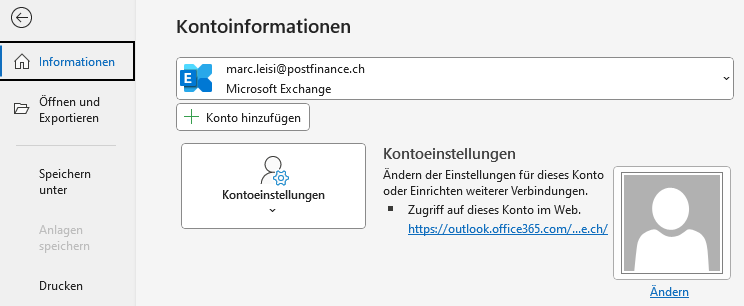
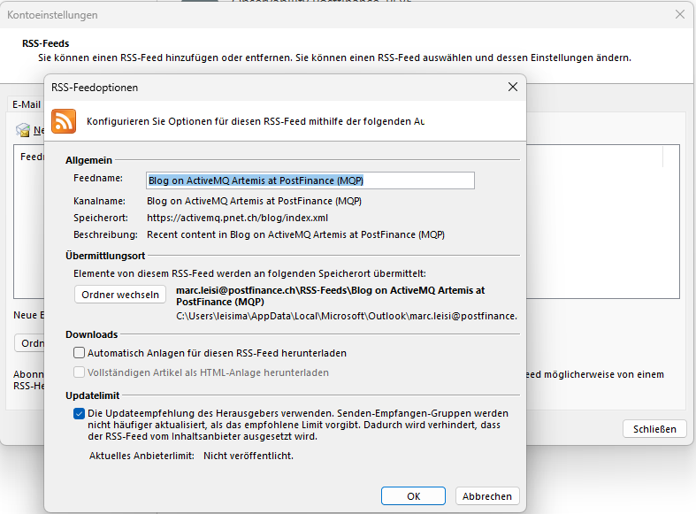
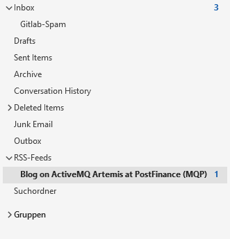

This is the first post in our new blog about ActiveMQ@PostFinance. We'll publish new posts regularly about the
following topics:

* Cluster updates
* Major changes
* Failure stories
* User stories (contact us if you would like to write a post)

!!! info
    Do not forget to subscribe to the RSS feed to get notifications when a new post is published!

## Subscribe

You can subscribe to the RSS feed in Outlook (or any other RSS reader), to do so copy the [feed link](/blog/index.xml)
to your clipboard.

Open Outlook and switch to the register *Datei*, then open *Kontoeinstellungen* as seen below.

In the newly opened window go to *RSS-Feeds* and click *Neu...*. Paste the URL and click *Hinzufügen*, configure the
feed as shown in the screenshot below.

Click *Schliessen* and restart Outlook. The feed is then displayed right below your main mail inbox.

Outlook will now notify you as soon as a new post was published.
