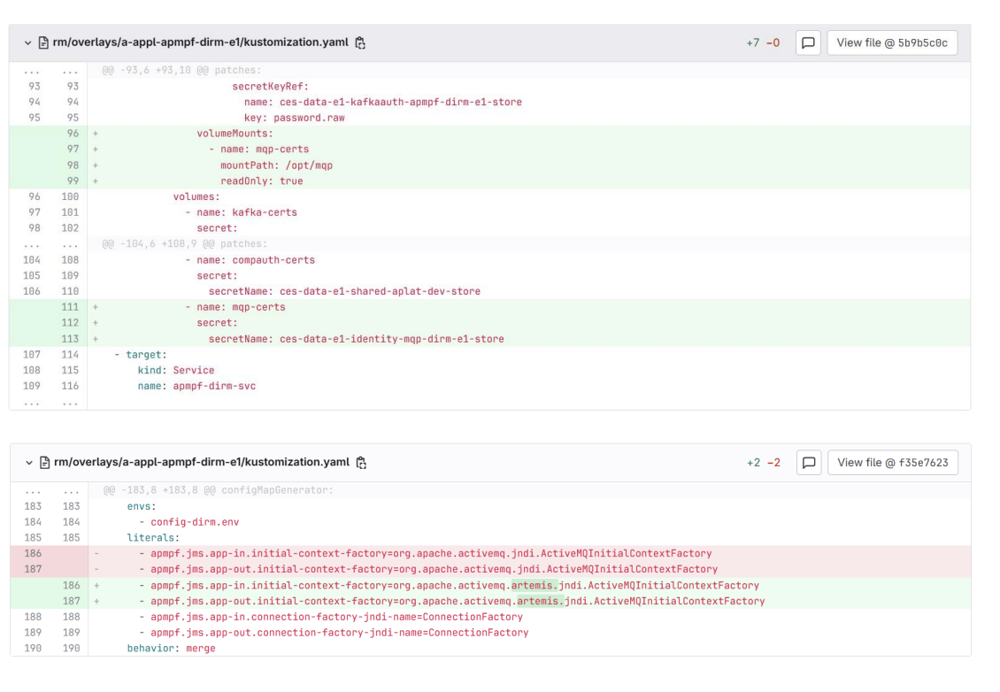
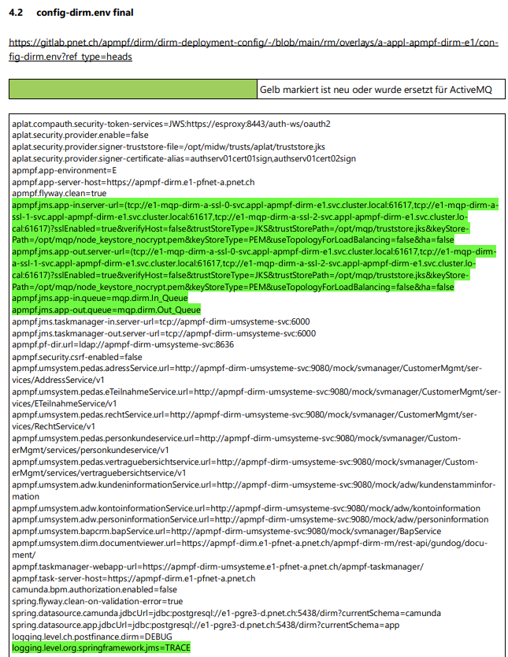

# Dirm Migration

Dirm migrated their ActiveMQ embedded Broker and Queues to MQP. The following changes were required for the DIRM
application to use ActiveMQ Artemis instead of the previous messaging system. The correct integration of certificates 
and the switch to the appropriate JNDI Factory were particularly important.

## Secret mounts and Factory adaption
The image below shows the Git diff of the `kustomization.yaml` file, containing the changes applied to it:



- **Adding certificate volumes**  
  New volumes were defined to provide certificates for the ActiveMQ connection. These include:
    - `mqp-certs` with the secret `ces-data-e1-identity-mqp-dirm-e1-store`
    - `kafka-certs` and `compauth-certs` for other communication paths.

- **JNDI Factory adjustment**  
  The `initial-context-factory` entry was changed from:
  ```
  org.apache.activemq.jndi.ActiveMQInitialContextFactory
  ```
  to:
  ```
  org.apache.activemq.artemis.jndi.ActiveMQInitialContextFactory
  ```
  This was necessary to use the specific ActiveMQ Artemis factory.


## Connection settings

To enable the application to connect to the queue, the following configurations were added or modified in `config-dirm.env`:

```properties
apmpf.jms.app-in.server-url=(tcp://e1-mqp-dirm-a-ssl-0-svc.appl-apmpf-dirm-e1.svc.cluster.local:61617,tcp://e1-mqp-dirm-a-ssl-1-svc.appl-apmpf-dirm-e1.svc.cluster.local:61617,tcp://e1-mqp-dirm-a-ssl-2-svc.appl-apmpf-dirm-e1.svc.cluster.local:61617)?sslEnabled=true&verifyHost=false&trustStoreType=JKS&trustStorePath=/opt/mqp/truststore.jks&keyStorePath=/opt/mqp/node_keystore_nocrypt.pem&keyStoreType=PEM&useTopologyForLoadBalancing=false&ha=false
apmpf.jms.app-out.server-url=(tcp://e1-mqp-dirm-a-ssl-0-svc.appl-apmpf-dirm-e1.svc.cluster.local:61617,tcp://e1-mqp-dirm-a-ssl-1-svc.appl-apmpf-dirm-e1.svc.cluster.local:61617,tcp://e1-mqp-dirm-a-ssl-2-svc.appl-apmpf-dirm-e1.svc.cluster.local:61617)?sslEnabled=true&verifyHost=false&trustStoreType=JKS&trustStorePath=/opt/mqp/truststore.jks&keyStorePath=/opt/mqp/node_keystore_nocrypt.pem&keyStoreType=PEM&useTopologyForLoadBalancing=false&ha=false
apmpf.jms.app-in.queue=mqp.dirm.In_Queue
apmpf.jms.app-out.queue=mqp.dirm.Out_Queue
```

The Git diff below shows the final config diff, in the case of Dirm `config-dirm.env`.


