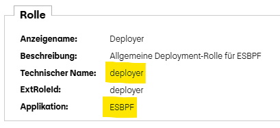

# OPS-UI

A user interface (UI) for all instances is provided, enabling each operations team to manage some functionalities for
their queues independently.

You can either use an existing role or create a new one specifically for this UI. The role is managed by you and
added to the `roles.operators` array in the self-service configuration. Everyone who has this IDM role will be able to 
manage the queues on this instance. Both UIs, ITD/Nonprod and Prod are using the [IDM-Prod](https://pfportal.pnet.ch/pfidm/).

### Adding a new role to your instance

Once you have selected the IDM role you want to use for your instance, you can add it to the self-service YAML file
in the [self-service repository](https://gitlab.pnet.ch/activemq/instances). You may also include multiple roles if needed.

To get the technical name of your role, you need to concatenate the application name and the technical name with
an underscore. You can find the technical name in IDM under the menu "Ressourcen" -> "Applikationen & Gruppierungen"
and then click on your role within your application.



Example of a self-service YAML with two roles:

```yaml
...
  roles:
    owner: mqp.appl_<my-app>
    operators:
      - esbpf.deployer
      - <application.technicalName>
...
```

After committing the changes to the repository, it may take up to 5 minutes for them to take effect on the UI.

Note: For E1 no IDM role is required, that's why adding an operator role is not strictly necessary.

## Links

The following table provides links to the UI for each platform. Note that E1, T1 and T2 share the same UI, and P1 does
have a separate instance.

| Platform | Link                                                                                            |
|----------|-------------------------------------------------------------------------------------------------|
| E1/T1/T2 | [ActiveMQ Operations UI - ITD / Nonprod](https://pfportal.pnet.ch/mqp-ops-ui-nonprod/instances) |
| P1       | [ActiveMQ Operations UI - Prod](https://pfportal.pnet.ch/mqp-ops-ui/instances)        |
