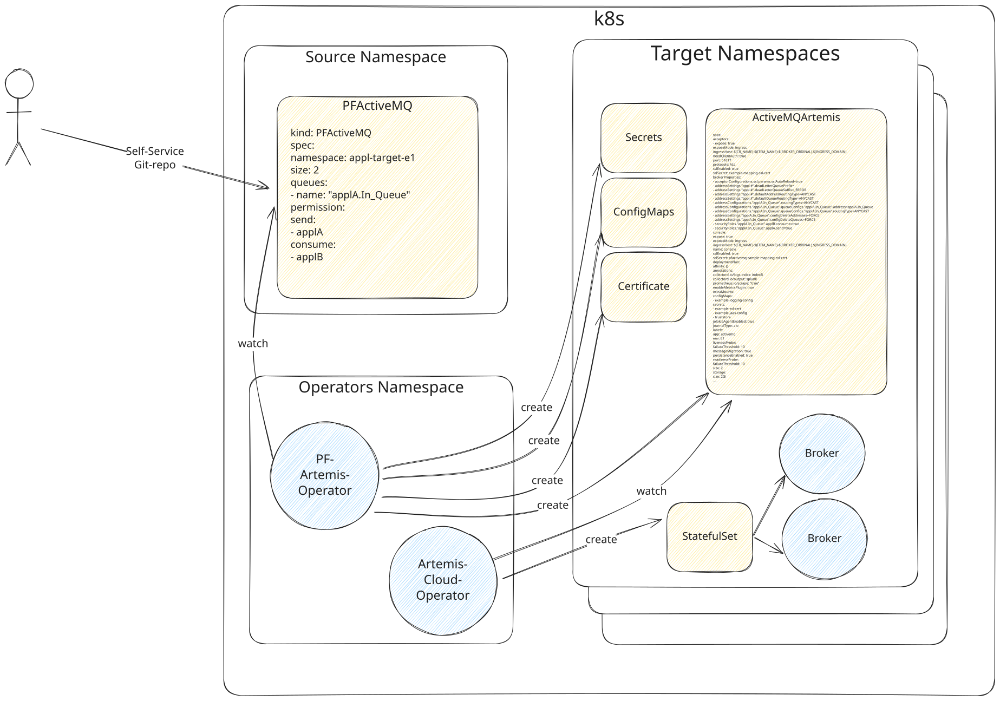

# Self-Service

A small introduction how to create and configure an ActiveMQ Artemis instance.

## Introduction

To create an ActiveMQ Artemis instance, you must create a PFActiveMQ file. PFActiveMQ is a [Custom
Resource Definition](https://kubernetes.io/docs/tasks/extend-kubernetes/custom-resources/custom-resource-definitions/)
that creates ActiveMQArtemis and additional resources within the kubernetes cluster. You can
add a new PFActiveMQ file to
the [self-service repository](https://gitlab.pnet.ch/activemq/instances) by submitting a merge
request. Once the merge request
is accepted,
the [pf-activemq-operator](https://gitlab.pnet.ch/middleware/activemq/pf-activemq-operator/) will
create the necessary resources and the open
source [artemis-cloud-operator](https://github.com/artemiscloud/activemq-artemis-operator)
will create the actual deployment.



## Create an instance

Please make sure that you read the getting started before you proceed.

Here is a simple example of creating a PFActiveMQ file:

!!! warning "Immutable fields"
    **Name** and **target namespace** cannot be changed after creation. To change either, delete the existing PFActiveMQ and create a new one.

```yaml
apiVersion: pf-activemq-operator.pnet.ch/v1alpha1
kind: PFActiveMQ
metadata:
  name: e1-mqp-<my-appl>-a
spec:
  teamMail: <my-team-mailbox>@postfinance.ch
  roles:
    owner: <idm-appl>.<my-role>
    operators:
      - <idm-appl>.<my-role>
  instance:
    namespace: appl-<my-appl>-e1
    replicas: 2
    storage: 4Gi
    resources:
      limits:
        memory: 4Gi
      requests:
        memory: 2Gi
        cpu: 1
    queues:
        - name: mqp.example.TEST
          permission:
            send:
              - a-pf-identity-mqp-<my-appl>-e1
            consume:
              - a-pf-identity-mqp-<my-appl>-e1
```

For available queue configuration options, see the [Create a Queue](#create-a-queue) section below.

Valid terms for <my-appl> can be fetched using `curl -s -X POST -H "Content-Type: application/json"  -H "Accept: application/json" -d '{}'  https://aletheia.p1-management-a.pnet.ch:7000/postfinance.aletheia.application.v2.ApplicationAPI/ListApps | jq` on paamlgw.pnet.ch

The owner role must be a valid IDM role. You can either create a new one within your application scope or reuse an existing one.
<idm-role> represents your application in IDM and <my-role> the specific IDM role. For example, for middleware, an IDM role 
called [mw_mqp_owner](https://pfportal.pnet.ch/pfidm/pages/resources/solution/business/businessSolutionShow.xhtml?id=7248&jfwid=e496a) 
was created under the application ASM. In this case, you need to set the owner to asm.mw_mqp_owner. In the operators field
the same IDM role or another existing IDM role can be defined.

For more information about the configuration options, you can refer to the [API documentation](/docs/default/resource/activemq/reference/api_reference/), or you can run kubectl explain project (see below).

```bash
$ kubectl explain pfactivemq.spec.instance
```


## Create a Queue
To create a queue, you can define it within the `queues` field in the instance's YAML definition. Access control for 
each queue can be configured under the `permissions` field.

For a detailed description, refer to the [API documentation](/docs/default/resource/activemq/reference/api_reference/).

You can also inspect the queue schema using `kubectl`:

```bash
$ kubectl explain pfactivemq.spec.instance.queues
```

Access control can be configured per operation (e.g., read, write, browse).
You need to add an identity such as a-pf-identity-mqp-e2e-e1, which represents the certificate of a user authorized to 
perform that operation. When an identity is defined on a queue for the first time, it will be created automatically, 
so there is no need to define it again. If no certificate is available for the identity, the Bot will leave a comment that 
the target host or namespace are needed - these can be provided in a comment on the MR. In addition, the TD of 
SM-Middleware will be notified to create the necessary certificate.

For more details on naming conventions, see the [Naming Guideline](/docs/default/resource/activemq/concepts/naming/).
