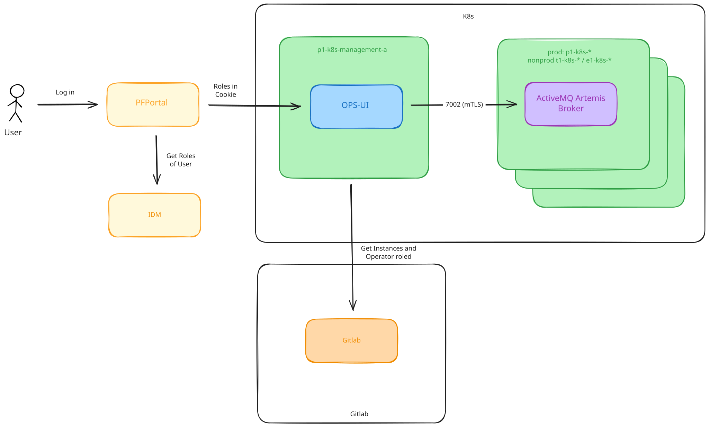

# Ops-UI

| Detail                 | Description                                                                                                                                                                                        |
|------------------------|----------------------------------------------------------------------------------------------------------------------------------------------------------------------------------------------------|
| Official Documentation | [OPS-UI Documentation](https://gitlab.pnet.ch/middleware/activemq/ops-ui/-/blob/main/README.md)                                                                                                    |
| Vendor                 | PostFinance AG                                                                                                                                                                                     |
| License                | none                                                                                                                                                                                               |
| Build                  | Custom Docker Image: [ops-ui](https://gitlab.pnet.ch/middleware/activemq/ops-ui)                                                                                                                   |
| Deployment             | ArgoCD Deployment: [ops-ui](https://gitlab.pnet.ch/middleware/activemq/deployments/-/tree/main/appl-mqp-ops-ui)                                                                                    |
| Web Endpoint URLs      | Prod: https://pfportal.pnet.ch/mqp-ops-ui/ <br /> Nonprod: https://pfportal.pnet.ch/mqp-ops-ui-nonprod/ <br /> Lab: https://mqp-ops-ui.e1-pfnet-a.pnet.ch:7000/mqp-ops-ui/e1-pfnet-lab-d/instances |
| Grafana Dashboard      | none                                                                                                                                                                                               |
| Splunk Index           | prod: midwprod                                                                                                                                                                                     |

## Introduction

Manage & view data inside your Apache ActiveMQ Artemis Instances. The OPS-UI provides possibility to manage queues, 
messages and consumers.

## Deployment

Two instances of the OPS-UI are deployed, one for the production environment and one for the non-production environment.
The prod OPS-UI manages the ActiveMQ Artemis Instances on the p1-k8s Clusters and the non-prod OPS-UI manages the 
Instances on the e1 and t1-k8s Clusters.

## Authentication and Authorization

After successfully logging in to the OIDC provider (PF Portal), the OPS-UI receives the username and associated roles. 
It then retrieves the self-service configuration from GitLab Pages, which contains the configured Instances and all 
the operator roles for each Instance.

See here an example for the self-service configuration for an instance with two operator roles:

```yaml
apiVersion: pf-activemq-operator.pnet.ch/v1alpha1
kind: PFActiveMQ
metadata:
  name: e1-mqp-test-a
spec:
  teamMail: smmwpf@postfinance.ch
  roles:
    owner: asm.mw_mqp_owner
    operators:
      - asm.mw_mqp_owner
      - esbpf.operator

```

Based on the defined operator roles, the OPS-UI only displays the Instances for which the user has access. The 
connection between the OPS-UI and the Artemis Instances is secured using mTLS. An OPS-UI user with the required 
permissions is configured on each broker to allow the OPS-UI to manage queues, messages and consumers.



## Splunk Logs

OPS-UI Logs:

```
index="midwprod" kubernetes_namespace=appl-mqp-ops-ui-prod-p1
```

Count User Access:

```
index="midwprod" kubernetes_namespace=appl-mqp-ops-ui-prod-p1
| rex field=_raw "Assertion successfully validated for user (?<Username>\S+)"
| stats count by Username
| sort - count
```

## Functionality

OPS-UI provides various functions for managing and monitoring Apache ActiveMQ Artemis Instances:

- Instances: Display of available Apache ActiveMQ Artemis Instances
- Queues: Display and management of queues, including stopping, pausing, activating and continuing queues
- Messages: Reading, producing and moving messages between queues
- Import/Export: Exporting messages to and importing messages from files

## Functional Tests

After each new installation or update, we must complete the following checks manually:

* 1 Access attempt to read an Instance to which the test user is listed as operator in the self-service configuration
* 1 Access attempt to read an Instance to which the test user in use has **NO** access, means is **NOT** listed as 
operator in the self-service configuration