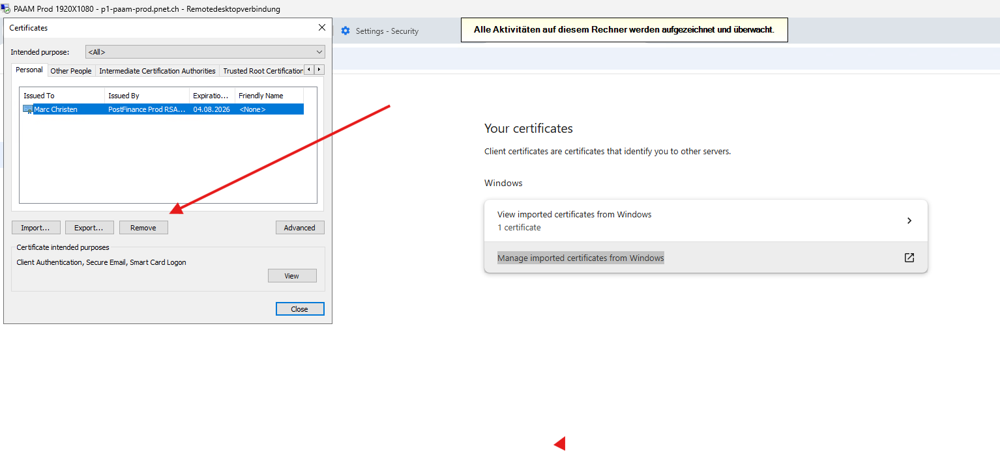

# Artemis Console

In some cases, it is necessary to access the Artemis console for troubleshooting or to gather more detailed 
information about an Artemis instance. On the E1 environment, the console is accessible directly from BaPo. For higher 
environments, access is possible via the PAAM host.

Since brokers do not share their stores, each broker exposes its own console. This means you need to open the console 
of the broker where you believe contains the information or message you are looking for.

### URL
The console is available under the following URL pattern:
````bash
Pattern:
<instance-name>-console-<broker-ordinal>.<namespace>.pnet.ch/console

Example:
e1-mqp-test-a-console-0.appl-mqp-test-e1.e1-pfnet-a.pnet.ch/console
````

### YubiKey
Access requires the YubiKey certificate. When opening the console for the first time YubiKey confirmation will be required.

Hint: If the browser is unable to load your certificate and/or you're getting an error trying to access the console you can try to wipe the imported user certificate in Windows:



A full re-login / authentication on PAAM is required.

### Credentials
The username and password can be retrieved from the environment variables of the broker pod.

````bash
kubectl exec -it e1-mqp-test-a-ss-0 -- bash
env | grep -E "AMQ_USER|AMQ_PASSWORD"
````
