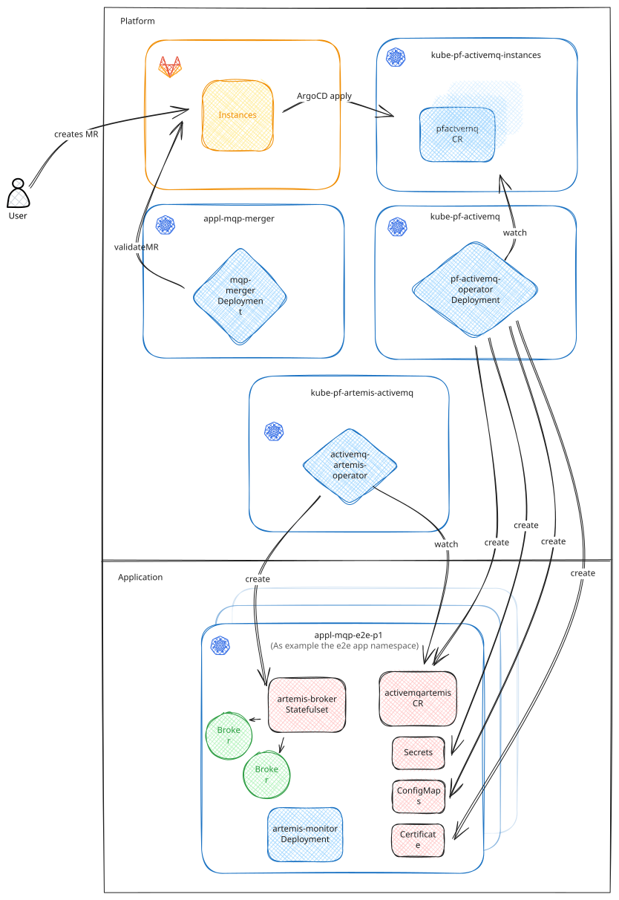

# Platform

## Overview

### instances
The [Instances](https://gitlab.pnet.ch/activemq/instances) repository is a centralized repository for ActiveMQ
instances. Customers can define their broker, including queues, within this repository. The instances repo is watched
by ArgoCD and applied to the `kube-pf-activemq-instances` namespace. This namespace holds all PFActiveMQ resources that
are deployed to any target namespace.

### activemq-merge-operator
The [activemq-merge-operator](https://gitlab.pnet.ch/middleware/activemq/activemq-merge-operator) is a merge operator
that validates merge requests.

### pf-activemq-operator
The [pf-activemq-operator](https://gitlab.pnet.ch/middleware/activemq/pf-activemq-operator) provides an abstraction
between the custom resource (PFActiveMQ) that users can define via self-service and the configuration of the Artemis
custom resource (ActiveMQArtemis). The [activemq-artemis-operator](https://github.com/arkmq-org/activemq-artemis-operator)
watches the instances within the `kube-pf-activemq-instances` namespace and creates the broker deployment based
on them. In addition to creating the custom resource, the operator also generates the required secrets, certificates,
and configmaps. These resources are created in the defined target namespace.

### activemq-artemis-operator
The `activemq-artemis-operator` is deployed cluster-wide. It watches all ActiveMQArtemis resources in the cluster and,
based on them, creates the broker in the namespace where the custom resource is located.

### certificate
The broker TLS certificate is created and monitored by Cert-Manager. Based on this certificate, an SSL secret is
automatically generated.

### secret
The secret created by the operator defines the mapping between the SSL secret and the TLS certificate. This ensures the
broker can correctly use the generated certificate for secure
communication.

### configmap
The configmap contains the JAAS configuration used by the broker's logging module. This configuration is defined within
the operator and deployed as a configmap.

## Installation

### Initial Installation
The platform consists of two central components: the `pf-activemq-operator` and the `artemis-cloud-operator`. The platform is entirely Kubernetes-based. The following sections serve as a guide for the initial installation of the platform.

### Preparations

#### Create Certificate Stores
Since the Artemis Cloud Operator requires a certificate to query the state of the brokers, a certificate store must be created:  
`identity-mqp-artemisoperator-<env>` and a certificate with `CN=a-pf-identity-mqp-artemisoperator-<env>`.

#### Deploy Components
Create Kubernetes namespaces using ApplicationSets for the following components in the corresponding Kubernetes clusters in [GitLab](https://gitlab.pnet.ch/kubernetes/workloads/applicationsets):

- `instances` (namespace for PFActiveMQ Custom Resources)
- `pf-activemq-operator`
- `artemis-cloud-operator`

The deployment repositories ([kube-artemis-operator](https://gitlab.pnet.ch/middleware/activemq/kube-artemis-operator),  
[pf-activemq-operator](https://gitlab.pnet.ch/middleware/activemq/kube-pf-activemq-operator))  
of both operators must be referenced in the corresponding ApplicationProjects.

After that, the operators can be deployed via ArgoCD.

## Expansion
The platform can be expanded with an additional cluster as follows:

- Create a certificate store similar to [Create Certificate Stores](#create-certificate-stores).
- Add the cluster to the ApplicationProjects of the operators and instances in [GitLab](https://gitlab.pnet.ch/kubernetes/workloads/applicationsets).

## Upgrade

### Operator upgrade

The platform upgrade is managed through the two Kubernetes repositories:  
([kube-artemis-operator](https://gitlab.pnet.ch/middleware/activemq/kube-artemis-operator),  
[pf-activemq-operator](https://gitlab.pnet.ch/middleware/activemq/kube-pf-activemq-operator)).

Merge requests with dependency updates are automatically created by Renovate. The upgrade process follows these steps:

- Upgrade Lab
- Blog post with details
- Upgrade E-Platform
- Upgrade T-Platform
- Upgrade P-Platform

There should be a **two-week waiting period** between each environment upgrade to gain experience and confidence.

### Selfservice upgrade

The selfservice validation relies on the CRD to verify instances against the defined schema. When upgrading the operators, the CRD version must be updated accordingly in the selfservice component to maintain compatibility and ensure proper validation.

The CRD version is centrally managed through the `PFACTIVEMQ_CRD_VERSION` environment variable defined in the [.gitlab-ci.yaml](https://gitlab.pnet.ch/activemq/instances/-/blob/main/.gitlab-ci.yml?ref_type=heads#L3) configuration file of the instances repository.