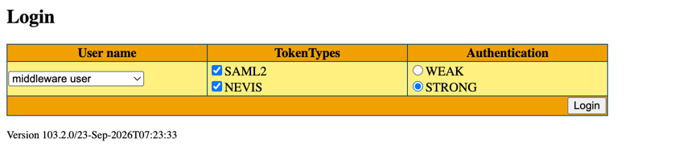

# MQP OPS UI - HowTo

Folgende Anleitung zeigt, was gemacht werden muss, damit man das MQP OPS UI (kurz MOI) lokal starten und entsprechend
daran entwickelt werden kann. Es sind die Konfigurationen der MQP-Broker für E1 hinterlegt. Man verbindet sich also von
Lokal auf die Broker auf E1.

## 1. Benötigte Installationen

Man benötigt eine IDE, Node.js, Maven, Java und falls man den ESProxy für die Aplat-Simulation testen möchte auch Docker
Desktop.
Es empfiehlt sich, das Frontend (Unterordner frontend) mit der IDE WebStorm zu starten und das Backend (Unterordner
backend) mit der IDE IntelliJ.

## 2. Backend starten

### 2.1 Starten

Das Backend ist in Spring Boot geschrieben und somit kann der integrierte Tomcat aus dem Terminal heraus mittels
`mvn spring-boot:run` gestartet werden. Danach läuft das Backend auf dem Port 8080.

### 2.2 E1-Brokers aktualisieren

Die Datei `backend/src/main/resources/self-service-config-e1.yml` ist eine Kopie der Datei vom MQP-SelfService, welche
dort mit einem Skript generiert und in GitLab Pages veröffentlicht wird. Man kann den
Link https://instances-activemq-e570aaba03ad4ec6d1682b187ed978b5006e55817ddd.pages.gitlab.pnet.ch/self-service-config-e1.yml
aufrufen und so die neuste Version holen und in diesem Repository hier ablegen.

## 3. Frontend starten

### 3.1 Starten

Bevor man den Angular DevServer starten kann, müssen mittels `npm install` einmalig alle Dependencies heruntergeladen
werden. Das Frontend kann dann ebenfalls aus dem Terminal heraus mit dem Befehl `ng serve` gestartet werden. Das MOI
läuft anschliessend unter http://localhost:4200/mqp-ops-ui/.

## 4. ESProxy

### 4.1 Vorbereitungen

Zuerst muss das Frontend gebaut werden mittels dem Befehl `npm run build-local-with-auth` im Unterordner frontend.
Danach muss das Backend gebaut werden mit `mvn -DskipTests clean package` im Unterordner backend.

Nun Docker Desktop starten und dann im Ordner esproxy-image den Befehl `docker compose up --build -d` ausführen. Dann
kann man sich über den Link http://localhost:8289/config/login.jsp einloggen und anschliessend das MOI
unter http://localhost:8289/mqp-ops-ui/ aufrufen. 

### 4.2 Login

Für asm MQP Instanzen existiert der "middleware user", beim Login muss SAML2 und NEVIS ausgewählt sein.
